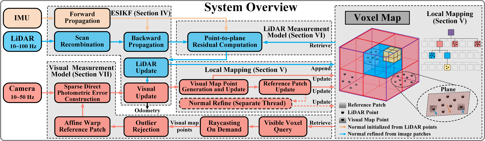

# FAST-LIVO2

本工程以 `livo-atlas` 为包目录开展重构。[重构文档](docs/README.md)包含目标架构、阶段验收、跨电脑验证步骤及 C++ 编码约定。

当前提供普通 C++17 核心库、ROS1 Noetic 和 ROS2 Humble；两个 ROS 版本共用
`src/app/livo_main.cc` 入口、`LivoSystem` 处理流程和参数清单，接入层只负责
各自的 ROS API。构建操作见
[双版本说明](docs/ros-builds.md)，职责目录和旧头路径迁移见
[源码组织](docs/core-build.md#源码组织与-include-迁移)。
当前命名迁移、职责边界与验证见 [整理记录](docs/p4-naming-validation.md)。

## FAST-LIVO2: Fast, Direct LiDAR-Inertial-Visual Odometry

### 📢 News

- 🔓 **2025-01-23**: Code released!  
- 🎉 **2024-10-01**: Accepted by **T-RO '24**!  
- 🚀 **2024-07-02**: Conditionally accepted.

### 📬 Contact

For further inquiries or assistance, please contact [zhengcr@connect.hku.hk](mailto:zhengcr@connect.hku.hk).

## 1. Introduction

FAST-LIVO2 is an efficient and accurate LiDAR-inertial-visual fusion localization and mapping system, demonstrating significant potential for real-time 3D reconstruction and onboard robotic localization in severely degraded environments.

**Developer**: [Chunran Zheng 郑纯然](https://github.com/xuankuzcr)

<div align="center">
    
</div>

### 1.1 Related video

Our accompanying video is now available on [**Bilibili**](https://www.bilibili.com/video/BV1Ezxge7EEi) and [**YouTube**](https://youtu.be/6dF2DzgbtlY).

### 1.2 Related paper

[FAST-LIVO2: Fast, Direct LiDAR-Inertial-Visual Odometry](https://arxiv.org/pdf/2408.14035)  

[FAST-LIVO2 on Resource-Constrained Platforms](https://arxiv.org/pdf/2501.13876)  

[FAST-LIVO: Fast and Tightly-coupled Sparse-Direct LiDAR-Inertial-Visual Odometry](https://arxiv.org/pdf/2203.00893)

[FAST-Calib: LiDAR-Camera Extrinsic Calibration in One Second](https://www.arxiv.org/pdf/2507.17210)

### 1.3 Our hard-synchronized equipment

We open-source our handheld device, including CAD files, synchronization scheme, STM32 source code, wiring instructions, and sensor ROS driver. Access these resources at this repository: [**LIV_handhold**](https://github.com/xuankuzcr/LIV_handhold).

### 1.4 Our associate dataset: FAST-LIVO2-Dataset
Our associate dataset [**FAST-LIVO2-Dataset**](https://connecthkuhk-my.sharepoint.com/:f:/g/personal/zhengcr_connect_hku_hk/ErdFNQtjMxZOorYKDTtK4ugBkogXfq1OfDm90GECouuIQA?e=KngY9Z) used for evaluation is also available online.

### 1.5 Our LiDAR-camera calibration method
The [**FAST-Calib**](https://github.com/hku-mars/FAST-Calib) toolkit is recommended. Its output extrinsic parameters can be directly filled into the YAML file. 

## 2. Prerequisited

### 2.1 Ubuntu and ROS

本分支已验证 Ubuntu 20.04 / ROS1 Noetic 与 Ubuntu 22.04 / ROS2 Humble。
依赖和构建命令见 [双版本说明](docs/ros-builds.md)。

### 2.2 PCL && Eigen && OpenCV

PCL>=1.8, Follow [PCL Installation](https://pointclouds.org/). 

Eigen>=3.3.4, Follow [Eigen Installation](https://eigen.tuxfamily.org/index.php?title=Main_Page).

OpenCV>=4.2, Follow [Opencv Installation](http://opencv.org/).

### 2.3 Sophus

Sophus Installation for the non-templated/double-only version.

```bash
git clone https://github.com/strasdat/Sophus.git
cd Sophus
git checkout a621ff
mkdir build && cd build && cmake ..
make
sudo make install
```

### 2.4 livo-atlas core

livo-atlas provides its own camera models and image operations. Vikit is no
longer required. See [standalone C++ / Noetic build instructions](docs/core-build.md)
for the current build entry points and supported dependencies.

## 3. Build

For this refactored package, follow [core / Noetic builds](docs/core-build.md).
In an existing Noetic workspace containing `src/livo-atlas`:

```
source /opt/ros/noetic/setup.bash
cd ~/livo-atlas_ws
catkin_make -DCATKIN_BLACKLIST_PACKAGES="vikit_common;vikit_ros" -j1
source devel/setup.bash
```

## 4. Run our examples

Download FAST-LIVO2-Dataset from [Global-LVBA](https://github.com/xuankuzcr/Global-LVBA) Section IV.

```
roslaunch livo_atlas mapping_avia.launch
rosbag play YOUR_DOWNLOADED.bag
```


## 5. License

The source code of this package is released under the [**GPLv2**](http://www.gnu.org/licenses/) license. For commercial use, please contact me at <zhengcr@connect.hku.hk> and Prof. Fu Zhang at <fuzhang@hku.hk> to discuss an alternative license.
