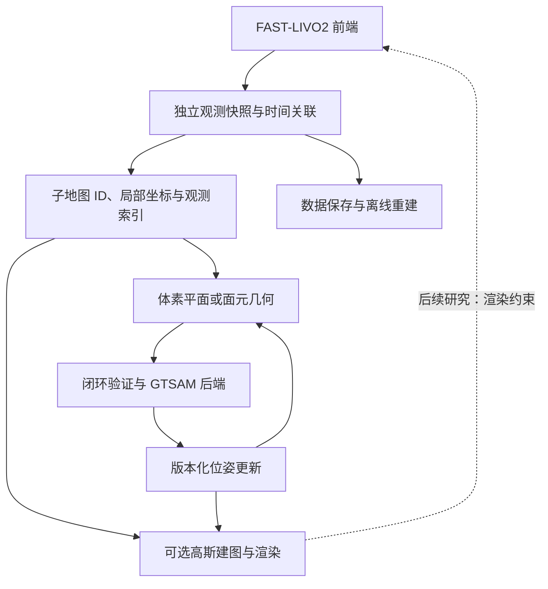

# 面向完整 SLAM 与在线 3DGS 的子地图调研

调研日期：2026-11-08。状态：研究记录和候选设计，尚未实施或作为新阶段验收。

目标同时包括完整 LiDAR–IMU–Camera SLAM，以及运行过程中的高斯地图构建、优化和渲染。
保留普通 C++ 核心、共用 ROS1/ROS2 入口及可选 GPU 依赖的边界。
本文核对论文和部分官方实现；没有在本机运行这些外部框架，也不据论文表格给出跨系统性能排名。

## 研究结论

当前按关键帧分组、按位姿版本重建点云的实现可以保留为观测存储基础。
在线系统还需要持久的几何与高斯表示、可见性选择、有限计算预算和闭环修正通道。
建议让它们共享观测 ID、局部坐标系和位姿版本，分别管理几何参数与渲染参数。

应区分三个层次：

1. 离线 3DGS：先保存轨迹和图像，再训练；当前 COLMAP 导出已经提供这种输入。
2. 完整 SLAM 加在线 Gaussian mapping：SLAM 持续定位和闭环，高斯地图同步增量学习并接受位姿修正。
3. Gaussian-assisted SLAM：高斯渲染误差进一步参与状态估计或后端约束。

第二层是建议的首个可交付目标，第三层是明确保留的研究方向。
仅有在线渲染速度，不能证明在线建图跟得上输入；只接收外部真值位姿的建图也不能作为完整 SLAM 验收。

## 核对的代表工作

这里同时覆盖近期工作和直接影响架构的较早实现，不声称穷尽所有最新论文。

| 工作及本次核对版本 | 与本工程相关的机制 | 适用边界 |
| --- | --- | --- |
| [GS-LIVO，2025，v1](https://arxiv.org/html/2501.08672v1) | 在 FAST-LIVO2 基础上使用高斯渲染参与视觉更新；哈希八叉树组织全局高斯，增量维护 GPU 活动窗口 | 重点参考多传感器融合与 CPU/GPU 地图管理；本文没有据此认定已有完整闭环后端 |
| [Gaussian-LIC2，2026-08，v3](https://arxiv.org/html/2507.04004v3) | 定位与高斯建图并行；稀疏 LiDAR 深度监督、深度补全帮助初始化 | 最新核对版本仍把闭环和地图大小控制列为后续工作，不能直接覆盖我们的完整 SLAM 目标 |
| [LoopSplat，3DV 2025](https://loopsplat.github.io/) | RGB-D 高斯子地图，通过高斯配准形成闭环约束，位姿图优化后刚性调整子地图 | 适合借鉴子地图生命周期；RGB-D 输入条件不能直接等同于稀疏 LiDAR |
| [Splat-SLAM，2024 预印本／2025 workshop](https://arxiv.org/abs/2405.16544) | 根据关键帧位姿及深度更新调整高斯地图 | 适合借鉴观测关联和局部修正；单目深度与尺度处理不应原样移植到米制 LIV 系统 |
| [VIGS-SLAM，2026-03，v2](https://arxiv.org/html/2512.02293v2) | 视觉惯性优化和闭环；以来源关键帧关联高斯，传播位姿、尺度更新 | 适合借鉴闭环更新契约；其视觉惯性前端与现有 FAST-LIVO2 不同 |
| [RMGS-SLAM，2026-04，v2](https://arxiv.org/html/2604.12942v2) | LIV 前端与高斯优化并行；体素 PCA 参与初始化，以 Gaussian GICP 构建闭环约束 | 作为近期方法参考；本次没有核实其可运行官方源码，也没有复现结果 |
| [LightSplat，2026-09](https://arxiv.org/abs/2609.07274) | RGB-D 混合表示，稀疏特征跟踪与高斯子地图后端结合 | 论文报告平均 8 FPS，需按输入频率理解实时性；本次未核实对应源码，不与同名语义理解项目混淆 |

官方代码抽查入口：

- GS-LIVO 的 [GSVoxelOctree.h](https://github.com/HKUST-Aerial-Robotics/GS-LIVO/blob/main/src/gs-livo/include/GSVoxelOctree.h)：已核实存在实际代码，不能仅根据旧 DemoPage README 判断是否开源。
- Gaussian-LIC2 的 [mapping.cpp](https://github.com/APRIL-ZJU/Gaussian-LIC/blob/master/src/mapping.cpp)：接收图像、位姿、深度和点云，驱动单独建图线程；[README](https://github.com/APRIL-ZJU/Gaussian-LIC/blob/master/README.md) 记录 2026 年发布及运行环境。
- LoopSplat 的 [gaussian_slam.py](https://github.com/GradientSpaces/LoopSplat/blob/main/src/entities/gaussian_slam.py) 和 [lc.py](https://github.com/GradientSpaces/LoopSplat/blob/main/src/entities/lc.py)：子地图切分、保存、刚性变换与闭环图。
- Splat-SLAM 的 [mapper.py](https://github.com/google-research/Splat-SLAM/blob/main/src/mapper.py)：使用 `unique_kfIDs` 关联高斯，提供刚性和包含深度变化的修正路径。
- VIGS-SLAM 的 [gs_backend.py](https://github.com/cvg/VIGS-SLAM/blob/main/vigs/gs_backend.py)：按关键帧 ID 应用高斯位置、尺度和旋转更新，随后进行局部优化。

这些源码链接指向调研时的分支，正式复现实验必须记录具体 commit、配置及依赖版本。

## 可选架构与推荐

| 路线 | 收益 | 代价 |
| --- | --- | --- |
| 刚性高斯子地图 | 整体位姿更新便宜，便于加载与卸载 | 无法独立消除子地图内部漂移，边界可能产生重影 |
| 全局高斯地图，按来源关键帧修正 | 可跟随细粒度位姿优化 | 观测关联、全局索引、显存管理与修正同步更复杂 |
| 局部子地图加关键帧关联 | 整体变换处理公共修正，内部变化通过关联和局部优化处理 | 需要明确两种修正的适用条件和版本，避免重复变换 |

推荐第三条，按需求逐步实现。第一版使用局部坐标、关键帧来源关联和有界活动工作集，
后续通过实测确定是否需要复杂形变。本文的选择是工程建议，不代表已获准实施的新方案。



几何子地图和高斯地图共享逻辑关联，不强制一一对应相同的存储块。
GPU 可以根据可见性与容量把一个逻辑子地图分块，也可以同时加载多个相邻子地图。
图中的高斯约束反馈是后续工作，不是现有功能。

## 子地图需要提前确定的契约

### 观测与训练选择

保留独立的图像、点云、标定和有效传感器时间。跟踪关键帧、闭环关键帧与高斯训练视图
可以引用同一观测 ID，但不必采用完全相同的选帧策略。
目前平移、转角和时间阈值可继续作为基础；高斯训练还需考虑共视、视差、清晰度和覆盖范围。
空间块、关键帧分组和训练窗口是不同概念。

相邻子地图允许共享观测引用，数据资产只保存一份。重复观测不等于应复制全部高斯；
要有明确的高斯归属和边界处理，避免重复渲染引起透明度叠加或重影。
初期只引入必要的运动范围和容量上限，阈值由实际轨迹及显存测量决定，不照搬其他框架数值。

### 局部坐标与闭环更新

每个逻辑子地图有稳定的局部坐标系，以及版本化的 `map_from_submap`。
至少保存高斯的归属子地图与初始化来源关键帧；完整多视图观测表是否持久化，可在需求明确后决定。
来源关键帧关联只能提供高斯修正的初始近似，多视图训练后的几何仍可能需要局部再优化。

对于整块公共刚性修正，局部高斯可保持不变，更新子地图外部位姿即可。
若必须把参数变换到另一坐标系，则均值和形状协方差分别满足：

```text
mu_new    = R * mu_old + t
Sigma_new = R * Sigma_old * R.transpose()
```

这两式描述高斯的几何参数。球谐系数的方向基准也必须约定：
可在子地图局部方向计算外观，若把方向相关外观转存到另一坐标系，则需一致处理球谐方向。
仅移动中心无法保证旋转后的几何和外观一致。

如果后端改变了子地图内部关键帧的相对位姿，应按来源关联修正受影响高斯，
随后对受影响区域再优化；严重失真时从保存的观测重建该块。
整块公共变换与内部修正必须使用明确的坐标约定，不能把同一修正应用两次。
对于米制 LiDAR 系统，第一版按 SE(3) 处理，不为单目系统的尺度问题额外引入 Sim(3)。

位姿版本和地图内容版本分别记录。建图任务读取一致的输入快照，提交时检查版本，
处理已过期的训练结果，防止旧梯度覆盖闭环后的地图。
优化器状态在几何修正后如何重置或变换，也需要在高斯模块中明确。

### 几何与外观表示

现有体素平面适合匹配，也能为高斯提供位置、法向和尺度初始化参考。
平面估计不确定性、点的空间分布协方差及渲染高斯形状协方差必须保持不同语义。
体素是空间索引；不要求一个体素只对应一个高斯，也不要求高斯必须按前端体素分辨率分布。

几何与外观可以相互约束，但应保留各自的有效性判断。
当前前端运行地图含多次观测融合、暂存点释放和可选滑窗删除，没有完整贡献来源记录，
不适合作为唯一持久数据。应参考其表示，独立维护子地图资产。

### LiDAR 与图像的输入约定

LiDAR 投影通常只提供稀疏深度。没有量测的像素应使用有效性掩码，不能按零深度监督训练。
深度约定需明确是相机光轴方向的 z，还是传感器量测距离；投影前处理时间差、外参和遮挡。
多帧累积要使用各自时间的位姿，不能把所有点直接当作图像曝光时刻的量测。

保留清晰的原始快照与派生数据关系。渲染器使用的去畸变图像、内参及深度图必须对应，
深度补全结果与真实 LiDAR 量测分别标记来源和置信度。
当前 `inverse_exposure_time` 是前端估计量，不能当作硬件曝光时间。
动态物体可先通过一致性筛选或掩码排除；完整动态 4D 重建另立研究范围。

### 计算与依赖边界

前端持续工作；后端与高斯训练使用拥有数据的快照，通过有界队列消费。
队列满时允许高斯训练降低选帧频率或迭代数，但应保持独立的观测保存和闭环更新策略。
位姿修正需要可靠处理，不能与可跳过的训练视图采用同一丢弃规则。
减少迭代、延后训练和丢弃视图必须可观测，避免以无限积压掩盖吞吐不足。

GPU 仅保留活动数据、可见高斯与必要优化状态，其余可转存 CPU 或磁盘。
封存子地图意味着停止常规插入，不意味着其位姿不能变化或永远不能再次优化。

现有 `FrontendResult` 的图像和点云是短期借用视图，不能直接跨线程保存。
现有关键帧快照提供所有权基础，但存储接口当前按串行使用约定设计，异步接入必须补齐同步。

ROS1/ROS2 继续共用算法接口。CUDA、LibTorch 或其他渲染依赖放在可选高斯模块，
核心公共头不暴露这些框架类型；GTSAM 同样在后端内部封装。
先用简单数据接口实现一个具体后端，避免提前建设通用插件体系。

## 当前代码与目标之间的差距

| 当前能力 | 可以沿用 | 需要新增或澄清 |
| --- | --- | --- |
| [Keyframe](../include/livo_atlas/mapping/keyframe.h) | 独立数据所有权、标定 ID、图像和点云时间 | 训练选择、深度来源/有效性、可选观测置信度 |
| [Submap](../include/livo_atlas/mapping/submap.h) | 稳定 ID、锚点、成员索引 | 活动生命周期、共享观测引用、容量管理 |
| [SubmapStore](../src/io/submap_store.cc) | 逐帧位姿版本和重建兜底 | 在线更新通知、持久几何/高斯表示、缓存失效 |
| [FrontendResult](../include/livo_atlas/frontend/frontend_result.h) | 图像、状态和点云消费边界 | 显式拥有数据的异步传输，不能延长借用视图寿命 |
| [COLMAP 导出](colmap-export.md) | 离线数据消费和相机约定验证 | 在线训练与闭环修正；格式可读不代表在线能力已经存在 |

现有 schema 1 读取行为保持兼容。新的重叠关系或在线元数据应使用明确的新格式/扩展，
不能悄悄放宽当前连续成员、不重叠的已验证契约。

## 建议实施顺序与验证范围

1. 先确定局部坐标、观测所有权、子地图生命周期和版本化位姿更新；保留现有重建作为基准。
2. 建立几何闭环与 GTSAM 后端，并接入可选异步高斯 mapper，交付完整 SLAM 加在线建图。
3. 验证高斯对闭环修正的响应、活动工作集、缓存失效和重新加载。
4. 在上述行为稳定后，研究渲染残差参与状态估计；明确它与既有视觉量测的相关性，避免重复计权。

实施前还需要确定目标 GPU/显存、图像分辨率和输入频率，以便给出实际预算；当前调研不假定固定硬件。

验收应同时测量定位误差（有真值时）、几何一致性和未用于训练的视图质量。
记录前端延迟、建图积压、每秒新增观测处理量、闭环修正延迟、GPU 峰值和 CPU/磁盘增长。
分别报告在线结果与停止输入后额外优化的结果，不能用最终精修画质代替在线画质。

现有约 135 秒的 Retail_Street.bag 可验证传输、投影、短段在线训练与资源使用。
人工注入的已知位姿修正可验证高斯更新公式和版本处理，但不能替代真实闭环检测与长距离漂移评测。
若数据没有合适真值或充分重访，不能宣称已验证绝对定位精度和长期全局一致性。
