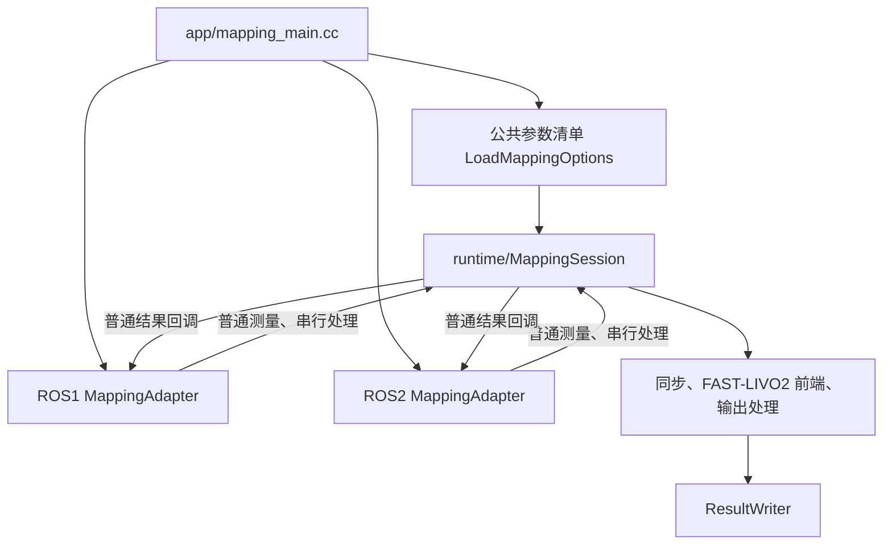

# ROS 接入收敛与跨电脑复现

本轮继续参考 OpenVINS 的[同一入口与共享 manager](https://github.com/rpng/open_vins/blob/master/ov_msckf/src/run_subscribe_msckf.cpp)：
入口创建一次普通运行对象，再交给所选 ROS 接入层。详见[设计](superpowers/specs/2026-10-25-ros-convergence-design.md)与
[实施计划](superpowers/plans/2026-10-25-ros-convergence.md)。仅借鉴职责关系，没有复制其源码。

## 实际结构

构建时选中一个接入层。main共同路径依次读取参数、构造MappingSession、构造引用它的
MappingAdapter；正常退出共同Finish和报告输入计数。适配器先析构，Session后析构。
ROS1节点句柄保留到异常报告结束，避免最后一个句柄提前析构关闭ROS而丢失错误日志。

| 位置 | 职责 |
|---|---|
| `src/runtime/mapping_session.cc` | 唯一预处理/缓冲/同步/估计/输出组合与传播状态 |
| `src/runtime/mapping_options.cc` | 一份参数键、默认值、相机/外参装配 |
| `src/runtime/options.cc` | 普通配置校验及输出模式/标定派生 |
| `src/ros1`、`src/ros2` | 各自四对 `mapping_adapter`、`parameters`、`measurement_conversions`、`result_publisher` 源/头 |
| `src/app/mapping_main.cc` | 唯一main，初始化、注入运行对象、执行器、退出 |

`livo_atlas::runtime` 是独立公开C++目标，依赖core/output/io；core不反向依赖runtime。
mode0不依赖ROS或vikit。原IMU/LIO/VIO、地图、相机、预处理、同步、输出处理和writer
共55个源/头的字节摘要保持不变。

保留的差异来自ROS接口：Noetic的NodeHandle/XmlRpc/ImageTransport、原订阅队列与
spinOnce/5000Hz空闲等待；Humble的rclcpp/DDS QoS、单线程executor、1ms处理与4ms传播定时器。
时间范围通过普通配置传入：Noetic `[0, 2^32)`，Humble `[-2^31, 2^31)` 秒。
两次纳秒量化、driver fix和coverage使用中间时间的顺序保持。负时间哨兵仍存在，
本次没有扩展负纪元端到端估计。

ParameterReader只有两个真实实现所需的类型读取方法；公共清单不含ROS版本条件。
Noetic保留斜杠路径/私有相机参数，Humble保留点号名称/只读参数/remap/QoS。
配置和话题先校验，再创建Session及输出文件。非法协方差/边界和非有限IMU现在也由
Noetic拒绝；合法输入要求与参考精确一致。

## 测试迁移

旧11项ROS1组合测试依赖公开内部状态。对应语义移入普通runtime或原组件测试；
接入测试通过真实ROS消息和外部注入的Session观察输出，不添加测试专用getter。

| 原测试 | 当前覆盖 |
|---|---|
| `TwoMappersHaveIndependentHighFrequencyImuCursors` | `SessionTest.IndependentPropagationCursors` |
| `LivoxValidatesBeforeChangingPairedRollbackQueues` | `Ros1AdapterTest.LivoxTransportRejectsBadRollbackWithoutErasingPendingInput` |
| `StandardValidatesBeforeChangingPairedRollbackQueues` | `Ros1AdapterTest.StandardTransportRejectsBadRollbackWithoutErasingPendingInput` |
| `LivoCutsBoundaryAndAlternatesSameImage` | Synchronizer测试与`RepeatedVisualUpdatesConsumeCloudsWithoutRosPublishers` |
| `LioUsesCoverageBeforeFinalRosRounding` | `CoverageUsesTimeBeforeSecondNanosecondQuantization` |
| `LidarOnlyNeedsNeitherImuNorImage` | `LidarOnlyStepPreservesAnchorAndProducesFiniteWorldCloud` |
| `ImuCallbackPreservesCoverageAndRollback` | coverage舍入与`AppliesImuOffsetAndDriverCorrectionAtActualIngress` |
| `LidarOnlyPipelineKeepsAnchorAndWorldPoints` | 普通LO与真实`PublishesFromTheInjectedRuntime` |
| `InitialImuOutputDoesNotBuildMap` | `InitialImuWindowDoesNotPublishAnEstimate`及原Frontend测试 |
| `VisualCloudIsConsumedWithoutPublishing` | `RepeatedVisualUpdatesConsumeCloudsWithoutRosPublishers` |
| `OutputUsesConfiguredDirectory` | 重复VIO实际写入与原Log摘要 |

两端新增从外部直接向Session送入数据、再经适配器发布的测试；适配器若另建自己的
Session便无法通过。ROS2保留LO/LIO/重复VIO的普通输入与消息转换输入配对测试。
参数测试使用真实NodeHandle参数服务器和rclcpp参数，没有模拟配置源。

新runtime/adapter接口先经历头或目标缺失的编译失败；安装消费者先对旧SDK失败于
缺少 `livo_atlas::runtime`。启动回归暴露ROS1句柄提前析构和畸变诊断缺少分类，
修复后50项检查全部通过。失败记录保留在包外证据目录。

## 跨电脑复现

参考提交为 `dae47ef4d4c330c8c5ff0c619cfa4a51882eb3d8`；新证据为包外
`validation/P4-convergence-20261025`。旧P4/layout证据只读。
Noetic宿主与Humble容器使用各自工具链；不同编译器环境不作数值逐字节相同的假设。

另一台电脑按[普通核心构建](core-build.md)和[双ROS构建](ros-builds.md)重新编译。
安装前缀移动后构建并运行 `tests/installed_consumer`，它通过Frontend和MappingSession
实际执行LO/LIO/连续VIO，检查有限状态、视觉跟踪和文件写入，只依赖安装头/导出目标。

官方 `Retail_Street.bag` 为1,961,140,106字节，SHA256为
`1745bee1d570749679bad7a0392100477ab62d50aa77f7f629bc57f2a72e4427`。
Humble迁移工具和消息定义来源沿用[双版本说明](ros-builds.md)。构建nice/-j1；
严格回放设 `OMP_THREAD_LIMIT=1`，与编译串行，无RViz。
每端先3秒产品段，再136秒全包；各自对照P4-layout，四数组、发布语义和短段57个
PCD/图像/COLMAP文件均精确比较。工具核验原始输入与节点接收计数，
回放前后绑定实际程序及13个库的SHA256。

安装与代码检查结果：mode0 shared/static各149项普通测试、40个普通头独立编译；
关闭OpenMP实际运行相同安装消费者，编译命令没有OpenMP标志/宏。三种安装前缀移动后，
Frontend和runtime的LO/LIO/连续VIO均通过，运行链接不含ROS/vikit或原源码/构建目录。
本轮27个新增或实质修改C++文件通过clang-format14 Google只读复核；两个仅修改include
路径的原发布源/测试保留原正文格式。宿主Python工具13项通过、1项按Python版本跳过；
Humble迁移工具5项实际运行通过。

Noetic最终构建169项单元测试、8项真实ROS接入/参数/发布测试通过，启动检查50项通过。
3秒短段26个位姿、57个产品文件精确一致；136秒全包1351个位姿，四数组尺寸分别为
1351×8、2707×19、2701×20、27365×7，所有数值和发布语义与Noetic的P4-layout参考精确一致。

Humble最终构建185项C++测试通过，包含真实DDS接入；启动检查16项通过。
ament安装移动后通过同一Frontend/runtime消费示例，运行不链接ROS/vikit；
实际colcon构建另外生成回放节点，动态链接检查确认它加载本次安装的13个库。
Humble短段26个位姿、四数组/发布语义及57个产品文件均与自己的P4-layout参考精确一致。
Humble完整回放1351个位姿，四数组尺寸同上，所有数值与发布语义也精确一致。
中途主机关机重启，首次Humble全包没有完成摘要；原始中断目录/日志已保留，
本结果来自重启后完整执行的新回放，未沿用部分结果。

最终软件验收汇总在 `acceptance.json`：四次严格回放全部通过，55个原算法源/头、
31个原Log文件和旁边rpg_vikit的提交/工作区均保持不变。两端回放绑定最终源码与实际
节点/13个库；Noetic真实接入测试也绑定同一源码及运行文件。

GTSAM、持久关键帧和3DGS仍属于后续阶段；本轮提供同一个普通运行边界供后续接入。
