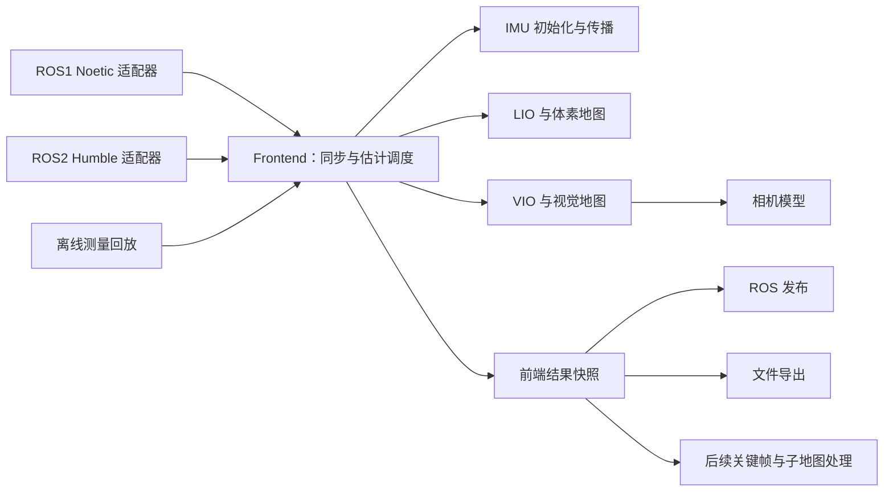

# livo-atlas 前端重构设计

日期：2026-10-11。状态：目标架构设计，供书面审阅及逐阶段实施。

## 1. 目的与约束

用户希望把现有 FAST-LIVO2 前端整理成能跨 ROS 版本和计算平台复用的算法库，并为 GTSAM 后端、3DGS 研究提供可靠的数据入口。
本次只修改 `livo-atlas` 包；`rpg_vikit` 保持原样。ROS1 验证平台为本机 Noetic；ROS2 目标为 Humble。后端优化与 3DGS 实现分别作为后续项目。

成功标准是：同一个前端实现可被 ROS1、ROS2 和离线程序调用，算法层不依赖 ROS 类型、回调、参数服务器、时钟或发布器；每阶段均有可重复的数值回归证据。
原算法的共享 19 维状态、IMU 初始化、点云去畸变、地图更新和视觉更新行为是迁移时的约束。

新增和实质修改的 C++ 代码采用 Google 风格，具体约定见 [编码约定](../../cpp-style.md)。
本轮保留工程现有 C++17 工具链；C++ 标准升级单独验证。

## 2. 现状与已有证据

原版提交为 `ca556e5ad6706ba20dc8dff91010faae546b7528`。
`LIVMapper` 同时负责 ROS 订阅、参数读取、同步、估计调度、发布与磁盘输出。
`common_lib.h` 同时承载状态、点类型和 ROS IMU 消息；`ImuProcess` 直接读取消息时间戳；`VoxelMapManager` 含 ROS 参数读取和可视化发布；VIO 依赖 vikit 的相机与图像工具。
单纯移动源文件不能完成算法隔离。

原版在本机能构建并处理 `Retail_Street.bag`。三次 30 秒回放在导出精度内得到相同轨迹与状态日志；完整回放得到 1351 个轨迹点，传感器时间跨度约 135 秒。
退出时稳定发生段错误。调用栈定位到释放 PCL 点云；最小程序在 `-march=native` 下崩溃，使用默认指令集时正常结束，证据指向 Eigen/PCL 分配约定不兼容。
这项构建修复已独立验证，结果见 [P0 实测记录](../../p0-baseline.md)。结构重构使用修复后的结果作为数值参考。

此 bag 包含 1355 帧图像、1355 帧 Livox 点云和 27447 条 IMU。没有用于本次评估的真值轨迹。
当前 0.5 倍回放用于行为与重复性验证，不能据此判定实时性能或绝对定位精度。

## 3. 选择的迁移方式

| 方案 | 代价与效果 |
| --- | --- |
| 逐步抽出类型、配置和算法，再添加第二个 ROS 适配器 | 推荐。每个变更保持 Noetic 可运行，可用同一 bag 查明偏差来自哪一步。 |
| 同时重写 ROS1/ROS2 前端和全部算法接口 | 单次改动范围大，时间同步、内存生命周期和数值偏差难以定位。 |
| 用宏在现有算法文件中切换 ROS1/ROS2 | 初期改动少，但算法继续依赖中间件，离线测试和跨平台部署仍然困难。 |

采用第一种方式。目录和类只在有明确调用者时引入；每次迁移一项职责，避免为远期研究搭建通用插件系统。

借鉴 Cartographer 的 bridge 层：ROS 转换和发布留在适配器，核心处理自己的数据类型。[参考 MapBuilderBridge](https://github.com/cartographer-project/cartographer_ros/blob/master/cartographer_ros/cartographer_ros/map_builder_bridge.h)
借鉴 OpenVINS 的同源构建组织：共享算法源文件，ROS1/ROS2 使用各自构建入口和依赖声明。[参考 CMake](https://github.com/rpng/open_vins/blob/master/ov_msckf/CMakeLists.txt)、[条件依赖](https://github.com/rpng/open_vins/blob/master/ov_msckf/package.xml)

## 4. 目标模块及依赖方向

目标目录位于同一个 `livo-atlas` 包内；这是迁移后的结构，不要求一次创建所有目录。

```text
include/livo_atlas/
  core/          # 状态、测量数据、同步与 Frontend 的公开接口
  camera/        # 相机模型、内参及投影
  io/            # 前端结果的文件输出接口
src/
  core/          # IMU、预处理、LIO、VIO、地图与调度
  camera/        # 相机模型实现
  io/            # 轨迹、图像和地图导出
  ros1/          # Noetic 节点、配置加载、消息转换和发布
  ros2/          # Humble 节点、配置加载、消息转换和发布
cmake/           # 共用核心与 ROS1/ROS2 构建入口
tests/
tools/
docs/
```



依赖方向为适配器 → 核心。核心可以使用 STL、Eigen、OpenCV、PCL，以及经确认仍需要的 Sophus；对 PCL/OpenCV 的继续瘦身按平台需求另行评估。
P3 完成前，相机模块可以临时封装 vikit，但不能据此宣称整个前端已实现无 ROS 构建。
最终 `livo_atlas_core` 不链接 catkin、ament、roscpp、rclcpp、tf、cv_bridge 或 vikit。

ROS 层处理订阅、消息字段、图像编码、参数读取、TF、发布频率与退出信号。
核心负责测量排序、同步窗口、状态更新和地图生命周期。
I/O 层接收已完成的结果，控制文件路径与保存策略；算法不再依赖 `ROOT_DIR` 写入源码树。

## 5. 数据与数值契约

### 时间与点内偏移

使用传感器消息的 header 时间作为测量时间，bag 的记录时间仅用于回放。
此数据集中两者属于不同时间基准，不能互换。
第一轮接口继续使用 `double` 秒，保留原有比较与截断方式。整数纳秒时间表示若有必要，单独迁移和测试。

现有点类型的 `curvature` 用于保存点内相对时间，单位为毫秒；Livox `offset_time` 的单位为纳秒。
先保留已验证的转换和预处理顺序，在接口中明确单位，再在后续变更中替换复用字段。
`avia.yaml` 的图像偏移为 +0.1 秒；IMU 偏移按当前代码的减法语义执行。lidar 偏移和驱动补偿也按实际使用路径迁移，不能因为参数同名而假定它已经在所有路径生效。

### 状态与坐标系

保留 19 维误差状态排列：旋转 0–2、位置 3–5、逆曝光 6、速度 7–9、陀螺偏置 10–12、加速度偏置 13–15、重力 16–18。
保留右乘旋转增量、初始协方差和全部数学分支。整理命名与修改数值公式分开提交。

统一采用 `T_A_B` 表示把 B 系坐标变换到 A 系：`p_A = R_A_B * p_B + t_A_B`。
外参配置的 `extrinsic_R/T` 表示 `T_I_L`；`Rcl/Pcl` 表示 `T_C_L`。迁移前用现有公式和非单位旋转测试确认方向。
相机位姿可由 `T_W_C = T_W_I * T_I_L * inverse(T_C_L)` 得到。
数组矩阵按原来行优先填入的语义解析，不能直接使用默认列优先 `Eigen::Map`。

### 测量所有权

IMU 测量保存时间、角速度和加速度数值，不保存 ROS 消息指针。
保持当前输入数值；原有 IMU 初始化归一化由算法执行，适配器不重复缩放。
图像在进入队列前获得可跨回调存活的所有权，明确保留灰度处理与 RGB/BGR 转换语义。
点云移动或共享时注明唯一修改者；避免同时给 ROS 发布线程和算法线程可写引用。

配置由适配器读取到普通结构，核心只接收配置值。
错误的数组长度、非有限标定值、非法尺寸和不支持的相机模型在启动阶段报告。
外参旋转检查容忍现有标定文件的舍入误差，不能擅自正交化并改变有效标定。

## 6. 算法调度和并发

把 `sync_packages` 连同它的状态机、剩余点云、IMU 边界样本和图像窗口迁入核心。
保留现有按图像时间切分点云、先 LIO 再 VIO 的交替更新流程，以及两者使用同一滤波状态的语义。
禁止在迁移时拆成两个独立滤波器或改用另一种近似同步策略。

第一轮由单一执行者依次驱动估计器。ROS 回调只转换、入队；ROS2 executor 的并发策略不能改变状态更新顺序。
高频 IMU 传播使用明确的估计结果快照。所有时钟、计时与发布功能分别放入适配器或工具，核心的测量时间由输入数据决定。

## 7. 分阶段实施与退出条件

| 阶段 | 可独立审阅的变更 | 验收条件 |
| --- | --- | --- |
| P0 | 原版快照、bag 基线、退出崩溃的独立构建修复 | 干净构建；PCL 内存测试；完整 bag 正常退出；保存修复前后数值差异。 |
| P1-01 | 从公共头剥离数值类型、19 维状态及其运算 | 核心状态仅依赖 Eigen；旧类型通过兼容别名继续使用；状态运算测试和 bag 回归通过。 |
| P1-02 | 传感器外参和相机配置的普通类型及校验 | 现有 YAML 可加载；错误配置启动即失败；矩阵方向、缩放和图像尺寸有测试。 |
| P1-03 | IMU、图像、点云的内部测量契约和 ROS1 转换 | 算法输入摆脱 ROS 消息；时间、点偏移、图像内容及所有权语义得到验证。 |
| P2 | 同步器、Frontend 调度与 ROS1 发布/I/O 分离 | ROS 回调不执行估计；同步边界和 LIO/VIO 顺序测试通过；完整 bag 数值回归通过。 |
| P3 | 在包内实现实际使用的相机与图像工具，解除 vikit 链接 | 投影、反投影、畸变和缩放与原路径一致；核心在无 ROS、无 vikit 环境构建及运行。 |
| P4 | Humble 适配器、条件 manifest 和双 ROS 构建 | Noetic/Humble 分别构建；相同内部测量回放得到一致的估计序列；ROS2 实际 bag 验证通过。 |
| P5 | 关键帧、子地图标识、位姿版本与研究数据导出 | 导出的图像、标定、时间与位姿能关联；模拟后端修正不破坏前端状态与地图一致性。 |

每个阶段结束后更新实施记录。未达到验收条件时保留具体失败及证据路径，不用下一阶段的改动掩盖问题。

### P1-01 的具体边界

新增 `include/livo_atlas/core/math_types.h`、`so3_math.h`、`state.h` 和对应的必要实现文件。
数学类型、状态运算及常量进入 `livo_atlas` 命名空间；变量与公开接口采用 Google 命名。
`utils/types.h`、`utils/so3_math.h`、`common_lib.h` 暂时提供旧名称兼容入口，使算法调用点继续编译。
兼容入口不复制另一份状态或运算实现。

状态公开成员若调整名称，必须在同一变更中更新所有消费者；为单纯命名增加两份同步字段不予采用。
先以保留状态成员名的兼容类型完成迁移，再在独立步骤统一旧成员名；这项兼容范围在编码约定中明确列出。

测试覆盖初值、19 维索引、右乘旋转、加减、复制、协方差保留和 `resetpose` 的既有范围。
单独的包含测试使用 C++17 和 Eigen 头编译新核心头，不提供 ROS/PCL/vikit 包含路径。
旧算法继续使用已验证的算法公式；本阶段不修改 `Exp`/`Log` 的阈值、重力模型或滤波更新。

后续每个阶段在实施前补充自己的文件级计划和数值验收用例；这份路线图不代替未来阶段的详细设计。

## 8. 同源构建和跨电脑复现

目标是通过 `LIVO_ATLAS_ROS_VERSION=NONE|1|2` 选择独立核心、Noetic 或 Humble；共享核心始终只编译一份算法源文件。
ROS 依赖只出现在对应适配器的 target 和条件 manifest 中。避免同时 source 两套 ROS 环境后根据查找顺序隐式选择版本。
P4 实施前，当前包仍然只支持 catkin/ROS1；目标参数尚不可用。

构建参数采用 target 级设置，尊重调用方的构建类型。默认使用编译器基准指令集，避免强制 native 或 fast-math。
记录编译器、Eigen/PCL/OpenCV 版本、源文件摘要、参数和执行命令；硬件相关优化单独测试数值和库 ABI。
Noetic 的复现步骤见 [验证说明](../../validation.md)。ARM、Humble 和无 ROS 的平台测试需要对应环境，不能由本机 x86 的结果代替。

ROS1 bag 迁移到 ROS2 时需要明确转换 Livox 自定义消息类型、时间戳和图像编码。先建立共用内部测量回放作为算法对照，再检验 ROS2 的输入和输出。
ROS2 订阅的 QoS、队列深度与 executor 策略作为适配器配置记录，并用实际传感器发布端验证兼容性。

## 9. GTSAM 后端和 3DGS 的后续接入

后端消费不可变关键帧快照：传感器时间、局部位姿、标定标识、图像、点云及必要的统计信息。
关键帧与子地图有稳定 ID，优化结果携带位姿版本。首先采用局部 odom 与全局 map 的变换表达后端修正；若要将修正注入 EKF，必须一并设计协方差、速度、偏置及已有地图的重线性化策略。
EKF 状态协方差不能未经推导直接当作独立的 GTSAM 里程计因子噪声。
真正接入因子图、回环和地图重建时再设计后端接口与约束模型，当前只保留这些信息的导出能力。

3DGS 首先使用离线数据导出：稳定关联的 RGB 图像、内参/畸变、曝光信息、`T_W_C`、稀疏深度及其有效性信息。
导出时明确图像是原始还是去畸变，输出使用的相机坐标约定。优化后重导出相机位姿，并携带同一位姿版本。
默认运行前端时不加载 GTSAM、CUDA 或训练程序。

## 10. 验证原则

构建修复允许与原 native 构建产生浮点差异，必须量化并记录；随后纯结构迁移以修复后的稳定参考为准。
先检查输入数量、传感器时间序列、LIO/VIO 更新序列、有限状态和正常退出，再比较同时间戳的位置、姿态及状态日志。
同机、同工具链的纯迁移要求轨迹和状态日志在原导出精度内一致；不一致时调查原因，不能通过轨迹对齐隐藏差异。
跨编译器或跨 CPU 比较采用明确的容差与原始差异报告，并记录依据，不以字符串逐字相等作为跨平台准确性证明。
需要实时性能时另做 1 倍回放和队列积压测试；需要定位精度时另提供真值并计算 ATE/RPE。
