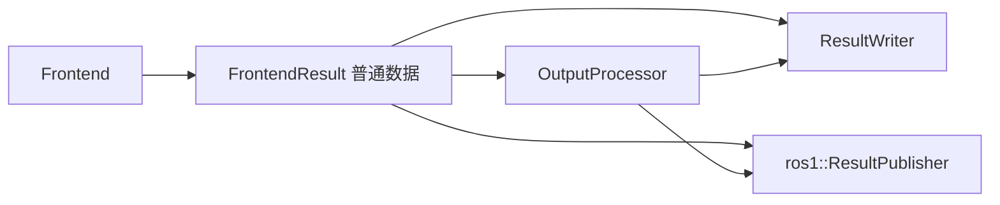

# P2-03 输出边界设计

状态：直接实施。基线：`3eb1f8cb72f4b3d9898dbd760aabf70e65db5bb7`。

## 目的与边界

将前端结果处理、文件写入和 ROS1 发布分开。`LIVMapper` 只负责参数、接收、同步、调用顺序和 IMU 高频定时器。Frontend 不再向接入层暴露 VIOManager / VoxelMapManager，也不读取 ROS 参数、发布 ROS 消息或写文件。

本阶段不改变估计公式、同步门控、单位、时钟回退、首帧锚点或局部地图策略。不实现后端、关键帧数据库、ROS2 或相机替换。vikit 保持原提交；它仍是私有相机实现的依赖，P3 再移除。旧算法的计算耗时统计暂留，不把本阶段称为整个核心的独立构建完成。

## 数据与组件

新增代码采用 Google C++17 风格。具体类即可，不增加虚拟接口、插件机制、线程、事件总线或异步队列。

1. `frontend/diagnostics.h` 定义普通 IMU 诊断行（相对时间、角速度均值、加速度均值）、命名调试图和可视化平面快照。平面仅含编号、中心、三个轴、三个特征值、协方差对角线和有效标志。
2. `frontend/frontend_result.h` 承载现有状态和点云结果，以及可选有效点云、平面数组、IMU 诊断、初始化状态、视觉原图/跟踪图、相机从世界的单位四元数和平移、调试图。状态和小型诊断是值；PCL const 指针与 cv::Mat 是只读视图，有效期到下次 Process。调用者若异步使用必须显式复制。本阶段只顺序消费。
3. `output/output_processor.h/.cc` 接受普通配置（模式、标定、颜色近裁剪距离、发布间隔、COLMAP 开关），`Process(const FrontendResult&)` 返回 `PreparedOutput`：是否有待发布点云、彩色世界点云、COLMAP 去畸变图。它拥有跨帧着色累积及实例级计数。相机由现有私有 factory 创建，公共头不暴露 vikit。
4. `io/result_writer.h/.cc` 接受输出配置（目录、序列名、开关、间隔、点云类型、下采样尺寸、模式和标定），`Write(result, prepared)` 写状态、轨迹及传感器产物，`Finish()` 幂等完成 EOF 导出并关闭文件。析构关闭文件，不吞掉显式 Finish 的失败。它只依赖 Eigen/PCL/OpenCV/标准库，提供无 ROS/vikit 的独立测试入口。
5. `ros1/result_publisher.h/.cc` 拥有原发布器、TF 和路径，只把普通结果及 PreparedOutput 转为 ROS 消息。初始化接收 NodeHandle 和 ImageTransport；`Publish` 保留原分支顺序；另提供 IMU 高频里程计发布入口。文件写入不依赖订阅者或发布器是否初始化。

FrontendOptions 增加有效点云输出开关；平面开关继续兼容现有配置字段。没有启用的可选快照不额外遍历地图。视觉 pose 来自实际 `new_frame_->T_f_w_`，不能由外参和估计状态重新推导。COLMAP 四元数继续由该 pose 的旋转矩阵构造，着色继续使用原四元数乘点的运算顺序；允许原标定舍入误差，不额外归一化。

## 调用与兼容行为

同步成功后：Frontend.Process → OutputProcessor.Process → ResultWriter.Write → ResultPublisher.Publish。更新失败仍写 mat_pre；mat_out 只写成功更新。发布可完全省略，前端及文件输出必须仍能推进。高频 IMU 传播公式和订阅回调留在 ROS1 接入层，本阶段不另造传播器。

- 着色计数初值 1；每个非空成功 LIO/LO/VIO 都先递增；VIO 累加世界点，达到间隔才投影当前图。只有产生彩色点才清空累积，保留原空投影行为。像素权重与颜色截断顺序不变；访问支持 OpenCV 行步长。
- LIVO 的 LIO 仍发布空、无字段的 PointCloud2；VIO 发布 RGB 模式（即使零点）；LO/LIO 模式发布强度云。话题、frame_id、消息类型及发布次数不变。墙钟时间和 seq 不作为数值一致性条件。
- 里程计、TF、Path、MAVROS 继续使用原 Euler → tf 四元数转换；轨迹和位姿文件继续使用 Eigen 四元数及原精度。图像话题使用跟踪叠加图，文件使用原始 BGR 图。
- PCD 类型 0 保留世界系及原 LIO 计数方式；类型 1 按 T_I_L 转换去畸变点到 IMU 系，逐帧写入。正间隔保持原部分尾批不落盘行为；负间隔 EOF 保存全量。旧的未知类型不再静默丢数据，配置校验拒绝它。
- 原图按 VIO 间隔写入；COLMAP 每次成功 VIO 写去畸变图和两行 pose，编号每实例从 1 开始。points3D 保留旧的下采样点导出格式，它是研究导出而非带特征轨迹的完整 SfM 重建。
- IMU 诊断在原平均值写入点采集，初始化结束才创建 imu.txt。可选 patch 调试图仍按原条件生成，但由 writer 保存。
- 地图仅提供普通平面快照；ROS marker 的颜色、尺寸、编号及零时间戳由发布器生成。移除算法内无必要的 ROS Rate.sleep；不改变数学调用顺序。

## 输出目录与失败

新增 ROS 参数 `output/directory`。默认 `$ROS_HOME/livo_atlas`，否则 `$HOME/.ros/livo_atlas`；两者均未设置时使用当前目录下 `livo_atlas_output`。这些环境解析只在 ROS1 层。独立 writer 必须显式传目录，绝不依赖编译时源码路径。

目录内保留 `mat_pre.txt`、`mat_out.txt`、`imu.txt`、`result/<seq>.txt`、`pcd/`、`image/`、`Colmap/images/`、`Colmap/sparse/0/`、`ref_cur_combine/`。按需创建子目录，不执行脚本/chmod/system。同时开启 PCD/COLMAP 时，像原脚本一样清空该目录下的 `Colmap/images` 和 `Colmap/sparse/0` 再写重建；其他目录不清空。文件覆盖与原新运行一致；不同并发实例必须使用不同目录。序列名仅允许单个非空文件名，拒绝 .、..、路径分隔符。

构造时先验证全部选项再创建文件/订阅：输出目录非空；着色间隔正数；图像启用时间隔正数；PCD 启用时间隔非零、类型 0/1、滤波尺寸有限且正；COLMAP 必须 Pinhole。目录/流/图像/PCD 写入失败报告具体路径并让本次运行失败，不能生成“成功”证据。写入失败或显式 Finish 后禁止继续 Write。

## 验证与移植

- 新独立 reference_ws 固定基线，不能重跑或改写 P2-02 冻结目录。新证据放 `validation/P2-03-noetic-20261024/`。
- 先记录原流程的 30 秒和完整 136 秒 Retail_Street。参考和候选固定 bag、源码、运行库、构建参数、ROS 参数与线程设置；默认线程另跑 45 秒。构建 `nice -n 10 -j1`，与回放串行，无 RViz。
- 除轨迹/mat_pre/mat_out/IMU 零容差，比较 ROS 点云字段、坐标/颜色和图像像素的摘要。忽略时间戳、seq 与 PCL 未定义填充字节；保留字段布局、frame_id 和数量。短场景覆盖保存图像、PCD/COLMAP，独立测试覆盖间隔、EOF、位姿约定和两个实例计数独立。
- 单元、实际 ROS 接线、启动参数检查、公开头独立编译和无 ROS/vikit 的 writer 构建通过。断言源码目录不产生输出，算法头/源不再引用 ROS 类型/宏和文件写入 API。
- 保持 estimator DSO 在 native vikit 之前解析 Eigen 符号；真实非空残差 3 秒 gdb 回放检查现有 ABI 风险。继续实际 Frontend 生命周期泄漏检查，不夸大为全程序 sanitizer 覆盖。
- 一次新上下文整阶段评审，修复实际 Critical/Important 项；结果、限制、命令、恢复步骤和源码 bundle 写入文档。
