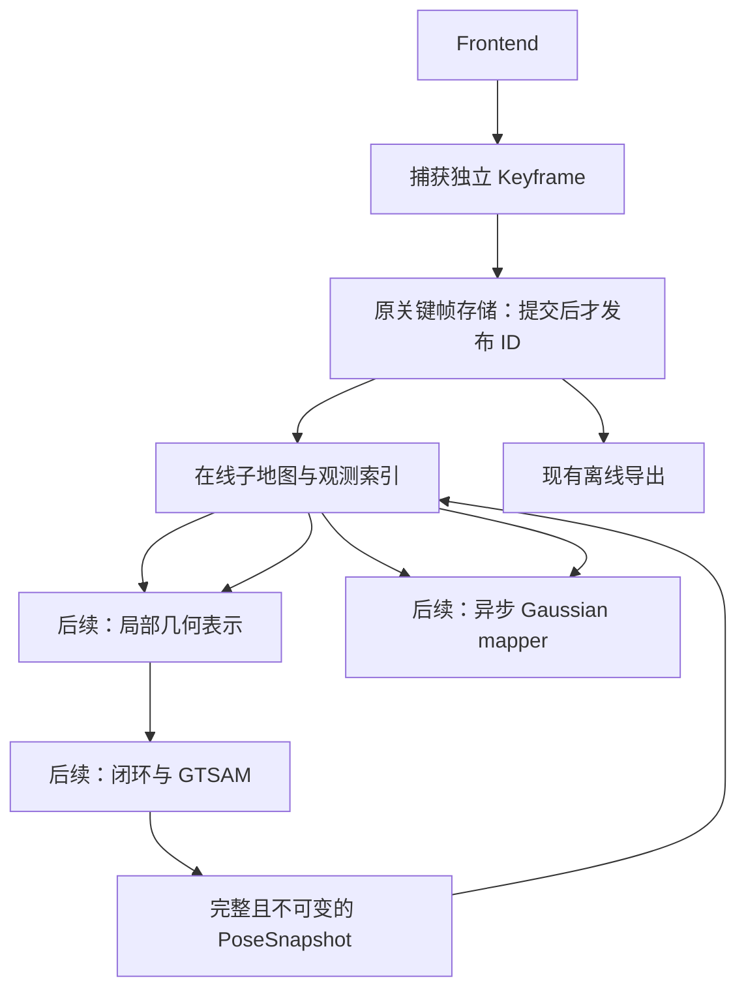

# 在线子地图：完整 SLAM 与 Gaussian mapping 的共享基础

## 状态、目标与范围

用户已选择继续设计面向完整 SLAM 和在线 3DGS 的子地图。本文件收敛
[调研建议](../../online-3dgs-submap-research.md)，供跨电脑实施和下一阶段计划使用。
当前只交付设计；下面的接口、格式和行为尚未实现。

首阶段的文件、接口和验证顺序见 [P6-01 实施计划](../plans/2026-11-08-p6-01-online-submaps.md)。
2026-11-08 用户要求在正式编码前通知并等待切换模型；本轮仅完善文档。

代码基线：`refactor2`，`4f24251fc02aac4e2659c4af2efc343eac386924`。
仅涉及 livo-atlas；Google C++17；普通核心、同一 ROS main、对称 Noetic/Humble 接入保持。
保留 VIOManager、Frame、Feature、Pose6D、SubSparseMap、VOXEL_LOCATION。
用户原始数据、旧验证目录和其他 Git 引用保持不动。

最终目标分层交付：完整几何 SLAM、同时运行的高斯建图与闭环修正、可选的高斯辅助状态估计。
本设计确定共享数据契约，并把首个实施范围限定为 P6-01：在线子地图元数据、观测传递、
位姿快照及修正分类。P6-01 不引入 GTSAM、CUDA、LibTorch、渲染器或新的前端估计公式。
后续阶段必须使用这些契约，但其配准算法、渲染内核、优化损失及性能参数单独设计。

## 已选架构与替代方案

采用“局部子地图 + 关键帧来源关联”。几何与高斯分别维护参数，共享观测 ID、
局部坐标和版本化位姿；整块公共修正走刚性路径，内部相对位姿变化走局部更新路径。
这是基于用户双重目标作出的工程选择，数值默认值仍是待标定的初始值。

| 方案 | 取舍 |
| --- | --- |
| 仅保存刚性子地图 | 更新便宜，但不能独立处理组内漂移；不作为唯一修正机制 |
| 单个全局高斯地图，按关键帧形变 | 修正灵活，但全局显存、索引与同步成本较高 |
| 采用：局部子地图加来源关联 | 支持分块管理和细粒度修正；需要清楚区分整体变化与组内变化 |

第一版后端路线采用关键帧位姿图，子地图位姿由锚点关键帧派生。
不同时引入一套独立子地图优化变量，避免重复约束和两套位姿权威。
未来如果引入刚性子地图图或局部 BA，作为后端能力演进，不改变观测资产的只读性质。

## 系统边界



`LivoSystem` 负责前端结果接入和串行提交；mapping 负责普通数据、分组和坐标规则；
io 负责持久化。未来 backend 和 reconstruction 使用独立可选构建目标。
ROS 消息、GTSAM 对象、GPU 张量均不进入共享公共数据类型。
暂不设计插件注册表、通用消息总线、多机地图合并或数据库。

实施时把现有 KeyframePose 定义移到 mapping 的位姿头，原 keyframe_store.h 包含它，
保留既有源码使用方式。坐标运算和分组不依赖 Store。在线提交组合放在 core 的私有
OnlineSubmapManager，避免继续把存储状态机堆进 LivoSystem；不新增安装库或继承接口。

## 观测模型与所有权

P6-01 沿用当前 `Keyframe` 和选择器。每个已选快照只捕获一次，图像与点云脱离
`FrontendResult` 的借用缓冲，原 Store 成功提交后，才通知在线消费者。
可用 `shared_ptr<const Keyframe>` 传递同一快照；消费者不得通过 cv::Mat/PCL 别名修改资产。
需要修改时独立复制。公共接口、回调命名由实施者按现有风格确定，不另建继承体系。

同步回调仅允许登记元数据或入队，不在其中执行高斯训练。异步线程不得直接调用
当前串行约定的 KeyframeStore；由唯一 I/O 所有者读写并交付拥有数据的快照。
原有同步磁盘写入成本仍存在，不能把“训练异步”宣称为前端完全不受 I/O 影响。

第一版高斯消费者只从已保存关键帧中选择训练视图。更密集训练需要时，再扩展观测选择策略；
跟踪、闭环、训练可以引用同一 ID，不强制相同选帧条件。
LO/LIO 可以构建几何子地图；没有有效图像、相机位姿与标定时，不创建高斯训练任务。

## 在线子地图的身份、成员和生命周期

保留现有 `Submap`、SubmapBuilder、SubmapStore 及 schema 1 语义。
新增在线元数据类型暂定为 `OnlineSubmap`，复用 `Submap` 表达主成员，另外持有
支持观测 ID、成员修订号和生命周期。管理器暂定 `OnlineSubmapBuilder`。
这些类型归现有 mapping，避免提前新增物理库。

| 数据 | 规则 |
| --- | --- |
| 子地图 ID | 单次数据集内从 0 递增，与旧分组 ID 属于不同索引命名空间 |
| 主成员 `keyframe_ids` | 连续、唯一归属；只包含已提交关键帧 |
| `anchor_keyframe_id` | 第一个主成员；子地图坐标为该帧的 body 坐标 |
| `support_keyframe_ids` | 可共享的历史观测，递增、无重复，与主成员不相交 |
| `membership_revision` | 每次已提交成员变化或封存递增，第一版从 1 开始 |
| 生命周期 | `kActive` 接受主成员；`kSealed` 停止接受主成员 |

同时只有一个接收新主成员的活动子地图。已封存邻居可参与配准或训练。
封存不冻结全局位姿，也不禁止未来重载、修正和局部优化。
CPU/GPU 驻留是缓存状态，不增加“卸载”等业务生命周期。

新子地图固定引用前一个子地图最后至多 2 个主成员作为支持观测，首组没有支持观测。
支持引用只共享资产，不复制图像和点云，不强制复制所有高斯。
支持观测不是新的独立测量，后端不得因其跨组重复引用而重复加入同一约束。

## 切分策略与配置

现有 `submaps.enabled=false` 和旧路径保持。新增 `submaps.mode`，默认
`keyframe_groups`，只在显式选择 `online` 时启用新流程；启用仍要求 keyframes.enabled。
同一运行只写一种子地图索引，原关键帧数据始终可独立读取。

在线模式初始参数：主成员上限 20；相对锚点平移 5 m；旋转 45°；持续时间 20 s；
支持观测数 2。这些值仅用于建立明确行为和初始实验，不代表已验证的最优设置。
距离、角度、时间阈值均要求有限且大于 0；成员上限为正整数；支持数在 0 至成员上限内。
原模式仍按原验证规则执行，不因在线配置而改变其已有行为。

插入顺序：

1. 检查 ID 为下一个已提交 ID、时间有限且不回退、位姿合法；失败不改变 Builder。
2. 无活动组时创建新组，当前帧为锚点。
3. 已有活动组且当前帧到锚点的平移、最短 SO(3) 旋转角或时间达到阈值时，先封存旧组，
   再创建新组，当前帧归新组。使用原始前端位姿决定边界；闭环不重分组。
4. 加入当前帧；若达到主成员数量上限，立即封存。下一帧再建立新组。
5. 正常 Finish 封存非空活动组；重复 Finish 不产生新修订，Finish 后拒绝插入。

一次插入可能产生多个有序修订：到达数量上限时先提交插入修订，再提交封存修订；
例如上限 2，组 0 依次是 revision 1 的 active{0}、revision 2 的 active{0,1}、
revision 3 的 sealed{0,1}。阈值触发的旧组封存先于新组第一条修订。

在线模式遇到时间回退明确停止在线索引写入并报告错误，不默默连接两段轨迹。
旧模式时间处理不变。P6-01 不承诺单个运行跨传感器时间重置或多 session 恢复。

## 位姿权威与快照

普通 `PoseSnapshot` 包含：单调递增的优化 `version`、输入 `base_version`、
覆盖的 `frame_count`、`optimized_frame_count` 和完整 `vector<KeyframePose>`。
版本 0 解释为前端原始 odom 位姿；正版本使用 map 坐标。显式记录 parent frame，禁止混用。
ID 从 0 至 frame_count-1 恰好各出现一次，变换有限且符合旋转约束。
P6-01 只实现数据验证与应用，使用模拟后端更新测试，不声称后端已存在。

version 只在接受后端优化结果时由串行所有者分配为上一优化版本加 1，普通新帧不提升它。
后端返回所用 base_version、优化前缀 N 及该前缀完整位姿；所有者验证后才构造发布快照。
要求 N>0，N 不小于上一版本的 optimized_frame_count，且不大于当前已提交帧数。

后端计算时冻结一个已提交前缀 N。在串行应用时，前端可能已提交 M≥N 帧。
N 之后的尾帧以最后一个优化锚点的校正延续：

```text
C_tail = T_map_B(N-1,new) * inverse(T_odom_B(N-1,raw))
T_map_B(j,new) = C_tail * T_odom_B(j,raw),  N <= j < M
```

这只是尾部全局定位的传播近似，不表示尾帧已参加优化；因此保留 optimized_frame_count=N。
该修正不覆盖前端滤波状态、速度、IMU bias 或前端工作地图。
后端第一版只允许一个在途优化；base_version 已过期的结果拒绝应用，由后端按新版本重算。

需要区分冻结的存储快照与持续增长的运行视图：

- 优化被接受时，保存当时覆盖 M 帧的不可变快照，以及固定的尾部策略
  `last_optimized_anchor`，其锚点为 N-1。C_tail 从该帧优化/原始位姿确定。
- 后续提交第 M+1 帧时，仍使用同一 C_tail 计算其 map 位姿，并发布一份新的只读运行视图。
  运行视图的身份是 `(version, frame_count)`；同一 version 下，已存在帧的姿态必须完全不变。
  不改写旧快照对象，也不覆盖磁盘 `poses/<version>.yml`。
- 持久化读者可显式请求把该版本物化到更长的已提交前缀，并采用同一已声明尾部策略。
  这是有标记的延续，不是静默退回原始位姿。默认读取仍返回原文件覆盖前缀；
  超过数据集提交范围的请求拒绝。
- version=0 按请求前缀从原始关键帧直接物化，无优化前缀、无 N-1 锚点。
- 同版本只因新增原始帧而增长的视图不会使在途优化 base_version 过期。
  应用下一优化版本时，以同一当前覆盖前缀物化旧、新视图，再计算修正。

串行发布顺序为：原关键帧提交、在线成员修订提交、当前版本视图覆盖新帧、向消费者交付。
尚未具备同版本位姿覆盖的新观测不得交付给地图消费者。
完整运行视图是逻辑契约；可共享不变前缀或按需物化，禁止每追加一帧就把完整轨迹再写一遍。

P6-01 以原始位姿向量和最近一次冻结优化快照维护状态；没有消费者时不逐帧复制完整轨迹。
显式读取或已注册回调需要完整快照时才物化，其时间和临时内存为 O(M)。跨帧保持同一快照
对象不变；第一版不另造持久化向量。未来训练接入前必须实测这项开销，再决定共享前缀实现。

同一个 PoseSnapshot 同时定义子地图与各成员的姿态：

```text
T_map_S(v) = T_map_B(anchor,v)
T_S_B(i,v) = inverse(T_map_S(v)) * T_map_B(i,v)
```

其中 S 是固定身份的锚点 body 坐标；位姿变动不重新定义其 ID 或更换锚点。
支持观测和主成员都必须被快照覆盖，不允许未覆盖部分退回原始版本混合使用。

## 图像、点云时间与相机位姿

当前 Keyframe 的状态、图像和云时间可能不同。保留三个有效时间，原始 body 云不修改。
用已保存变换建立快照内相机相对关系：

```text
T_B_C(image) = inverse(T_odom_B(raw)) * inverse(T_C_odom(raw))
T_map_C(image,v) = T_map_B(v) * T_B_C(image)
```

此规则对快照整体施加相同修正，不能解释为重新估计图像时刻运动或重新进行逐点去畸变。
后续涉及连续时间轨迹、扫描内变化或重新标定时，需要更丰富的原始数据，不能靠当前快照恢复。

深度派生数据应约定为对应相机的光轴 z，米制，配套有效性掩码、内参和去畸变图像。
完成投影前处理时间与外参；多点投到同像素采用可见性筛选。
实测深度、补全深度与平面估计不得混为同一来源；`inverse_exposure_time` 不当作硬件曝光值。
这些训练派生字段属于后续高斯接入范围，P6-01 不添加没有消费者的深度网络或缓存。

## 整体修正与组内修正

应用新优化版本时，在相同覆盖前缀下计算所有已有主成员和支持观测的旧、新局部位姿。
如果局部变换相同（double 数值判定：平移和旋转角差分别不超过 1e-9 m、1e-9 rad），
标记为整体修正；否则列出局部位姿改变的观测 ID，标记需要局部重建/优化。
这只是识别计算舍入误差的判定，不是放宽轨迹回归容差。

整块修正只更新 T_map_S，保留局部几何和局部高斯内容。
组内修正由几何模块重建受影响的局部表示；高斯模块按来源关键帧进行初始修正，再局部训练。
单个高斯的归属子地图固定，初始化来源关键帧固定；训练可以使用多个观察视图。
高斯分裂/复制应继承来源关系，合并规则在实际引入合并算法时再设计。

在子地图局部系下，来源观测 i 的初始高斯修正为：

```text
D_i = T_S_B(i,new) * inverse(T_S_B(i,old))
mu_new = R(D_i) * mu_old + t(D_i)
Sigma_new = R(D_i) * Sigma_old * R(D_i).transpose()
```

渲染时再应用当前 T_map_S；不得把整体校正重复乘进局部参数。
来源关联修正是多视图高斯的近似初值，不保证替代再优化。
球谐方向基准约定为子地图局部坐标；局部修正改变方向时，高斯模块需要一致处理方向相关参数。
优化器动量的失效/重置由高斯阶段明确，禁止悄悄保留与新坐标不一致的训练状态。
米制 LIV 第一版只处理 SE(3)，不引入单目尺度自由度。

成员修订增加的观测作为新增观测初始化，不对不存在的旧几何计算位姿差。
消费者跳过多个成员或位姿事件时，以自己已提交资产的成员集合区分“已有”和“新增”，
从各版本尾部策略物化已有观测的旧、新位姿，再初始化新增观测。不得把“旧文件未覆盖”
误判为几何变化，也不得把源观测尚未存在的情形伪造成旧姿态。

## 版本与异步消费

成员修订、位姿版本和派生地图内容修订分别记录，不用一个计数混淆三种变化。
派生资产至少标记 submap_id、membership_revision、pose_version 和 representation_revision。
训练任务只读一致快照；输出提交时核对前两种输入修订，过期结果不得覆盖新状态。
P6-01 验证此提交规则；实际 CUDA 执行和线程调度留给高斯阶段。

未来接入采用两个独立通道：

- 有界训练视图队列。满时移除最旧、尚未开始的训练任务，保留最新视图并计数；
  这是跳过一次训练调度，已提交观测资产不删除。容量由高斯阶段依据字节预算确定。
- 最新完整位姿快照槽。新快照可以覆盖未消费旧快照；消费者从自己已应用版本计算到新版本的修正。
  完整快照覆盖消费者所有已存在观测，因此无须按顺序重放每个中间位姿增量。

槽中的视图按 `(version, frame_count)` 前进，同版本只接受更长前缀。
过期后端结果与最新运行视图的优化 version 比较，不和 frame_count 比较。

应用位姿修正优先于开始下一次训练。已提交观测的主存索引可增长，驻留图像/点云、
GPU 高斯和任务队列必须各有预算。有限活动窗口不能被宣传成全局数据总量有界。
持久化失败按现有策略终止该次写运行并保留错误现场；未来可选高斯模块失败则停止该消费者并报告，
已启用的几何 SLAM 可以继续运行，不能伪装成在线重建仍正常。

## 新索引持久化与兼容

原 keyframes、poses、submaps 的 schema 1 和读写行为保持。
在线模式使用独立命名空间 `keyframes/online_submaps/`，自身格式从 schema 1 开始：

```text
online_submaps/
├── dataset.yml                 # schema、模式、切分参数、坐标约定
├── records/<id>/<revision>.yml  # 主成员、支持 ID、锚点、生命周期
└── poses/<version>.yml          # 优化提交时快照、覆盖/优化前缀、尾部延续策略
```

所有 uint64 ID/版本遵循既有规范十进制字符串规则。
记录按每次插入/封存提交不可变修订，先检查并写临时文件，检查关闭后 rename；
不覆盖已存在的修订，不依赖可被单独写坏的 latest 指针。
同一 ID 的修订必须连续，锚点与已提交主成员前缀不得改变，封存后禁止新增成员修订。
位姿记录独立递增且禁止覆盖；只引用已提交关键帧。
先完整提交位姿文件，再发布新的优化版本；提交失败时保留旧版本并终止该写运行。
冻结快照要求 0<optimized_frame_count<=frame_count，并验证其尾帧符合所声明延续规则。

重开只读，取每组最大完整修订，忽略 pending 文件，验证跨组唯一主归属与支持引用。
未正常封存的活动组按活动状态显示；不自动恢复追加，也不假装已封存。
沿用现有 checked-close + rename 的边界，不增加断电 fsync 事务保证。

关键帧提交与多个索引修订不构成跨文件事务。失败可能留下连续的原始帧尾部尚未进入任何组，
或已封存旧组但尚未创建新组。读者接受这样的已提交前缀，并报告未索引尾帧数；
索引内部缺号、重复主归属、封存组之后的非法修订或非末尾活动组仍是损坏。
消费者只在本次全部索引提交成功后收到事件；失败后停止写入，不伪造回滚或自动补齐。
该目录格式能检测中间缺号与现存损坏记录；没有独立提交清单，无法区分“最高修订被整体删除”
和“该修订从未提交”。第一版不承诺检测任意历史文件删除，也不为此新增事务日志。

在线通知是可选的同步回调，调用者在第一帧前注册，只登记或入队，不重入系统、不抛异常。
用户代码意外抛出的异常按系统终止错误保留，已提交数据仍可只读检查；后续高斯适配器应在
自身边界捕获可选训练错误、停用该消费者并报告，不能把训练错误冒泡为几何写入故障。

在线 PoseSnapshot 是在线消费者的位姿权威。原 poses/ 保持离线兼容出口：
显式导出时先按所选优化版本物化到当前全部提交帧，记录哪些尾帧属于延续，
再调用原 WritePoses。兼容格式只保存最终位姿，不声称这些尾帧已参与优化；
在线原快照仍保留优化前缀和尾部策略供追溯。禁止用没有声明来源的原始尾帧填充。
这份兼容副本只用于现有离线工具，不反向驱动在线地图。
现有 inspect 工具默认继续读取旧格式，新增显式 online 选项检查新索引，不能自动猜测和混读。

## 后续几何与高斯模块约束

几何表示首选独立的局部体素平面/面元。前端 VoxelMapManager 仍负责原估计流程，
不直接持久化其内部指针或把它当作唯一观测来源。新模块的体素键统一使用数学 floor，
覆盖负坐标和整边界；不复制已记录的视觉负坐标索引缺陷，也不在本阶段顺带修改原前端。

每份几何资产可以由来源观测与位姿快照重建。优化后只处理受影响子地图，整体修正不重建。
支持观测在几何块中允许重复出现；全局导出和渲染需要去重/归属策略，不能假定跨块无重复。

高斯模块拥有均值、形状、透明度、外观、来源关联及训练状态。
局部平面仅提供初始化先验，平面参数不确定性不直接复制为渲染形状协方差。
可见块与邻接块共同用于判断新区域，避免每进入一个子地图就重复初始化全部边界高斯。
闭环验证先使用几何地图；高斯配准和光度反馈作为后续研究选项，不作为首版完整 SLAM 的唯一依赖。

## 首阶段实施边界与验收

P6-01 的实际改动限定为：在线模式配置、在线 Builder/Store、提交后观测交付、PoseSnapshot
验证/应用/尾帧延续、修正分类、显式索引检查，以及文档。仍无后台训练和实际后端。
不提前定义所有 GPU 参数、通用配准接口或完整高斯磁盘格式。

验收应覆盖：

1. 旧模式关闭/开启时的既有数值和资产兼容；两种模式配置互斥且默认值不变。
2. 按数量、平移、旋转、时间切分的边界；支持引用、唯一主归属、尾组和重复 Finish。
3. 非法 ID、时间回退、非法姿态不改变 Builder；真实文件失败、pending 与活动重开行为。
4. 非平凡旋转下的全局刚性修正不改变局部几何；不同逐帧修正改变对应区域；不重复变换。
5. 位姿覆盖、过期 base_version、尾帧延续、相机相对关系及未优化尾帧标记；
   连续新帧不使在途优化过期，同版本物化不改变已有姿态，磁盘重开可重现尾部视图。
6. 借用缓冲失效后快照仍可用；模拟消费者跳过中间版本及拒绝旧结果覆盖。
7. 普通 C++ shared/static 核心、Noetic/Humble 共用参数和 SDK 消费；真实 bag 回放仍串行限资源。

新验证在实施时创建独立目录；不重写旧证据。使用现有 Retail_Street.bag 比较开启在线元数据
前后的前端输出，并用已知模拟位姿修正验证几何契约。这不能证明真实回环准确性。

后续阶段分别完成：P6-02 几何子地图与闭环后端，P6-03 在线高斯 mapper 和闭环更新，
P6-04 可选高斯辅助估计。每阶段在实施前细化其自身设计及预算。
目标 GPU、显存、输入分辨率、真实闭环数据仍影响 P6-03 参数；它们不阻塞 P6-01 普通核心设计。

## 设计审阅

2026-11-08 已完成一次独立只读 builder check。审阅提出一个高优先级问题：
正版本应用后继续提交新帧时，版本、覆盖范围与不可变持久文件的关系未定义。
已通过区分优化版本与覆盖前缀、冻结快照与运行视图、明确尾部延续及新增成员初始化规则解决。
该问题属于工程一致性选择，由执行者确定；无需改变用户目标。
审阅未报告其他影响 P6-01 计划的重要缺口。本记录是设计审阅，不是实现或测试通过声明。
