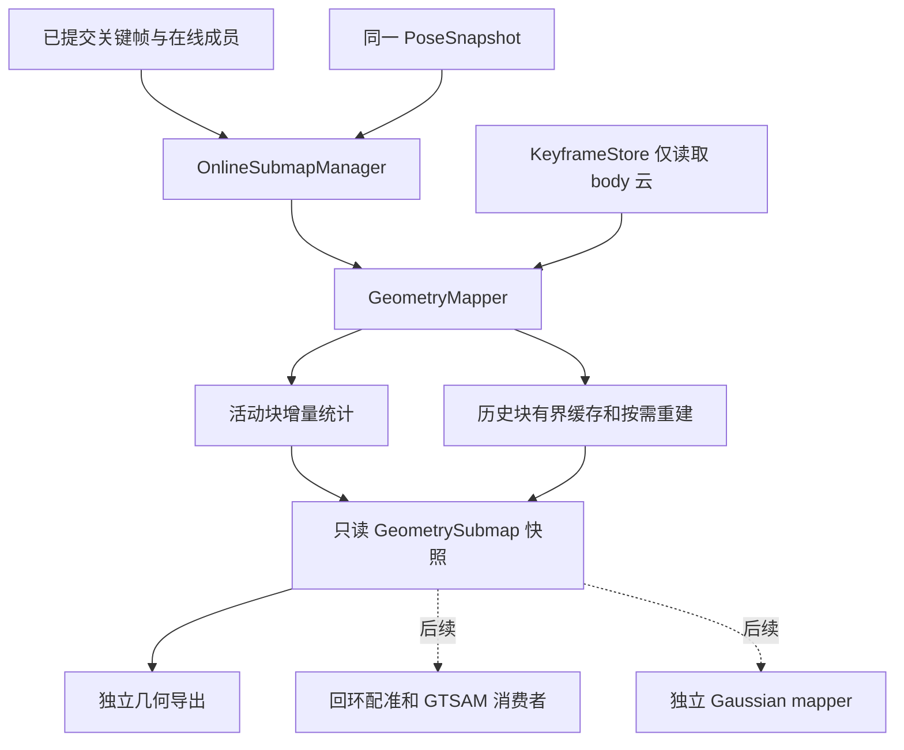

# P6-02a：几何子地图设计

## 状态与目标

2026-11-10。状态：**设计提案，尚未编码或验收**。用户要求先完成设计和实施计划，
正式编码前通知其切换模型。本文的表示、默认值和缓存策略是执行者的建议，不记为已获用户逐项确认。
当前检视分支为 `framework_completion`，代码基线为 `5e0bf071de3591c62f84364321df44ff1eb5d802`；
它已经合入移除 Pimpl 和函数间空行修正。不要按旧报告切回 `refactor2` 或重做已完成工作。

目标：在 P6-01 的观测、成员索引和位姿版本之上，维护可查询、可重建的独立几何子地图，
为后续几何配准、回环验证和 Gaussian 初始化提供有来源的几何数据。
本阶段不实现配准器、GTSAM、真实回环、训练、渲染、TSDF、动态剔除或新的 TF。
“几何已可消费”不等于“完整 SLAM / 在线 3DGS 已实现”。

相关文档：[总体设计](2026-11-08-online-submaps-design.md)、
[实施计划](../plans/2026-11-10-p6-02a-geometry-submaps.md)、
[研究记录](../../online-3dgs-submap-research.md)、[编码约定](../../cpp-style.md)。

## 现有基础与实际输入

| 现有实现 | 本阶段使用方式 |
| --- | --- |
| `Keyframe::cloud` | 已拥有的 body 系 XYZI 云；不从前端借用指针，也不再次施加 LiDAR 外参 |
| `OnlineSubmap` | 固定锚点、主成员、支持成员、活动/封存状态、成员修订 |
| `PoseSnapshot` | 一致的 `(version, frame_count)`，v0 属于 odom，正版本属于 map |
| `OnlineSubmapManager` | 原帧及索引提交后更新几何，再向外通知；仍由一个串行所有者调用 |
| `KeyframeStore` / `OnlineSubmapStore` | 原始重建来源，旧 schema 和只读重开行为保持 |
| `VoxelMapManager` | 继续服务前端匹配；含可变八叉树、点暂存及滑窗释放，没有本阶段需要的完整来源记录 |

2026-11-10 只读检查旧验证产物
`validation/Pimpl-20261110/acceptance-noetic-online-136/keyframes/`：172 帧，
3,763,228 点，单帧 19,169–23,218 点，中位数 22,089；PCD 合计 120,466,124 字节。
相邻关键帧间隔最小约 0.2995 s、中位数约 0.7002 s，共 13 个在线子地图。

按最终成员、v0 原始姿态，将每帧 XYZ 转成 double 后变换到锚点系，再以 `floor(p / h)`
统计占用格数，得到下表。该只读数据分析没有实现融合或验证法向质量，不是新算法验收。
迁移机器时用相同数据、成员和姿态重新统计；不能将这些数值当成任意配置的固定测试答案。

| 体素边长 h | 每个子地图占用格数范围 | 取舍 |
| --- | --- | --- |
| 0.2 m | 8,285–16,527 | 建议起点；当前数据容量不大，保留较细的空间划分 |
| 0.3 m | 4,363–8,357 | 降低格数，但更容易混入同格不同表面 |
| 0.5 m | 1,983–3,753 | 适合后续粗尺度研究，本阶段不直接沿用前端的 0.5 m 参数 |

## 方案比较与选择

| 方案 | 收益 | 代价与结论 |
| --- | --- | --- |
| 复制前端八叉树和体素平面 | 可以利用当前匹配结果 | 内部指针、释放策略、观测来源和优化后重建难以独立管理；不作为持久来源 |
| **稀疏体素统计 + 条件有效的 surfel** | 结构直接；增量计算中心和分布；局部位姿修正后可按来源重建 | 一个格最多一个平面描述，会损失同格多表面；本阶段推荐 |
| TSDF / 多分辨率、多 surfel 体素 | 可扩展到连续表面或更细几何 | 需要额外的量测射线、融合权重、层级及更新规则；当前关键帧契约和首个消费者还不需要 |

这里的 voxel 是索引，surfel 是通过有效性检查后得到的局部面元，两者并不互斥。
每格保留点数、中心、空间分布协方差、平均强度和贡献帧；平面无效时仍保留该格的几何统计，
不伪造法向，不将道路边缘、稀疏点和线状结构直接丢掉。

PCA 法向依据是局部点协方差的最小特征值方向；符号不由 PCA 唯一确定，邻域尺度也会影响边缘质量，
见 [PCL 官方说明](https://pointclouds.org/documentation/tutorials/normal_estimation.html)。
本文的阈值、主成员策略和资源策略是项目工程选择，不是该资料的推荐参数。

## 数据流与模块边界



新增算法在 `mapping/`，文件读取与导出在 `io/`，串行接线与配置在 `core/`。
ROS1/ROS2 共用配置定义和普通核心，不增加两套几何实现、两个 main 或新 ROS 消息。
新增普通目标 `livo_atlas::geometry`，依赖现有 keyframes/Eigen/PCL common，io 和 core 使用它；
geometry 不依赖 io、core、ROS、GTSAM 或 GPU 库。catkin 的静态库导出顺序同步更新。

只建立两个算法类：单块的 `GeometrySubmapBuilder` 和组合多块的 `GeometryMapper`。
构建器负责统计，mapper 负责版本、缓存和重建。类型和私有成员直接在头文件声明，
不使用 Pimpl、插件基类、通用任务系统或没有消费者的线程池。

## 坐标、来源与重叠

固定子地图系 S 是首个主成员的 body 系。对选定位姿视图 P：

```text
T_parent_S = P.poses[anchor].map_from_body
T_S_B(i)  = inverse(T_parent_S) * P.poses[i].map_from_body
p_S       = T_S_B(i) * p_B(i)
```

字段 `parent_frame` 决定 parent 是 odom 还是 map，不能凭 `map_from_body` 字段名猜测。
新几何只使用云 XYZ 和 intensity；现有 `PointXYZINormal` 的 normal/curvature 字段不作为
表面法向或曲率输入。原云和图像时间可能不同，几何修正不重新去畸变、不重新标定，也不恢复原始射线。

首版**只融合主成员**，支持 ID 原样保留在子地图元数据中，供后续配准/训练按需读取。
这样每个关键帧恰好向其主归属块贡献一次。支持帧局部姿态改变不会使本块几何失效；
它作为另一块主成员时，影响其实际归属块。相邻块的空间重叠依然存在，不能把“观测不重复”
写成“世界表面已全局去重”。后续跨块配准、Gaussian 种子合并应按自己的空间和可见性规则处理。
本阶段的导出保持分块，不直接拼成宣称去重完成的全局 surfel 云。

每个体素保存排序、去重的贡献关键帧 ID 列表，同一帧的许多点只登记一次 ID。
每块保存实际参与构建的 `T_S_B(i)` 与 ID。没有逐点贡献矩阵、逐帧协方差或减法反融合。
原始 body 云保留全部重建能力；一个主成员发生相对变化时重建其整个子地图。
“选择性重建”的粒度是受影响子地图，不承诺只更新其中几个体素。

## 体素与融合统计

新键为 `GeometryVoxelKey`，三个 `std::int64_t` 分量。
不用或修改前端 `VOXEL_LOCATION` 和旧哈希实现；新哈希使用无符号运算，避免有符号溢出。
每维 `k = floor(p_S / h)`，格区间为 `[k*h, (k+1)*h)`，没有人为 epsilon 吸附边界。
校验除法结果有限，且 `-2^63 <= floor(p/h) < 2^63` 后才能转整数。
坐标本身有浮点误差；这一规则针对实际输入 double 值，不承诺还原理想实数边界。

按主成员 ID 升序、原 PCD 点顺序累积，权重每点为 1，不再下采样或按距离筛选。
输入非有限 XYZI、点数溢出、变换结果非有限、索引越界均拒绝整个候选，不能跳点后伪称完整地图。
使用 double 的 Welford 增量统计，内部保存 `count, mean, M2, mean_intensity`：

```text
n'    = n + 1
delta = p - mean
mean' = mean + delta / n'
M2'   = M2 + delta * (p - mean')^T
C     = (M2 + M2^T) / (2*n)
```

`C` 是总体点分布协方差，单位 m²，**不是**均值估计协方差、平面参数不确定度或渲染高斯的形状参数。
均值和 M2 从零初始化；不对累计计数截断或饱和；溢出必须报错。
每个新帧先构建候选统计，通过检查后替换单块状态，异常不留下“已插入一半”的格子。
第一版允许复制有界的单块统计作为候选；实测确有瓶颈后再设计局部事务优化。

令自伴矩阵求解得到 `lambda0 <= lambda1 <= lambda2`。求解失败或明显负特征值报错；
绝对值不超过 `1e-12*h*h` 的负舍入值仅在派生特征值判定时取零，累计 M2 不被回写修改。
`GeometryVoxel` 的 `spatial_covariance` 保存对称的 C；使用方允许上述浮点 PSD 残差。
仅当以下条件同时满足才产生有效法向：

- `count >= min_points_per_voxel`，初始值 6；
- `lambda1 >= 0.01*h*h`，避免重合/线退化；这是首版算法常量；
- `lambda0 <= max_plane_rms²`，初始 `max_plane_rms=0.02 m`；
- `lambda0 / lambda1 <= max_plane_ratio`，初始 0.1。

有效法向为最小特征值对应的单位向量。其绝对值最大分量取正，并列按 x/y/z 顺序决定，
便于重复导出；这不是朝向相机的规则，也不代表物体外侧。平面为 `n·(p-mean)=0`，
不额外存容易不一致的平面截距。`normal` 使用 optional 表示无效，不用零向量伪装正常结果。
这不是鲁棒多表面拟合或动态剔除：薄的平行面、动态车体仍可能通过判定，必须在使用说明中披露。
新几何的数值比较使用明确容差，旧前端数组/产品回归仍要求同环境精确一致。

## 类型和接口契约

公开值类型位于 `mapping/geometry_submap.h`：

| 类型 | 字段与含义 |
| --- | --- |
| `GeometryOptions` | 下节选项；算法选项对一个 mapper 固定，变更需新建 mapper |
| `GeometryVoxelKey` | `int64_t x,y,z`；相等与字典序，用于稳定输出 |
| `GeometryVoxel` | key、`uint64_t point_count`、`Vector3d centroid`、`Matrix3d spatial_covariance`、`double mean_intensity`、`optional<Vector3d> normal`、`vector<uint64_t> keyframe_ids` |
| `GeometrySource` | `uint64_t keyframe_id`、`RigidTransform submap_from_body`，记录实际构建变换 |
| `GeometryData` | `GeometryOptions options`、按键排序的 `vector<GeometryVoxel> voxels`、按 ID 排序的 `vector<GeometrySource> sources`、`uint64_t input_point_count`；创建后仅以 const 共享 |
| `GeometrySubmap` | `OnlineSubmap membership`、`pose_version`、`frame_count`、`optimized_frame_count`、`parent_frame`、`parent_from_submap`、`representation_revision`、`shared_ptr<const GeometryData> data` |
| `GeometryCacheStats` | resident_submaps、resident_voxels、full_builds、incremental_updates、rigid_updates、evictions、cloud_reads；以及 last_update_seconds、last_cloud_read_seconds、last_full_build_seconds、last_snapshot_seconds |

`GeometrySubmap` 是持有数据的结果，不能用可变 PCL/cv::Mat 别名破坏其只读承诺。
`representation_revision` 在每个 mapper 生命周期、每个 submap 内从 1 开始；不是跨进程全局编号。
数据集身份由 mapper 绑定的 cloud reader 决定，不能混用另一数据集相同 ID 的云。

```cpp
class GeometrySubmapBuilder {
 public:
  explicit GeometrySubmapBuilder(GeometryOptions options);
  void AddKeyframe(std::uint64_t id, const PointCloud& body_cloud,
                   const RigidTransform& submap_from_body);
  std::shared_ptr<const GeometryData> Snapshot() const;
};

class GeometryMapper {
 public:
  using CloudReader = std::function<PointCloud::ConstPtr(std::uint64_t)>;
  GeometryMapper(GeometryOptions options, CloudReader cloud_reader);
  void Update(const std::vector<OnlineSubmap>& revisions,
              std::shared_ptr<const PoseSnapshot> poses,
              const Keyframe* new_keyframe = nullptr);
  GeometrySubmap GetSubmap(std::uint64_t id);
  GeometryCacheStats GetStats() const;
};
```

Builder 只接受递增且不重复 ID，单帧为空拒绝，单块最多接收 64 帧，Snapshot 返回稳定排序的独立 const 数据，
后续插入不改变已返回快照。构造器不做 I/O。它不替调用者决定成员归属或分配表示修订。
Mapper 为普通串行组件；CloudReader 仅用于重载已提交 body 云，允许现有存储读者或测试内存读者，
不为它增加多态插件接口。reader 返回值须非空、有限且符合点数上限。

Update 先验证所有输入，然后按传入顺序处理修订；同一调用同 ID 可有插入和 seal 两条修订。
允许离线首次提交各块的最新完整修订，以及跨过中间修订的前缀扩展；不允许改锚点、改已有主成员、
seal 后增成员、成员重复归属或主归属有洞。Mapper 对每块实际主成员数也执行 64 帧上限。
Mapper 只检查支持结构：有序唯一、与本块主成员不交叉、引用前块末尾的一个连续后缀，
首块必须为空；不推测配置要求的具体支持数量。运动/时间阈值和配置指定的支持数量由
原 OnlineSubmapBuilder / OnlineSubmapStore 验证，几何层不再接收一份分组配置。
已存在块的支持列表固定，状态只允许 active→sealed；封存后仅允许相同内容重送。
修订号须与成员数及状态一致：`membership_revision = primary_count + (sealed ? 1 : 0)`。
相同修订且相同内容可重送，重复新帧不二次计数；重送以原观测不可变为前提，不逐次计算云摘要。
相同修订不同内容拒绝。
较旧修订拒绝。位姿的 version、覆盖范围均不得回退，同版本既有姿态必须相同。
正版本可跳过未消费中间版本，但必须覆盖全部成员，不能降级到 v0；不能跨数据集拼接版本。

`new_keyframe` 是仅本次调用有效的借用，用于免除新帧的磁盘重读；只使用 id/cloud，
不保存其图像或整帧 shared_ptr。非空时必须对应本次最新、已提交的主成员，且
`id+1 == poses.frame_count`；其归属块在 Update 返回前完成融合。纯离线 Update 可以为空，
只登记最新成员/位姿；GetSubmap 才逐块加载。新帧属于封存修订时也必须先融合再释放活动统计。

系统提供 `GeometrySubmap LivoSystem::GetGeometrySubmap(std::uint64_t id)` 和
`GeometryCacheStats LivoSystem::GetGeometryStats() const`，转发给内部 mapper。
调用者在 Process/ApplyPoseUpdate 返回后、同一串行所有者上查询；不在原回调里重入。
不扩展 OnlineSubmapUpdate 的内容，不为尚未查询的封存块提前物化几何。几何未开启时查询抛
logic_error；未知ID抛out_of_range，不能因参数查询错误锁住系统。

## 版本更新、重建与缓存

几何结果身份包含 `(submap_id, membership_revision, pose_version, frame_count, representation_revision)`。
比较修正时以该块**上次实际构建使用的局部变换**为基准，避免连续多次低于阈值的小变动累计漂移。
沿用 P6-01 的 `1e-9 m / 1e-9 rad` 数值等价判定，并在新文档中强调这不是轨迹误差容忍度。

| 输入变化 | 必须执行 | 表示修订 |
| --- | --- | --- |
| 新主成员，旧主成员局部关系不变 | 活动统计追加一次；若活动统计不驻留则完整重建 | 成功后 +1 |
| 只有 seal，没有新融合观测 | 更新包装元数据，支持引用和数据保持 | 不变 |
| 所有已融合主成员局部变换相同 | 只更新 parent_from_submap 和位姿标签，不读云、不改中心/协方差/法向 | 不变 |
| 至少一个主成员局部变换改变 | 标记该块需要重建；已有 data 不再作为当前版本返回 | 成功重建后 +1 |
| 相同 version 的 frame_count 增长且该块无新增成员 | 更新视图覆盖标签，不修改该块数据 | 不变 |
| 缓存淘汰后再次读取 | 从固定成员和当前位姿重建；不保留全部原始云 | 成功后 +1，允许内容与之前相同 |

位姿修正优先登记所有块的新目标；活动块在下一次插入或 Get 时重建，封存块按 Get 请求重建。
不在一次后端修正中同时读入所有历史点云。Get 同步返回与当前目标一致的结果或抛出错误，
绝不返回旧几何却贴新位姿标签。不可变的旧快照仍可用于带旧标签的消费者任务。
失效时释放 mapper 持有的旧几何/活动统计，仅保留小型来源和最后分配的修订；需要时从原云重建。
候选构建或快照创建失败不能推进表示修订；丢弃未提交统计，独立mapper可按当前目标重新Get，
在线系统则遵循下述终止错误策略。元数据输入校验失败保持原目标不变。
消费者提交未来的配准/训练结果时须核对整个身份；本阶段不新增尚无消费者的异步提交协议。

局部几何与外部变换分离：整块刚性修正必须重用同一个 GeometryData，不能对其逐点变换后又更新外部位姿。
来源仍是构建时的局部变换；在上述数值等价范围内复用时，不伪写来源为新计算结果。
封存仅停止插入，不冻结位姿或禁止重建。对受影响块完整重建不改变逻辑成员、锚点和原始文件。

缓存采用一个固定活动构建器、按访问次序淘汰的封存快照；驻留块合计默认最多 3。
活动块如存在则不可被历史查询淘汰，默认另有 2 个历史槽；最小配置为 2，保证历史查询可行。
构建时只额外保留一个候选块和一份正在读取的云，不收集全部成员云，不保留图像。
活动块的统计和已发布快照可同时存在；提交增量后生成并缓存一次新的 GeometryData，
重复 Get 和纯刚性修正重用它，Snapshot 的时间计入本次 Update。封存后释放可变统计。
resident_voxels 计驻留块的逻辑格数，不把活动统计/快照的同格副本或候选内存解释成零成本。
纯刚性更新不提升封存块的访问热度；历史查询/Get 才改变其访问次序。
元数据及最后分配的表示修订仍随历史块数增长，不宣称整个系统内存严格常数。
调用者长期持有的 shared_ptr、分配器开销和已有前端内存不在内部驻留计数之内。

## 开关、预算与错误

`SystemOptions` 增加 `GeometryOptions geometry`，共用参数前缀 `submaps.geometry.*`：
配置读取始终读取 enabled，其余几何参数仅在 enabled=true 时读取和验证，避免影响既有关闭模式；
直接使用 Builder/Mapper/ExportGeometry 时始终验证算法选项，不以enabled=false跳过校验。

| 参数 | 初始值 | 校验 |
| --- | --- | --- |
| enabled | false | 启用必须同时开启 keyframes、submaps 且 mode=online |
| voxel_size | 0.2 m | 有限且 >0，h²、0.01*h²、1e-12*h²均须有限且 >0 |
| min_points_per_voxel | 6 | 整数 >=3 |
| max_plane_rms | 0.02 m | 有限且 >0，平方有限且 >0 |
| max_plane_ratio | 0.1 | 有限且 0<值<1 |
| max_voxels_per_submap | 100000 | 正整数 |
| max_points_per_keyframe | 1000000 | 正整数 |
| max_resident_submaps | 3 | 整数 >=2 |

启用几何时额外限制 `submaps.max_keyframes <=64`，防止来源列表无界膨胀；旧模式校验不变。
独立 Builder、Mapper、导出同样拒绝实际主成员数超过64；离线源配置上限更大但实际各块不超过64时可消费。
该限制和容量是初始资源保护，不改变现有在线分组边界。达到上限后报出块/帧 ID 和上限，
不能静默截点、扩容到无限、自动改变体素尺寸或另切一个几何子地图。
容量校验在插入新格/读取云分配之前生效；读取 PCD 时用元数据和头检查点数上限。
自定义 CloudReader 也应执行受限读取；mapper只能在其返回后检查云大小，无法替外部reader限制分配。
纯数学 API 不受 enabled 开关影响，enabled 只决定系统是否组合该组件。

新的在线顺序为：原帧提交 → 全部索引修订提交 → 位姿覆盖 → 几何 Update → 原外部回调。
正常 Update 为同步有界工作，不从原外部回调重入系统，不新增后台线程。
如果几何失败，原始资产可能已经提交；按现有终止错误策略停止后续变更并保存原异常，
不发送一次带半成品几何的成功通知，也不伪造跨文件回滚。重开仍可检查原始数据。
非法/过期 PoseUpdate 仍在持久化前拒绝，不污染运行；已持久位姿之后的几何异常则终止本次运行。
Finish 后允许 Get 几何，只会读取和构建派生缓存；失败后 Get 不返回“当前成功”假象而重抛错误，
GetStats 与调用者已持有的旧快照仍可查看。

几何计时使用 steady_clock，last_* 字段以秒为单位。每次 Update/Get 开始清零这四个字段，
一次操作含多次读云/完整重建/Snapshot时分别累加，Update字段仅计Update总时间，Get时为0。
成功 Update 输出一行含 `geometry_update_seconds=` 与其余计时字段的诊断，关闭时没有该行。
核心另计 `geometry_total_seconds=`：从为几何物化共享PoseSnapshot之前，到GeometryMapper::Update完成之后，
不含外部回调；几何关闭时不计。由此避免把新增O(M)位姿物化开销漏出模块验收。
计时阶段可以包含关系重叠，不能相加冒充总耗时；full_builds等累计计数只计成功提交，
cloud_reads计reader实际调用次数，evictions计缓存实际释放，resident计数不含外部保留的旧快照。

本阶段给定数据/机器下的性能验收目标：1 倍速无新增消息丢失；geometry_total_seconds的p95≤50 ms、
最大≤200 ms；逐块完整重建 p95≤500 ms；相同 online 配置的几何开启/关闭峰值 RSS 差≤128 MiB。
这些是待实测的工程门槛，不是已证明的实时保证；分别统计增量、Get 重建、数据读取和快照物化时间。
若超出，记录具体瓶颈并先改善本阶段实现；需异步调度时另补设计，不能放宽门槛或用停止后的补算冒充在线。
计数上限有确定性单元测试，墙钟/RSS 门槛放在机器验收而非易波动的 GTest 中。

## 读取、导出与持久化边界

新增 `KeyframeStore::ReadBodyCloud(id, max_points)`，只验证帧标识/标定/元数据、PCD 格式、
数量与有限 XYZI，不读取或验证 PNG；图像完整性仍由原 Read 保证。参数 max_points 必须为正。
复用原 PCD 防护，并在进入 PCL 之前将单点 PCD 布局限制为最多 64 字节；本项目保存的布局为
32 字节。该几何专用限制防止少量点通过巨大额外字段触发无界分配，不改变原完整 Read 的格式兼容性。

首版**不持久化每帧几何缓存**，不新增另一份在线几何权威。原观测、成员、冻结位姿已经可恢复，
重启后派生缓存重建；这省去目前没有必要的二进制缓存升级和断电恢复协议。
提供普通库 `ExportGeometry` 与安装 CLI，显式导出一份自包含的几何结果：

```text
livo_atlas_export_geometry DATASET_DIRECTORY OUTPUT_DIRECTORY [--pose-version V] [--voxel-size M]

OUTPUT_DIRECTORY/
├── manifest.yml
└── submaps/<id>/
    ├── metadata.yml
    ├── voxels.csv
    └── contributors.csv
```

仅消费 online 索引。默认 V=0；正版本必须存在，按现有 Materialize 规则延续到已提交原帧数，
记录 stored_frame_count / frame_count / optimized_frame_count / unindexed_frames。
每个已索引块逐块导出，末尾 active 仍标为 active，未索引尾帧不能自动补进地图。
原数据打开后须保持不变，不支持边写源数据边做一致性导出。

manifest 的 `schema_version=1`、`algorithm=voxel_moments_v1`，保存全部数值选项、源路径说明、
数据集标定和块列表；ID/计数用规范十进制字符串。metadata 保存完整结果身份、主/支持成员、
parent 变换和实际构建来源局部变换。来源路径是线索，不是跨数据集唯一 ID 或内容校验和。
表示修订属于本次 exporter 的 mapper，不假称等于之前在线进程的缓存修订。

voxels.csv 固定列：`kx,ky,kz,count,x,y,z,cxx,cxy,cxz,cyy,cyz,czz,intensity,plane_valid,nx,ny,nz`；
contributors.csv 固定列：`kx,ky,kz,keyframe_id`，每条来源一行；均按键、ID 字典序输出。
无有效平面时 plane_valid=0、三个法向列写 0，读取方必须使用标志。double 使用经典 locale 和
max_digits10；不在格式中把协方差转成 float。源图像/点云不复制到导出目录。

输出路径存在即拒绝，输出不得位于源数据目录内；先在目标同父目录的独立 pending 目录写全，
检查所有流的关闭和完整文件集合，再 rename 发布。不覆盖既有结果、不修改源目录。
一个输出路径只允许一个writer，发布前再次检查目标不存在；本阶段不提供多进程抢占同一输出路径的协议。
失败不产生成功 manifest/最终目录，保留可识别 pending 供排查；不新增 fsync 断电事务保证。
本阶段用 SDK 和标准 Python csv 读者验证导出，不引入通用 GeometryStore 读写框架。
旧 inspect_submaps、SubmapStore、COLMAP 出口、默认话题和 TF 均保持原语义。

## 验收与后续边界

- 数学：负坐标、精确格边界、整数溢出、已知中心/协方差、退化点/线、多平面失效、稳定排序与来源。
- 生命周期：重复观测幂等、阈值触发旧组封存/新组创建、数量触发插入后立即封存、Finish、缓存淘汰重载。
- 位姿：非交换旋转+平移的整体修正重用 data；单帧相对变化仅使归属块失效；支持帧例外；
  同版本覆盖增长、跳版本、累计微小修正、过期输入和持有旧快照。
- 失败：受限云读取、超体素/帧上限、索引/云损坏、导出写失败，不能出现带新标签的旧几何。
- 兼容：普通 shared/static/无 OpenMP、Noetic/Humble、头文件与移动安装消费；同环境配对 bag
  保持四数组、发布语义、旧原始资产与索引精确一致，新增几何另行比较。
- 品质：0.2/0.3/0.5 m 下报告体素数、有效平面比例、每帧/每块耗时和来源覆盖；
  平面比例高不能单独证明质量提高，现有 bag 没有用于几何绝对精度结论的参考真值。

P6-02b 用这些快照接 GTSAM 位姿图；P6-02c 再选择具体配准/检索器。
几何 centroid、normal、空间协方差可作为 Gaussian 初始化参考，但不直接当作训练参数或可靠深度。
P6-03 仍须处理相机/云时间、遮挡、颜色采样、种子跨块融合、GPU 容量、训练队列与优化器状态。
若未来配准证明单层体素不足，再演进多尺度或每格多面元；原始观测和版本契约仍可沿用。

## 设计审阅

2026-11-10 已完成一次独立只读 builder check，提出两项需明确的接口问题，均由执行者在本设计中补齐：

1. 在线快照/统计如何取得：增加 LivoSystem 的两个串行查询方法，不扩展原通知，不允许回调重入。
2. 支持成员与容量校验归属：存储层验证分组配置，mapper只验证支持引用结构；所有几何入口执行实际64帧上限。

相应实施和具名测试已写入 Task 1/3/4/5。上述是设计审阅，不代表实现、测试或性能已经通过。
