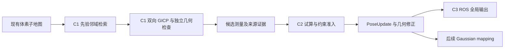

# P6-02c：真实几何回环设计

2026-11-12 设计，11-13 更新。状态：**C1 已完成阶段验收，C2/C3 待细化**。设计时代码基线为 `495ecf1`；
[P6-02b](../../p6-02b-validation.md) 已完成可选位姿图与版本化几何交付。
本文确定下一阶段的边界和实施顺序，C1 详见[实施计划](../plans/2026-11-12-p6-02c1-loop-verification.md)。
实现冻结于 `64054a7`；实际结果与限制见 [C1 验证记录](../../p6-02c1-validation.md)。
后续边界已细化为 [C2 设计草案](2026-11-13-p6-02c2-loop-admission-design.md)与
[C2a 实施计划](../plans/2026-11-13-p6-02c2a-loop-admission.md)，尚未编码。

## 目标与阶段划分

从传感器产生的几何数据中检索历史位置，验证相对位姿，再将可信约束交给已有位姿图。
最终通过一致的位姿版本驱动地图、轨迹和 ROS 全局修正，为后续在线 Gaussian mapping
提供可追溯的局部几何及修正事件。

P6-02c 分为三个可独立验收的步骤，逐步细化计划：

| 步骤 | 本次建议交付 | 验收边界 |
| --- | --- | --- |
| C1 几何回环验证 | 普通 C++ 候选检索和子地图配准；离线工具输出每一对候选的几何证据 | 不修改图、位姿文件或 ROS 行为；真实数据的匹配与人为构造测试分别记录 |
| C2 在线回环后端 | 有界的在线调度、约束准入、试算、版本提交及失败恢复边界 | 不合格或陈旧结果不污染已接纳约束；记录延迟、积压、内存和退出行为 |
| C3 ROS 全局输出 | 同源接入全局 TF、当前全局位姿、优化关键帧轨迹与版本化地图 | 两端共用普通 C++ 结果；TF 树无双重父节点，产品来自同一已提交版本 |

**本次只实施 C1。** C2 的鲁棒噪声、调度与持久化协议，以及 C3 的发布接口，
在 C1 提供实际配准证据后另行冻结设计和计划。C1 完成不能称为 P6-02c 全阶段完成。
后续阶段正式编码前仍按用户要求通知切换模型。



## 当前工程事实

- `LivoSystem` 与 `OnlineSubmapManager` 都由单一串行所有者调用。
  在线回调仅允许记录拥有的数据，不能重入系统，也不能抛异常；当前只有一个在线回调。
- `GeometrySubmap` 已提供主成员体素质心、条件有效的法向、来源关键帧，以及成员、
  位姿和几何修订信息。局部坐标是首个主成员的 IMU/body 坐标，支持观测不重复融合。
- `GeometryVoxel::spatial_covariance` 表示点的空间分布，不能直接解释为配准误差协方差、
  位姿协方差或图因子的统计权重。
- `PoseGraph::AddLoopConstraint` 会修改输入图；随后 `Optimize` 失败不会自动删除已添加约束。
  C2 必须先试算、再接纳，不能直接复用先插入、后决定的示例来自动处理真实回环。
- 现有 TF 是 `camera_init -> aft_mapped`；`camera_init` 承担原始 odom 系的角色。
  不能再发布 `map -> aft_mapped` 使同一子节点拥有两个父节点。
- 普通核心已依赖 PCL common/filters/io；可选 GTSAM 只在开启后发现和链接。
  C1 使用 PCL registration 时也应显式限制依赖，公共头不暴露 GICP 类型。

## 方法取舍

| 方法 | 适合之处 | 当前代价与限制 |
| --- | --- | --- |
| 里程计邻域检索 + 子地图 GICP | 复用现有位姿和体素几何，使用现有 PCL；便于先验证完整证据链 | 检索和初始化依赖里程计仍足够接近，不能保证大漂移、绑架或任意视角重定位 |
| Scan Context + 几何验证 | 提供几何外观检索和航向提示，可与位姿先验结合 | Avia 小视场、覆盖不完整和运动方向变化需要实测，不能照搬环形扫描的阈值 |
| STD/BTC + 几何验证 | 三角特征适合研究视角变化；STD 官方展示了 Avia 小视场案例 | 需要适配描述子、资源与依赖边界；当前官方代码包含 ROS/Ceres 等接口，不能整包接入核心 |

**执行者建议第一种作为 C1。** 它是有明确工作条件的先验辅助回环，不宣称具备全局位置识别能力。
后续是否增加 STD/BTC 或其他描述子，由实际漏检、初值捕获范围、耗时和移植成本决定；
当前不提前建立可插拔描述子框架。

Scan Context 的原始实现和 STD/BTC 官方仓库作为研究参照，见文末来源。
第一种方案不复制这些仓库的实现，也不新增 Ceres、学习模型或 GPU 依赖。

## C1 输入、表示与坐标

回环验证读取两份已封存的 `GeometrySubmap`；每份只使用其 primary 成员形成的几何。
查询块为较晚的 source，历史块为 target。配准点是体素质心，避免每次候选匹配都重新拼接
全部关键帧点云；旧几何被缓存淘汰时，仍通过既有 `GeometryMapper` 从原始资产重建。

法向只用于几何质量检查。GICP 自行按邻域重算其局部协方差，不能把现有点分布矩阵直接
填作测量置信度；`PointXYZINormal` 中未约定的字段也不能被误当成有效法向。
配准内部使用独立的 `pcl::PointXYZ` 临时云，原始资产和共享快照均只读。

约定 `T_A_B` 将 B 系点变换到 A 系。历史块锚点为关键帧 i，查询块锚点为 j，i < j：

```text
source = S_j = B_j                 target = S_i = B_i
p_target = T_Si_Sj * p_source
T_initial = inverse(P_v(i)) * P_v(j)
未来图约束：from_id=i, to_id=j, from_body_from_to_body=T_Si_Sj
```

P_v 是同一快照中的锚点位姿。合法近似旋转先在临时副本投影到 SO(3) 后构造刚体初值；
不得改写输入位姿。不能直接用 `parent_from_submap` 作为相对测量，也不能把 GICP 返回的
source-to-target 矩阵再次取逆。

输入必须携带并核对两端 submap ID、anchor ID、membership revision、representation revision、
pose version、frame count、optimized frame count。必须为相同位姿视图且已封存；主成员不能重叠，
`GeometryData::sources` 的 ID 序列必须与各自 primary 成员一致。
匹配结果保留这些来源字段。C2 重新提交前必须检查来源是否仍然有效，不能只比较两个 ID。

C1 离线工具首先只支持明确选择版本 0；普通验证函数接受同一有效视图的几何输入，并测试
版本 0、相同正版本及版本不匹配的拒绝。后续在线接入时另补修订变化与陈旧结果提交测试。

## C1 候选检索

查询块按 ID 递增处理；历史索引只包含更早的封存块，不含查询自己或未来数据。
从原始关键帧元信息读取区间时间，无需加载图像或点云。
建议初始条件如下，全部可配置且为实验起点：

| 参数 | 初值 | 精确定义 |
| --- | ---: | --- |
| `min_submap_gap` | 3 | query ID - target ID >= 3 |
| `min_keyframe_gap` | 50 | query 首主成员 ID - target 最后主成员 ID >= 50 |
| `min_time_gap_s` | 30 | query 首主成员时间 - target 最后主成员时间 >= 30 s |
| `search_radius_m` | 15 | 同一位姿视图下两锚点的三维距离 <= 15 m |
| `max_candidates` | 5 | 每个 query 最多验证 5 个历史块 |

候选按锚点距离平方、target ID 排序，平局确定处理；首版线性扫描轻量元信息即可。
时间必须有限、成员区间必须有序；配置非法或来源自相矛盾时在产生结果前拒绝。
主成员时间范围重叠、相邻块或共享主成员不能作为回环证据。

空间半径是检索条件，不是回环成立条件；不为“必须产生回环”而放宽门限。
未来外观检索可增加半径外候选，但不改变几何验证器的坐标及质量契约。

## C1 配准与几何判定

配准临时云先按局部坐标以数学 `floor` 做 0.5 m 体素降采样，质心等权聚合；稳定排序保证固定输入处理顺序。
先验证原始几何有限性和体素计数，不能靠删除异常点掩盖损坏的资产。
降采样后每端需有 100～20,000 个点；超过上限返回资源限制，不静默截取某个空间方向。
原始几何仍受现有每块 100,000 个体素等限制约束，降采样前也须检查这些限制。

使用 PCL 1.10/1.12 均支持的 `GeneralizedIterativeClosestPoint<PointXYZ, PointXYZ>`：

- 邻域数 20，最大对应距离 2.0 m，外层最多 50 次、内层优化最多 10 次；
  平移变化阈值 `1e-4`，旋转系数变化阈值 `1e-4`，逐项显式设置，不使用较新版本专有线程 API。
- 分别求 source→target 和 target→source，反向初值为正向初值的逆；每次调用独立持有临时求解状态。
- 内部极小的局部派生 helper 可读取迭代次数；不增加公开继承体系或 Pimpl。
- `hasConverged` 为 false、结果非有限、旋转非法或达到外层迭代上限时拒绝。
  **PCL 1.10 和 1.12 在达到最大迭代数时也设置 converged，故该标志单独不足以准入。**

对最终结果在原 `GeometryData::voxels` 的质心上重新计算独立诊断，不直接把 `getFitnessScore`
当作统一质量门限。这些诊断点保留各自原有的可选法向，每端最多 100,000 个；不为 0.5 m
粗点平均法向，避免将边缘两侧不同平面混成一个虚假法向。以下点数和覆盖率均指该诊断云：

1. 在 0.5 m 对应半径内建立相互最近邻，避免多对一匹配重复计数；至少 100 对，且对两端点数
   的覆盖率都 >= 0.30。平方距离与米制半径在接口边界显式转换。
2. 对这些对应计算欧氏 RMSE <= 0.20 m、距离 p95 <= 0.30 m，两个方向分别记录。
3. 记正向结果 F=`T_target_source`、反向结果 B=`T_source_target`，闭合误差分别取
   `E_target=F*B` 和 `E_source=B*F`，两者都要求平移范数 <= 0.10 m、旋转角 <= 2°。
   两个坐标原点不同，平移指标不等价，不能只选更容易通过的一个。
4. 记正向初值为 I、反向初值为 `inverse(I)`；初值修正分别取
   `D_forward=inverse(I)*F`、`D_backward=I*B`，两者都要求平移范数 <= 3 m、旋转角 <= 20°。
   该平移量比较各自输入云原点的预测位置与配准位置，不能换成 `F*inverse(I)`。
   这是首版有限捕获范围的保护，不能解释为全局重定位。
5. 两方向分别对有有效目标法向的对应检查退化。每端至少 100 个法向对应；以其变换后位置均值
   为中心，L=max(1 m, 点到该中心距离的 RMS)，构造无量纲行 `J=[((p-center)×n)/L, n]`。
   `H=mean(JᵀJ)` 的最大特征值需为有限正值，最小/最大特征值比 >= `1e-4`。
   单平面、直线和欠约束走廊不能因点数多或残差低而被接纳；H 只作退化指标，不当成统计信息矩阵。

上述旋转角均为 `acos(clamp((trace(R)-1)/2, -1, 1))`，先校验并在副本中投影合法近似旋转，
再作比较。闭合差双端检查有意偏保守：较大的锚点基线会放大旋转误差的平移影响，可能额外拒绝
有效候选，但不在 C1 为增加通过率而悄悄改用其他坐标原点。确定性测试必须分别覆盖非交换旋转
和非零锚点位移下的 `F*B`、`B*F` 以及两种初值修正，不能仅用单位初值或纯平移。

所有几何阈值都需要在不同场景上标定。C1 输出“通过这些几何检查的候选”，不把它直接等同于
绝无误检的真实闭环；重复结构和双向一致的错误配准仍可能通过。C2 需增加约束一致性、歧义
处理与鲁棒图准入后，才允许自动改变系统位姿。

非法配置、损坏输入属于异常；合法输入但缺少对应、迭代到限、低重叠、退化或超过资源限制
属于可解释的候选拒绝，输出稳定原因。失败不能修改输入快照，也不能留下半个可用测量。

## C1 模块、资源与离线工具

建议放在已有 backend 职责下，沿用普通结构与直接成员：

| 位置 | 职责 |
| --- | --- |
| `include/livo_atlas/backend/loop_closure.h` | 普通配置、候选、配准诊断和结果；不暴露 ROS/GICP/GTSAM 类型 |
| `src/backend/loop_closure.cc` | 候选筛选、排序及来源校验 |
| `src/backend/loop_registration.cc` | GICP 调用、独立质量计算和拒绝原因 |
| `tools/verify_loops.cc` | 读取已结束数据集、重建几何、输出候选和验证记录 |
| `tests/backend/` | 坐标、检索、配准、退化与预算测试 |

`LIVO_ATLAS_WITH_LOOP_CLOSURE=OFF` 建议作为独立构建选项，开启时才查找 PCL registration/kdtree
并导出 `livo_atlas::loop_closure`；C1 验证器本身不要求 GTSAM。静态和共享安装消费者均需实测。
是否已有 `WITH_GTSAM` 与是否验证几何回环是两个不同选择，不用 ROS 版本宏控制算法库。

一次只保留一个查询块和一个目标块的外部引用，逐候选处理；不存全部历史云或图像。
既有几何缓存最多 3 块不代表进程最多持有 3 份数据：外部共享引用仍可能固定被淘汰的几何，
需要单独记录 pinned 数据和临时 GICP 内存。此阶段只承诺结构上的有界工作集与输入上限，
不把点数上限解释为硬实时或固定字节 RSS 上限。

工具读取原数据集和在线索引均为只读，输出目录必须不存在；保留输入来源、实际参数、候选排序、
全部质量数值、拒绝原因及配准耗时。零候选和全拒绝也是合法结果，进程成功不代表检测到了回环。
已有索引不得以写者方式重开，不能覆盖位姿文件或历史验收目录。

## C2/C3 后续必须满足的契约

这些是后续设计的约束，不是本次允许直接编码的接口清单：

- 在线回调仅投递拥有的数据；`ProcessNext` 返回后由普通 C++ 调度器处理。
  如引入后台 worker，它不能持有或调用活体 `LivoSystem`/`GeometryMapper`，也不能无界积压图像、云或快照。
  每次接纳都由系统唯一所有者完成；一个回调内的后端和未来 3DGS 消费需明确统一分发。
- 新回环先在独立候选图上优化、检查、再提交；当前 `PoseGraph` 的值拷贝可作为初版试算方案，
  但要计入复制峰值内存。不能让被拒绝约束残留在正式图中；不能反复加入高度相关的相邻块约束。
- 几何低残差不等于可信协方差；鲁棒核、噪声、相关约束、歧义与优化后几何复核需要 C2 单独定义。
- 提交仍使用已有 `base_version` 和投影刚体尾帧策略。组内变形后重新验证、跨版本结果拒绝或重算；
  不能简单改写旧候选的 base version。旧数据可检查，不表示失败后的活体会话可继续。
- 当前 `ApplyPoseUpdate` 可先持久化位姿、再在通知时失败并终止会话。C2 的约束记录与位姿文件
  不天然构成跨文件原子事务；必须明确成功、终止和重启恢复的界限，不宣称可以无条件回滚。
- 全局修正取最后已优化锚点 k 的 `T_map_odom=P_v(k)*inverse(O(k))`，遵循投影刚体策略。
  当前连续位姿由该修正与原始前端位姿组合；整条历史优化轨迹需使用每帧 P_v，不能统一乘一个修正。
- 现有帧名下先形成 `map -> camera_init -> aft_mapped`；它对应 REP-105 的 map/odom/body 语义。
  帧名迁移可独立配置和验证。原始 odom 的连续性与地图校正跳变分别处理，不反馈改写前端状态。
- 新旧 TF 在同一次原始位姿发布时使用一致的 ROS 时间戳；不能把旧关键帧求解时间当成当前 TF 时间。
  普通估计时间与 ROS clock 的区别继续保留。相同快照生成的不同 ROS 话题也不保证传输原子性。
- 3DGS 消费局部观测、几何修订和位姿版本，不用一张已全局变换的合并点云作为唯一真值。
  刚体整块修正更新变换，组内变化触发重建/重训练；过期训练结果要有明确拒绝策略。

## 现有数据能验证什么

只读检查了 P6-02b 的 `replay-noetic-on-omp1/keyframes`，对应冻结算法源码 `77eebbe` 和原始
`Retail_Street.bag`，未修改资产。13 个封存块，在上述 gap 和 15 m 半径下有 22 对候选，
每 query 最多 5 个后共 20 对。第 0 与第 12 块锚点相距约 0.416 m，锚点时间相隔约 128.5 s；
按主成员区间末端计算的间隔约 109 s。

这些是设计时的原始里程计候选统计，当时尚未执行 GICP，也没有对应真值。
C1 后续实际配准结果见验证记录；候选统计本身不能称作真实闭环检测成功。
本机只读分析记录在包外 `validation/P6-02c-design-20261112/candidate-probe.json`，包含参数、
22 对候选、top-5 标记与读取元信息的 SHA256；迁移电脑时需单独复制或按上述规则重新计算。
不保证该 bag 在严格退化/重叠检查下产生任何被接受的匹配，也不调整阈值强造成功。
现阶段仍使用现有数据，暂无更长连续 bag，不重复索要；长距离误检率与召回率以后需要有标注的数据评估。

## C1 实施顺序与验收要求

1. 固定候选输入与拒绝语义：零候选、排序平局、未来块、共享成员、无效时间和边界值可确定复现。
2. 接入几何质心与双向 GICP：用具有已知非交换旋转和平移、足够三维结构的合成几何验证方向、
   初值和变换恢复；再测部分重叠、离群点、极少点、非有限值和外层迭代上限。
3. 固定独立指标：互为最近邻防重复计数，验证米/平方距离转换、双向闭合差和归一化退化指标；
   平面和直线的低残差必须不能绕过退化拒绝。
4. 提供只读离线工具，实测上述候选及各项拒绝原因；报告完整参数、通过与拒绝的全部数量。
   人工构造真值用来证明算法契约；真实 bag 输出用来评估可运行性，分别写记录。
5. OFF/ON 的普通 SDK shared/static、Noetic、Humble 及安装消费逐项验证；开启 C1 构建不会改变
   默认 ROS 节点。既有单线程完整 bag 对照沿用同环境基线，确认前端和原资产不受影响。
6. 新证据放独立目录；单任务 `nice -n 10`/`-j1` 构建，与回放顺序运行，`OMP_THREAD_LIMIT=1`，无 RViz。
   记录配准次数、迭代数、耗时分布、点数和采样 RSS；验证输入未变、输出不覆盖以及中途失败可诊断。

C1 未承诺固定总运行时间；GICP 的迭代次数限制不是壁钟硬截止。C2 上线前应据测量决定任务预算
与执行方式，不能把离线通过直接等同于前端能无阻塞运行。

## 来源与证据

以下为 2026-11-12 核对的一手资料，方案取舍是结合当前代码所作的工程建议：

- [Scan Context 官方作者仓库](https://github.com/gisbi-kim/scancontext)：描述子和检索实现的参照，
  其性能说明不能直接转用到本工程的 Avia 数据。
- [STD 官方仓库](https://github.com/hku-mars/STD)：展示 Avia 小视场、低重叠案例；
  [当前公开头](https://github.com/hku-mars/STD/blob/master/include/STDesc.h) 包含 ROS 与 Ceres 接口。
- [BTC 官方仓库](https://github.com/hku-mars/btc_descriptor)与
  [构建入口](https://github.com/hku-mars/btc_descriptor/blob/master/CMakeLists.txt)：参照三角及局部描述子，
  当前构建涉及 ROS、Ceres 和 TBB，未作为本次依赖引入。
- [PCL 1.10 GICP 实现](https://github.com/PointCloudLibrary/pcl/blob/pcl-1.10.0/registration/include/pcl/registration/impl/gicp.hpp)与
  [PCL 1.12.1 GICP 实现](https://github.com/PointCloudLibrary/pcl/blob/pcl-1.12.1/registration/include/pcl/registration/impl/gicp.hpp)：
  初始化、协方差和迭代到限行为按实际目标版本核对，不能照搬最新文档专有 API。
- [REP-105 原文](https://github.com/ros-infrastructure/rep/blob/master/rep-0105.rst)：odom 的连续性、
  map 修正与 TF 单一父节点约束；实际帧名按现有工程演进。

## 设计审阅

已完成一次独立、只读 builder check。审阅提出一项需要先固定的问题：正反向闭合误差与
初值修正采用哪一种 SE(3) 复合顺序，且是否检查两个方向。执行者已明确上述四个公式、
各自平移/旋转门限及非交换变换测试要求；这是工程判定规则，不改变用户目标。
审阅未提出其他 C1 计划所需的重要问题。C2/C3 明确留待后续细化的事项不属于本次审阅范围，
设计审阅也不代表算法已经测试。用户随后确认按推荐继续；本次仅完成 C1，其验收见文首链接。
