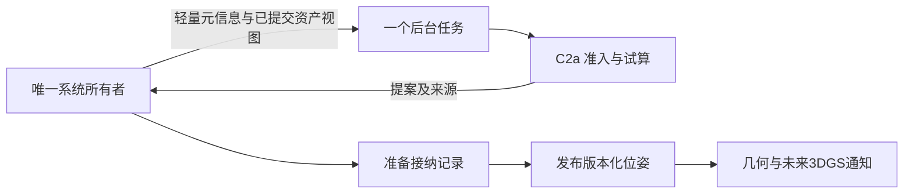

# P6-02c2：回环准入与在线接纳设计

2026-11-13，基线 `7cc1b69`（C1 产品代码 `64054a7`）。状态：**设计与实施计划草案，尚未编码**。
本轮按用户“继续”推进方案；下述阶段拆分、接口和数值是执行者建议，不记作用户逐项确认。
正式编码前通知用户切换模型。仅修改 livo-atlas，Google C++17，不使用 Pimpl，保持单一 ROS main。

## 目的与本次交付边界

C1 的 `verified` 表示几何检查通过，尚不能自动进入位姿图。C2 要解决相邻约束重复计权、
多位置歧义、优化后图与几何冲突、过期结果，以及提交失败后的可解释状态。

| 步骤 | 可独立验收的交付 | 本次计划范围 |
| --- | --- | --- |
| C2a 约束准入与试算 | 无状态普通 C++ 提案函数、鲁棒图诊断、固定变换几何复核、离线顺序试算工具 | 是 |
| C2b 在线调度与接纳 | 单 worker、有界任务、所有者接纳、持久化记录与只读恢复检查、双 ROS 同源接入 | 先确定边界，另写实施计划 |
| C3 全局输出 | map 修正、全局轨迹与版本化地图发布 | 后续 |

C2a 不能称为“在线回环已经接通”。它先把准入规则做成可复现的算法模块，C2b 再接入运行调度。
继续使用现有 Retail_Street，无新长 bag 要求；不为得到回环通过数调低验收阈值。

## 现状与方案选择

代码事实：

- `PoseGraph::Optimize(const PoseSnapshot&) const` 在局部构造 GTSAM 图，返回更新，不写正式状态；
  `AddLoopConstraint()` 则立即改变该对象。当前仅对角 Gaussian 噪声，目标下降不代表回环正确。
- `LivoSystem`、`OnlineSubmapManager`、`GeometryMapper` 都要求串行调用。在线回调只能投递拥有的数据。
- `ApplyPoseUpdate()` 顺序为验证、保存 pose、替换内存快照、更新几何并通知。
  后半段失败可能已经产生持久化新版本，当前会话随即终止，不能捕获后继续或宣称回滚。
- `Finish()` 先进入 finished 状态，再发尾块封存通知；现状不能在通知后继续提交位姿。
- `GeometryMapper` 淘汰后重新构建会增加表示修订，即使成员及局部源位姿相同。
- 重开存储是只读，现有存储索引不会实时刷新；停止写入前不使用重开 reader 扫描活体目录。

考虑过的路线：

| 路线 | 好处 | 代价与选择 |
| --- | --- | --- |
| 在前端线程同步检索、配准、优化、提交 | 调用关系最短 | C1 单对已约 84–96 ms，中位数乘最多5候选即可影响前端；不作为在线方案 |
| 一次接入 worker、准入、日志与恢复 | 较快形成完整链条 | 并发、数学与文件失败一起出现，难以定位；不作为下一次编码范围 |
| 先无状态准入，再薄在线协调层 | 同一算法可离线确定性验收，再复用到 worker | 多一个验收阶段；**建议采用** |

C2a 不新增管理器类：输入包含原始位姿、当前快照、封存子地图元信息和已接纳约束；
函数内构建临时图，输出候选更新。正式约束列表是唯一事实来源，不额外维护一份可能失步的长期图。
现有 Optimize 本就批量构图；初版继续批量 LM，暂不引入 iSAM2、检索描述子或通用任务框架。

## C2a 普通接口与所有权

新增 `include/livo_atlas/backend/loop_admission.h`，定义以下普通值类型（无 ROS/GTSAM 类型）：

- `AcceptedLoop`：`LoopConstraint constraint`、封存的 `OnlineSubmap target, source`。
  保存主成员/锚点，供相关性判断与后续几何复核；其来源版本与完整诊断由外围记录保留。
- `LoopAdmissionInput`：`PoseSnapshot poses`、`vector<RigidTransform> raw_poses`、
  `vector<LoopSubmapInfo> submaps`、`uint64_t query_id`、`vector<AcceptedLoop> accepted_loops`。
- `LoopAdmissionOptions`：已有 search/registration/graph 选项与下文明确的准入参数。
- `LoopProposal`：新增 `AcceptedLoop loop`、对应 `LoopVerification verification`、
  `PoseUpdate update`。更新只在成功提案中保存一份。
- `LoopAdmissionResult`：稳定状态、最多5项候选诊断、不含可提交位姿的图/几何检查诊断、`optional<LoopProposal> proposal`。
  只有 `kProposed` 有 proposal；被拒绝、异常和超预算不能留下可提交更新。

```cpp
using LoopGeometryReader = std::function<GeometrySubmap(
    std::uint64_t submap_id, const PoseSnapshot& poses)>;
LoopAdmissionResult ProposeLoopUpdate(
    const LoopAdmissionInput& input, const LoopGeometryReader& geometry_reader,
    const LoopAdmissionOptions& options = {});
```

所有输入调用期间不可变；reader 只能使用调用者独占的缓存与已提交资产，不捕获活体系统。
引擎顺序调用 reader，不启动线程。一次仅固定一个查询/目标几何对；候选列表只留诊断和元数据。
试算快照是临时普通值；函数不写文件、修改输入、调用 `ApplyPoseUpdate()` 或改变正式约束。

严格检查完整连续 raw/frame 前缀、快照合法且与 raw 尾帧策略一致、元信息同一视图、封存成员合法、
锚点与约束方向一致、重复/非法已接纳约束。accepted 数量必须与初始版本策略兼容：C2a 从版本0、
空 accepted 开始，每次提案接纳恰好新增一条、版本加1；不接受导入未知外部优化历史。
options 在一次会话内固定，既有约束噪声必须与本次配置一致。

准入配置还拒绝min_points/min_inliers/min_normal_pairs大于max_voxels的不可达关系，
避免C1已记录的配置边界缺口进入新消费者；max_points是粗化预算，不用于限制原始体素诊断数量。
非法数据/配置抛异常；正常拒绝使用下文状态。不要用异常掩盖损坏资产。

## 检索、歧义和相关性

1. 用同一 input.poses 更新所有 `LoopSubmapInfo` 的父位姿与三项视图字段，再调用 C1 搜索。
   元信息原始来源字段先验证，不能把任意旧几何结果只改版本号后复用。
2. 对最多5个候选顺序调用 C1 `VerifyLoop()`，记录全部结果，不导入之前 CLI 的 verified 标志。
3. 每个几何通过项 j 推导当前查询锚点的假设世界位姿 `H_j=P(target_anchor_j)*Z_j`。
   所有通过项两两比较 `inverse(H_i)*H_j`；平移<=0.5 m、旋转<=5°（含边界）才视为一致。
   任何一对冲突则整个查询为 `kAmbiguous`，不按最高分强行选位置。
4. 一致时按四个覆盖率的最小值降序、两方向 RMSE 最大值升序、锚点距离升序、target ID升序排序。
   每查询最多选择一条；不存在通过项为 `kGeometryRejected`，检索为空为 `kNoCandidate`。
5. 选择项与任何已接纳项有任一端主成员交集，或两端 submap ID 差分别<=2，则 `kCorrelated`。
   端点按较早target/较晚source规范化，差值用安全无符号差计算。相同端点自然被拒绝。
   最优项相关时不尝试次优替代；初版保守去重，明确可能损失独立有效约束。

阈值限制的是先验辅助、小漂移运行域。多个一致错误匹配仍可能通过；这不是全局位置识别或误检概率保证。

## 噪声、试算与图检查

C2a 新回环采用会话内固定的先验标准差，默认平移0.2 m、旋转3°（内部转弧度），不从 C1 的 RMSE、体素空间协方差
或归一化 Hessian 伪造测量协方差。这些sigma允许通过配置调整为正有限值，但一次运行中不改变，也不由几何残差自适应推断。
所有正式回环统一使用 Huber block weighting，默认delta=1.345，
作用于白化后的6维残差范数；这个 delta 是实验起点，不解释成6维置信概率。
先验/里程计仍沿用 P6-02b 默认参数。

在 `PoseGraphOptions` 增加 `loop_huber_delta=0`：0保持原 Gaussian 行为；正有限值开启回环 Huber，
负值/NaN/Inf拒绝。C2a 的 graph 默认设为1.345，且强制delta>0；
C2a 配置0是非法输入，通用PoseGraph的0仅用于保持原Gaussian消费者兼容。只包装回环因子，不修改 prior/odometry。

在 `PoseGraphResult` 增加里程计和回环因子的优化前/后残差诊断。每项包含两端ID、实际 factor 的
`unwhitenedError()` 除以原对角 sigma 后的范数，以及误差变换的旋转角和欧氏平移长度。
诊断不使用鲁棒降权后的数值，否则被降权的坏因子可能伪装成小残差。
GTSAM 的具体切空间约定由该因子的误差函数决定，不另写一份假定等价的 SE(3) Logmap。

临时图由完整原始前缀和已接纳列表重建，随后加入唯一新约束并 Optimize。依次检查：

- 有限目标值、不增加，且 `iteration_limit_reached=false`；否则 `kOptimizationRejected`。
- 所有里程计、历史回环与新回环的优化后未鲁棒降权白化范数<=3；
  历史回环相对优化前的范数增量<=0.5；否则 `kConstraintResidual`。
- 每个已覆盖关键帧相对当前快照的位姿变化<=3 m/20°；否则 `kPoseCorrection`。
- 使用 `MakePoseSnapshot()` 创建实际投影尾帧策略下的预览；随后执行几何复核。

初始/最终目标只在**同一个临时图**内比较，不比较“加约束前后的总目标”来判断新约束收益。
上述门限均含等号、实数有限；这是一套保守实验准入规则，不是统计一致性证明。

在普通头中增加派生自std::runtime_error的 `PoseGraphOptimizationError`。原始输入检查仍抛
invalid_argument/overflow_error；有效输入下的非有限目标、目标上升、无效求解输出，以及
GTSAM IndeterminantLinearSystemException或仅求解器调用范围内的runtime_error，转换为此异常。
准入层只捕获该类型并返回kOptimizationRejected，保存原因。bad_alloc、未知异常和reader/I/O错误
向外传播，让CLI保留失败报告并退出1；不以宽泛catch继续运行。迭代到限沿用原返回标志。

## 优化后的几何复核

新增普通函数 `EvaluateLoopGeometry(target, source, target_from_source, options)`，返回两方向
`LoopMetrics` 与质量状态。它使用**给定变换及其逆**计算重叠、RMSE/p95、法向数量和退化；
不启动 GICP，不把互逆的闭合误差当作另一份独立证据，不进行 C1 初值修正判断。
输入验证与 float 运算包络复用 C1，禁止把未检查的变换直接送入 KD-tree。

对所有历史已接纳项及新项，按预览快照重建/获取主成员几何；对原始测量 Z 和预览中两锚点的
相对位姿 Z_pred **分别**做上述双向检查。全部沿用 C1 质量阈值，通过才返回 `kProposed`；
任一不通过为 `kGeometryChanged`，保留具体约束与失败指标。
这是检查地图与固定测量是否仍相容，不是重新配准出另一个 Z 后偷换原约束。

reader 返回的数据必须与指定快照的 version/frame/optimized、成员以及逐源局部位姿相符。
`representation_revision` 记录诊断，但不把不同 reader/cache 中的计数当作全局标识；
局部 sources、成员和位姿视图构成语义校验。缓存淘汰导致的重新构建允许，真实局部变形必须重建。
所有封存成员均在优化前缀内；caller 只提供符合该视图的几何，不能混用旧体素与新锚点。

## 预算与确定性

- C2a默认最多5候选，允许配置范围1–5；最多5000关键帧、200条已接纳回环。
- 会超出图/回环上限时返回 `kResourceLimit`，不删除历史约束、不修剪原始图、不中断前端数据保存。
- 几何继续最多100000体素、20000配准点；每块最多64主成员，reader缓存最多3块。
- 每次最多一个图求解；几何复核遍历全部已接纳约束，因此时间随图/约束增长。
  点数、队列和图上限不等于固定 RSS 或壁钟硬截止。计入输入快照、临时图、求解器及缓存外固定引用。
- 候选顺序、质量排序及拒绝顺序固定；不同 PCL/GTSAM 构建不要求浮点结果逐字节一致。

拒绝优先级：输入异常 → 预算 → 无候选/几何全拒绝 → 歧义 → 相关 → 优化 → 因子残差 →
位姿修正 → 几何变化 → 提案。每级只在前级通过后执行，未执行指标用 optional，不用0占位。

## C2a 离线交付与构建

新增 `livo_atlas::loop_backend`，仅当两个既有选项 GTSAM=ON、LOOP_CLOSURE=ON 时创建。
不添加第三个算法开关。C1 两种单独开关仍可用；普通节点不会自动启用后端。
公共头不含 GTSAM/PCL registration；新增真实安装消费者验证双开目标及静态依赖。

工具 `livo_atlas_propose_loops DATASET OUTPUT --pose-version 0 [--config FILE]`：
要求停止写入、索引完整且全部封存；输出目录全新且在输入外。按 source ID升序试算，
输入从版本0开始，只将通过的 proposal 应用到**工具的内存快照与约束列表**，供后续查询使用。
每个查询固定使用**整个已结束数据集的N帧前沿**：raw_poses为[0,N)，frame_count=N，
submaps包含全部封存块（未来ID由C1排除）；每次成功均优化N帧。超过5000帧时报告图预算拒绝，
不自动裁剪到早期前缀。该工具是利用完整里程计的离线顺序试算，不模拟封存当时的在线可见性；
C2b另用任务派发时捕获的前沿验证在线行为。
输出每查询诊断、完整实际配置、每个提案的 PoseUpdate/来源和 complete 摘要；不写入原数据集的
两个 poses 命名空间，不自动修改用户在线图。零提案正常退出0，语法错误2，运行失败1并保留已写记录。

配置分 search、registration、graph、admission，严格未知键/类型/数值检查；复用 C1 内部配置助手，
不复制其传感器布局或数值转换代码。离线工具结果是顺序模拟证据，不是在线提交日志或可直接导入的可信约束。

## C2b 预定接入契约（另行冻结实现）



- 回调只收集轻量元信息和最新共享快照，不积压整幅图像/云；处理每个 ProcessNext 返回后泵送，
  等待输入时也能接纳完成结果。两种 ROS 使用相同协调逻辑，不新增 main。
- 单 worker、最多1个在途任务、1个待处理查询ID、1个结果。过载合并为最新查询并记录跳过，
  原始关键帧元信息不能丢弃而形成前缀空洞。一次任务是一个完整查询，不在内部无界积压子任务。
- worker 不持有或调用活体 LivoSystem/GeometryMapper。重建几何需要独立资产读取能力：
  由所有者提供已提交资产的明确读取视图，不能重开并扫描正在写入的存储索引。
  该小型资产视图 API 是 C2b 需要另外设计的接入点，C2a 不提前创造无消费者接口。
- 接纳要求 base_version不变、封存成员与逐源局部位姿未变；只新增尾帧可用现有投影策略物化。
  任一历史变化则丢弃并在新视图重新计算，不能改写提案 base_version。
  正式状态是约束记录和完整最新 raw 前缀，不能用 worker 的旧图副本覆盖新增关键帧。
- 接纳前分配好新约束列表，先持久化不可变 prepared 记录，再调用现有位姿提交路径。
  已发布且与 prepared 内容匹配的 pose 才是接纳权威；单有 prepared 不算成功。
  发布后通知失败属于“已提交但会话终止”，禁止回滚、重复接纳或继续处理。
- C2b独占启用会话内的位姿提交；其他调用者不能绕过接纳日志写版本。只读恢复检查 prepared/pose
  配对、连续版本、来源、参数和优化前缀；孤立 prepared 为未提交，缺记录/不匹配为不一致。
  不承诺自动重启前端或续写旧数据集，也不宣称无 fsync 的现有存储支持掉电事务。
- 为处理 Finish 封存尾块，需要窄的“封存输入→后端排空与接纳→最终 Finish”生命周期。
  不在析构函数提交位姿；异常退出 join worker，禁止 detach。停止标志不能中断正在执行的 GICP/LM，
  先等待当前求解返回再释放资源，不承诺定时强杀线程。
- 缓存、点数、图上限和在途数量各自计量；前端本身历史元数据增长不受后端队列上限约束。
- 后端和未来3DGS由唯一事件分发点接收相同版本；C2 不实现训练器或高斯地图。

## 验收与资料

C2a 必须有非交换旋转/平移、歧义重复结构、近邻重复约束、试算失败不污染输入、错误回环即使
鲁棒目标下降也被原始残差拒绝、投影后几何失效、历史约束复核、缓存重建等确定性测试。
真实 bag 逐查询记录初始与模拟后续视图；不规定必须接纳几条，也不照搬 C1的8条作为成功目标。

SDK及双 ROS shared/static 的组合构建、安装消费和实际节点回归沿用已冻结方法；默认节点继续
对同环境基线比对原始前端、资产和导出。重型构建串行 nice10/-j1，回放 CPU0/OMP1，不启 RViz。
C2a 不需要新网络依赖；GTSAM继续使用已验证的4.2.2环境。

- 当前契约：[C1 设计](2026-11-12-p6-02c-loop-closure-design.md)、[C1 验收](../../p6-02c1-validation.md)。
- 源码：[PoseGraph](../../../include/livo_atlas/backend/pose_graph.h)、[位姿物化](../../../src/mapping/pose_snapshot.cc)、
  [系统提交](../../../src/core/online_submap_manager.cc)、[几何缓存](../../../include/livo_atlas/mapping/geometry_mapper.h)。
- [GTSAM 官方鲁棒噪声说明](https://gtsam.org/2019/09/20/robust-noise-model.html)：支持在已有噪声模型外包装鲁棒权重。
  本机4.2.2的 NoiseModel.h/LossFunctions.h 另确认白化与 Block 语义；本文数值与准入门限是工程建议。

## 独立设计检查的收敛

审阅提出三项会改变实施行为的问题，均由现有范围及上述工程选择解决：

1. 离线前沿采用完整N帧；代价是不能将该工具结果解释成在线精度或延迟，超预算不自动裁剪。
2. 数值求解失败以专门异常转为拒绝；未知异常与资产失败终止运行，避免吞掉真实错误。
3. 准入sigma可配置但单次运行固定；C2a强制正Huber delta，通用图默认Gaussian继续兼容。

这三项是执行者裁定，尚未将设计标为用户批准。C2b明确留待细化的接口不属于本次编码计划。
