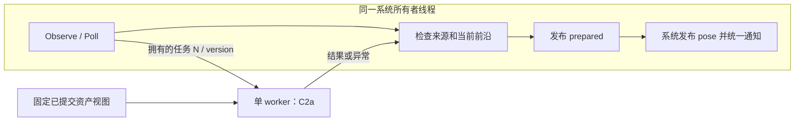

# P6-02c2b：在线回环调度与持久接纳

2026-11-14，基线 `99d5f27`，算法冻结代码为 `8d4bcf6`。
状态：**实现、主验收、独立审阅问题闭环及受影响构建复验已完成**。沿用 [C2 总体设计](2026-11-13-p6-02c2-loop-admission-design.md)
中已选定的“无状态准入＋薄在线协调层”；下文记录本阶段的接口、格式和调度约定。
正式编码已通知用户并取得实施授权。只修改 livo-atlas，保持单一 ROS main、普通 C++ 核心、Google C++17 和函数间空行，不使用 Pimpl。

## 目标与边界

让已封存子地图在线触发 C2a，后台顺序计算，唯一系统所有者检查并接纳提案。
每个正式位姿版本都能与不可变约束记录配对；异常后提供只读检查，明确哪些更新已经发布。
未来 SLAM 和 3DGS 消费同一个版本化位姿通知，不创建第二份正式地图状态。

本阶段包括在线读取视图、后台执行、接纳协议、停止排空、双 ROS 接线和真实数据验收。
C2a 的几何/图门限、Gaussian 兼容、固定 sigma 和 Huber 规则保持原定义。
不加入 iSAM2、全局描述子、前端状态反馈、map→odom TF、全局地图发布或 Gaussian 训练器。
不自动重启前端或续写旧数据集；现有文件系统接口没有 fsync，本阶段不承诺掉电事务持久性。

## 当前代码约束

以下描述实施前基线；完成后的接口和行为见[使用说明](../../online-loop-backend.md)。

1. `KeyframeStore::Append()` 先完成 `.pending-ID` 中的资产，再 rename 为正式帧目录，最后更新 `ids_`。
   重开构造函数会枚举目录；活体 writer 的 `ids_` 也不能跨线程读取。
2. `OnlineSubmapUpdate` 已拥有关键帧、成员修订和位姿快照。回调只能收集数据，不能重入系统或抛异常。
3. `OnlineSubmapManager::ApplyPoseUpdate()` 先写正式 pose，再替换内存视图和通知几何/消费者。
   后半段失败可能已提交新版本；不能回滚或捕获后继续。
4. 当前 `Finish()` 在尾块通知前设置 finished，无法排空最后一次回环后再提交。
5. C2a 的离线工具用完整结束数据集的 N 帧图；在线任务必须使用派发时捕获的前沿。
6. ROS1 主循环和 ROS2 定时器都经过 `LivoNode::ProcessNext()`，可以在同一位置泵送结果，包括等待输入时。

## 路线与取舍

| 路线 | 影响 | 选择 |
| --- | --- | --- |
| 在系统所有者上同步配准/求解 | 调用关系短，但一个查询最多运行五对 GICP，阻塞输入消费 | 不采用 |
| 通用线程池、插件或另起 ROS 节点 | 增加协议、状态副本和恢复问题，当前没有多个执行器消费者 | 不采用 |
| 单 worker＋唯一所有者接纳 | 复用 C2a，锁只保护任务传递，前端保持串行 | 沿用总体设计，本轮细化此路线 |

只有一个计算任务、一个结果槽和一个待处理查询 ID。过载合并为最新封存查询，原始元信息仍完整保存。
初版允许跳过回环查询，不能丢失关键帧前缀或阻塞原始资产保存。

## 组件与依赖

| 文件/类型 | 责任 |
| --- | --- |
| `io/keyframe_read_view.h` / `KeyframeReadView` | 拥有目录与固定已提交帧数，按 ID 读取不可变原始元信息/点云 |
| `backend/loop_task.h` / `LoopTask` | 固定派发前沿、原始时间戳、读取视图与实际 C2a runner |
| `backend/loop_worker.h` / `LoopWorker` | 一个线程、一个任务/结果槽、异常交付、等待与 join |
| `core/loop_backend.h` / `LoopBackend` | 唯一所有者上的元信息收集、任务派发、时效检查、接纳和排空 |
| `io/loop_closure_store.h` / `LoopClosureStore` | 接纳准备记录、查询诊断、会话摘要和停止后的只读一致性检查 |
| `src/io/loop_admission_io.h/.cc` | 从现有 proposer 提取 C2a 配置和诊断序列化；离线与在线共用源码 |

新增可选目标 `livo_atlas::online_backend`，仅当 GTSAM 与 LOOP_CLOSURE 都开启时生成。
依赖已有 `loop_backend`、`core`、`io`；基础 `core` 不反向链接在线后端，不形成依赖环。
`LoopWorker` 和 `LoopBackend` 的普通成员在头文件中直接可见，不用 Impl 或重新命名的隐藏实现类。
不创建通用事件总线、线程池、可加载插件或另一份 ROS 入口。

复用序列化源码时，loop_admission_io.cc 编入私有 proposer 和 online_backend；
online_backend 还直接编入现有 loop_options.cc、loop_diagnostics.cc，避免链接未安装的私有 loop_io target。
只共用同一份源文件，公共声明/实现各一处，不建立新的公开 helper 库；以安装消费验证静态传递链接。

## 固定的已提交资产视图

```cpp
class KeyframeReadView {
 public:
  const std::filesystem::path& directory() const;
  std::uint64_t frame_count() const;
  RigidTransform ReadRawBodyPose(std::uint64_t id) const;
  double ReadTimestamp(std::uint64_t id) const;
  PointCloud::ConstPtr ReadBodyCloud(std::uint64_t id,
                                    std::uint64_t max_points) const;
 private:
  friend class KeyframeStore;
  // 仅由 store 捕获：自有绝对目录和固定 count，不持有 writer 引用。
};
KeyframeReadView KeyframeStore::CaptureReadView() const;
KeyframeReadView LivoSystem::GetKeyframeReadView() const;
```

捕获只能发生在 writer 所有者线程、成功的 `ProcessNext()` 之后。count 取成功 Append 的前缀。
视图读取只访问 `frames/ID`，不扫描 frames、在线成员或 poses 目录，不访问活体 `ids_`。
`ID >= count` 即使磁盘上后来出现该帧也拒绝；空视图可捕获，但不能读取任何 ID。
所有数据按值持有，writer 销毁后仍可读，前提是调用者保留相应数据集文件。
LoopBackend 从这个视图的 directory 推导接纳目录，不接受另一份可能不匹配的数据集路径。

方法与现有 reader 共用标定/元信息和 PCD 校验实现，保留 max_points、64 字节点布局和非有限值检查。
不读图像，也不缓存 `cv::Mat` 或完整历史点云。视图不是针对外部恶意改写/删除文件的安全能力。
worker 独占自己的 GeometryMapper；不调用或捕获活体 LivoSystem、OnlineSubmapStore 或 GeometryMapper。

## 任务、前沿和资源

`LoopTask` 包含单调递增 `task_id`、一个拥有的 `LoopAdmissionInput`、N 个原始时间戳和 `KeyframeReadView`。
`LoopTaskResult` 移回原任务，另带一个结果或 `exception_ptr`；二者恰好有一个。

派发前沿 N 是此时已经提交并交付通知的全部关键帧数，包括尚在活动块内的尾帧。
raw 和 poses 覆盖 `[0,N)`；submaps 只包含截至此时封存的连续块前缀，查询在这个集合内。
不从磁盘重开索引补入未来帧/未来块。任务的 view.count、raw.size、timestamps.size、poses.frame_count 必须都为 N。
worker 对当前/优化预览视图分别重建几何，复用 C2a 的三块缓存、0.2 m 体素和全部质量阈值。
每个任务独立构造缓存，禁止以 version 相同为由跨不同 N 重用旧缓存。

`LoopBackend::Observe(update)` 在系统所有者上提取 ID、时间戳、raw pose、成员修订和 poses；
立即释放关键帧资产引用。逐帧验证 ID 连续，封存成员不再变化。该回调不调用系统、不写文件；
异常保存为 failure，在下一次 `Poll()` 由所有者终止会话，不能从回调抛出。

待处理槽只放 query ID。新封存查询替换旧待处理查询，累计被替换 ID 的范围和数量；
下一次 Poll 写跳过诊断。运行中的任务不被替换。结果取走并检查之前，worker 不接受新任务。
任务和结果共用容量 1，不会同时保存一个完成结果再排队另一个完整任务。

沿用默认 5000 帧、200 条回环、最多 5 候选等 C2a 预算。
最新帧数超过 max_keyframes，或接纳数达到 max_loops 时，后端停止新派发，记录 resource_limit；
前端与资产继续保存。超过帧预算后不继续复制后端历史元信息；保留计数与有效前缀，不再恢复派发。
在途提案返回时若最新前沿也已超预算，丢弃该提案，不以旧前沿绕过会话限制。
后台限额不约束系统原有 raw/pose 元信息、消费者外部引用或进程 RSS，也没有求解硬截止。



## Worker 和所有者接口

```cpp
using LoopTaskRunner =
    std::function<LoopAdmissionResult(const LoopTask&)>;

class LoopWorker {
 public:
  explicit LoopWorker(LoopTaskRunner runner);
  bool idle() const;
  void Submit(LoopTask task);  // 非 idle 时抛 logic_error，不静默覆盖。
  std::optional<LoopTaskResult> Take();
  void Wait();                // 仅在计算中等待；idle/结果就绪/停止时返回。
  void Stop();                // 请求停止并 join；不接纳位姿。
};

class LoopBackend {
 public:
  LoopBackend(LivoSystem& system, LoopAdmissionOptions options);
  void Observe(const OnlineSubmapUpdate& update) noexcept;
  void Poll();
  void Finish();
  LoopSessionStats GetStats() const;
};
```

正常 runner 为一个普通函数 `RunLoopTask(const LoopTask&, const LoopAdmissionOptions&)`，
worker 只持有该函数、不可变配置和任务数据。runner 参数也用于确定性屏障测试，不添加算法虚接口。
锁内只移动槽位、修改状态并通知条件变量；配准、文件读取、序列化、系统调用和 join 都在锁外。
后台捕获所有异常并交付给所有者，包括 bad_alloc/未知异常，不将它们伪装成合法候选拒绝。
错误交付后不再派发。Stop 等待当前 GICP/LM 返回，不强杀或 detach 线程。
析构只 Stop/join，不调用 Finish、ApplyPoseUpdate 或提交任何新版本。

LoopBackend 只在新会话、帧数和位姿版本均为 0 时创建。其配置在会话内不变。
创建成功后独占该 LivoSystem 的位姿提交；用一个明确的 friend 接入和私有布尔状态实现：
`ClaimLoopPoseUpdates()`、`ApplyLoopPoseUpdate()`、`FailLoopBackend(exception_ptr)` 仅供 LoopBackend 调用。
Claim 在构造末尾执行，之前分配/建目录/建线程失败不会留下已领取状态；领取后不在析构时释放。
现有 public `ApplyPoseUpdate()` 在该会话内拒绝外部调用；未启用后端时保持已有手动更新能力。
不创建通用权限 token、提交拦截器或服务注册框架。

## 所有者时效检查与接纳

Poll 先取结果，再考虑派发新任务，接受和拒绝均保存诊断。只有所有者接触正式系统和 LoopClosureStore。
合法拒绝不写位姿；worker/观察器/存储的真实错误终止后端，并通过 FailLoopBackend 停止系统后续变更。

提案必须满足：

1. 当前版本仍等于 task.base_version，已接纳列表与任务历史相同。
2. 最新 M ≥ N 且不超过图预算；`[0,N)` raw 元信息完全相同，原时间戳、有效位姿和 tail policy 未变。
   raw 矩阵逐项比较，不使用 trace/AngleAxis 替代数值相等。
3. 任务内所有封存块身份、锚点、主/支持成员及 membership revision 均保持一致。
   同版本下新增尾帧/新块可以存在；不能把旧结果改一个 base_version 后使用。
4. proposal.update 覆盖原任务完整 N 帧、base_version 正确，投影尾帧策略有效。
   用当前完整 M 帧 raw 和已有快照 MakePoseSnapshot，得到实际提交候选。

旧结果丢弃并记录 stale；若仍在预算内且没有更新的待处理查询，可重新安排同一个 query ID。
每次重算产生新的 task_id，查询记录不覆盖。只有尾帧增加时，保留优化前缀 N，
将 `[N,M)` 依现有 projected-last-anchor 策略物化，不重新求解，不替换约束 Z。

接纳顺序：

1. 完成上述校验，预先构造下一份 accepted 列表、完整候选快照和接纳记录。
2. 写不可变 prepared 记录，成功发布后才能调用系统提交。
3. 通过 ApplyLoopPoseUpdate 调用现有位姿提交路径；它写 pose、切换视图并统一通知几何/消费者。
4. 调用成功后用无异常交换切换 accepted 列表，保存查询接纳结果。不能在提交之后再分配新的正式状态。

pose 文件发布是接纳权威，额外 ack/summary 不是事务提交标志。
Apply 或后续诊断写入失败时终止会话，不撤销 prepared/pose，不重试同一版本。
若 pose 已发布而通知失败，属于“已提交但会话失败”；只读检查应仍识别其有效配对。
原始异常优先；尽力写 failure 报告不能覆盖原错误。公开 GetPoseSnapshot 保持可读，供诊断最后成功视图。

## 接纳记录与只读检查

目录为 `keyframes/loop_closure/`，仅所有者写。schema=1：

- `session.yml`：固定全部 C2a 选项、worker 几何参数、坐标/tail 约定和 `frontier=dispatch_prefix`；
  另保存原始 dataset.yml 元信息字节（读取上限64 KiB），供停止后严格核对标定来源。
- `prepared/VERSION.yml`：base/new version、task/query ID、派发 N、接纳 M、成员及约束、
  原 verification/图/几何诊断、完整 PoseUpdate、预期完整 M 帧 PoseSnapshot；
  `raw_frames` 逐项保存任务 `[0,N)` 的 ID、时间戳和原始矩阵/平移，不能从优化结果倒推来源。
- `queries/TASK_ID.yml`：尝试的前沿/版本、C2a 诊断及最终 proposed→accepted/stale 等所有者处置。
  `events/SEQ.yml`：合并跳过范围与资源停止等无任务事件；所有序号单调、规范十进制。
- `summary.yml`：初始 complete=0，仅后端排空且 system.Finish 成功后写 complete=1。
  `failure.yml` 是尽力诊断，不能替代 prepared/pose 权威。

session/prepared/query/event 是不可变记录，正式文件不可覆盖；summary 是明确的可替换摘要，
以同目录 pending＋rename 原子替换旧摘要。任何写入失败停止当前会话。
原始关键帧和 `online_submaps/poses/V.yml` 仍由原有单 writer 发布，不修改旧文件格式或另一套 `poses/`。
记录不声称具有密码学身份认证；来源检查验证派发前缀的帧元信息、成员、位姿、标定元信息和配置，不重新证明几何真值，
也不以这些检查冒充全部原始点云字节的内容摘要。原始资产仍要求应用单 writer 下不可变。

提供 `livo_atlas_check_loops DATASET OUTPUT`，只在停止写入后运行。输出全新、位于输入之外。
按版本重建 accepted 历史，检查 prepared 与 pose 连续配对、N/M/优化前缀、base/tail、固定 sigma、
成员和原始元信息来源；重算 MakePoseSnapshot 并与记录及正式 pose 比较，矩阵/平移容差 1e-9。
不重新 GICP、不解码图像、不自动补文件、改版本或恢复续写。

| 状态 | 含义 | 退出码 |
| --- | --- | ---: |
| consistent | 正常完成、所有正式 pose 与 prepared 匹配，摘要一致 | 0 |
| incomplete | 已提交前缀可解释，但未正常完成；可有紧邻末版的孤立 prepared 或 pending | 3 |
| inconsistent | pose 缺 prepared、版本缺口/多余记录、配对内容/配置/来源错误、假 complete | 1 |
| 参数语法错误 | 命令行无法解释 | 2 |

存储无法读取等运行错误退出 1 并尽力保存原因。孤立 prepared 只能是最后已提交版本的下一版，
它不算已接纳；多个越过版本的孤立记录是不一致。未封存尾块或 raw/成员前沿不齐属于未完成，
不能因此伪造成功；仍单独报告可验证的已提交版本前缀。
这里的恢复是解释已有文件，不是恢复运行；掉电、并发外部修改仍不提供事务保证。

## 停止、异常和通知

新增 `LivoSystem::SealInput()` 与 OnlineSubmapManager 对应 SealInput：
封存尾块但不设置最终 finished，允许之后的合法 pose 提交；重复调用不再产生修订。
SealInput 后 AddLidar/AddImu/AddImage、ProcessNext/ProcessAvailable/PropagateLatest 拒绝继续处理输入。
只读快照和合法位姿提交仍可用。Finish 最终关闭 writer/manager；重复 Finish 保持幂等。
未显式 SealInput 的旧调用方 Finish 保留原来正常输出及 writer 错误优先顺序。

在线正常停止：ROS executor 停止消费 → SealInput（收集尾块）→ Poll/Wait 排空当前和最新待处理查询 →
Stop/join worker → system.Finish → 写 complete 摘要。全部在 main 的显式 Finish 路径完成。
排空期间新版本通知仍送到同一回调；回调提取状态但不能因 pose-only 更新生成无限新查询。
异常路径丢弃未派发查询、停止并 join；不再接纳任务，不在析构补提交。main 对 std/未知异常均退出 1。

应用只注册一个 OnlineSubmapCallback，集中分发给后端和未来消费者；后台不另开几何/位姿通知旁路。
LoopBackend 不擅自替换外部回调。main 和 SDK 示例明确注册 Observe，并保证 callback/backend/system 生命周期。
LoopBackend 的析构在系统之前，ROS 回调源在 backend 之前销毁；不会从 worker 访问 ROS 对象。

## 双 ROS、参数与构建行为

共享配置增加两个普通字段，ROS1/ROS2 通过同一 LoadLivoConfig 读取：

```yaml
loop_closure:
  enabled: false
  options_file: ""
```

options_file 为空沿用全部 C2a 默认值；非空读取与离线相同的 search/registration/graph/admission 四组。
只有 enabled=true 才读取该文件、创建 store/线程。启用要求 keyframes、submaps 开启，模式 online，
每块最多 64 主成员；live geometry 可关闭，worker 使用自己固定的几何参数。
不支持的构建或非法配置在 LivoSystem 创建输出目录之前报错。

两端 LivoNode 构造函数增加默认空的 `std::function<void()> after_process`，ProcessNext 在系统返回后
调用它，包括 kWaiting。main 仅在启用时注入 backend.Poll；ROS2 的 while 排空也调用同一方法。
同一 main 完成配置、构造、观察注册、执行和显式停止，ROS 分支只处理已有原生接入差异。

双开构建的同一节点直接链接 online_backend：即使 runtime 关闭，也可能加载 GTSAM/后端共享库。
这是本轮明确取舍，避免动态插件加载或再造一个节点入口；runtime 关闭时不创建后台线程和接纳目录。
默认两个构建开关全关仍不依赖 GTSAM。C2a 历史“节点双开但不加载后端”的证据不延伸为 C2b 保证。
验收分别检查链接范围与运行行为，不能继续沿用旧的无后端库断言来判定双开节点。

## 验收与实施顺序

按六个可验收环节推进：读取/生命周期 → 有界 worker → 日志/只读检查 → 所有者接纳 → 双 ROS 接线 → 完整验收。
每环节先失败测试再实现；每个查询/接纳失败路径使用真实文件边界，必要的时序由屏障控制，不用 sleep 猜测。
worker 测试使用条件变量控制慢任务和未知异常；核心/存储测试使用真实 C2a 几何与图，不能仅以假成功覆盖接纳。
补齐 C2a 延期的“CLI 预览拒绝后后续成功”场景，特别验证缓存重新切回当前视图。

SDK 六种组合与双 ROS shared/static 全关/双开、安装消费、实际节点/会话测试必须通过。
默认关闭回放严格对照 C2a 同平台基线；开启后端回放也逐项核对原始前端四数组、输入和资产，
位姿/成员新版本另按协议检查，不将优化结果与原始前端轨迹混为同一产品。
两端各完整与短段回放 runtime OFF/ON；零真实 bag 接纳正常，但确定性整链测试必须实际提交至少一个真计算提案。
记录队列峰值、跳过/拒绝/过期/接纳、派发/接纳前沿、耗时、RSS、实际加载库和输入摘要。
真实在线任务取决于调度，不规定两端接纳数或数值一致；给定固定任务的确定性测试证明规则和时序。

重型任务串行，nice10/-j1，回放 CPU0/OMP1、1 倍速、图像队列32，无 RViz。
若后台竞争导致输入/前端回归失败，定位调度或所有权原因，不以放宽容差/改门限使其通过。
沿用现有约 135 秒 Retail_Street；结果不能证明长距离鲁棒性或在线 3DGS 效果。
最终交付使用说明、验证报告、源码冻结/实际库证据和一次整分支独立审阅。

## 独立设计检查与测试访问

检查确认两项需要明确的工程选择，均由执行者裁定，不要求调用方改变产品需求：

1. 在 `src/core/loop_commit.h/.cc` 提供无副作用 `CheckLoopCommit(task, result, current, current_timestamps)`，
   返回 eligible/stale 和 eligible 时的完整候选快照。正常独占会话不会在同一在途任务间改变 base version；
   版本、raw 前缀、成员变化等防御条件用合成 current 值直接测试，不通过放开外部提交制造过期。
   非法引擎结果仍抛异常，不能统称 stale；预算判断由所有者在构造完整任务/接纳视图前执行。
2. 使用单个 `LoopBackendTestPeer`，只在测试头中定义，在 LoopBackend 和 LivoSystem 中窄 friend 声明。
   它能经私有构造函数提供屏障 runner（正向用例仍调用真实 RunLoopTask），并通过现有
   KeyframeStore/OnlineSubmapManager 追加确定性已提交帧，不引入另一套写盘/通知路径。
   由此测试从已提交观测到真实 C2a、系统位姿提交和文件记录的完整链；原始传感器前端另由双 ROS bag 验证。
   代价是一个私有构造重载和测试访问声明；生产 main/安装 API 不提供替换准入算法的开关。

另已明确 summary 可原子替换、其他正式记录不可覆盖，避免初始 complete=0 与最终 complete=1 冲突。
通过仅为 LoopWorker 注入 runner 无法控制 owner 集成测试，这个缺口不能留给实施者自行猜测。

自查补充：prepared 必须保存原始派发前缀，而不只记录 N 和优化后的 pose；否则 N=M 时，
原始元信息被改后无法仅从完整优化结果识别。时间戳随任务按值捕获，接纳时不再逐帧读盘；
代价是每个 prepared 的 O(N) 元信息体积，受5000帧/200回环实验预算限制。

实施顺序和精确文件/接口见[实施计划](../plans/2026-11-14-p6-02c2b-online-backend.md)。
设计检查提出的 owner 时序控制与不可达旧版本测试均已写明解决方式；
summary替换、读取视图目录归属、完整原始来源记录等实施细节已在本稿收敛。
