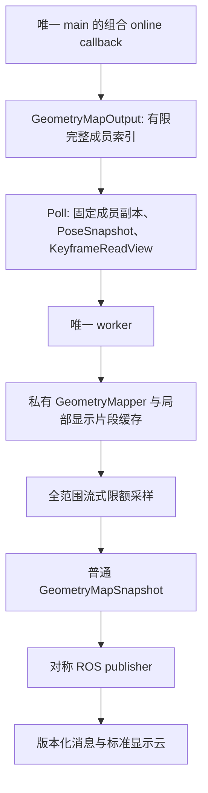

# C3b-02：版本化几何地图显示设计

2026-11-15，基于 `9257f44`。状态：实施、构建矩阵和 bag/RViz 验证完成；整阶段审阅待完成。
本设计最初在编码前编写，并在用户切换模型后执行；实现和使用方式见[几何地图显示说明](../../geometry-map-output.md)。
下述路线和默认值由执行者按此前“按照推荐的来”的委托提出，并非用户逐项确认的要求。

## 目标和范围

提供可追溯到正式位姿版本和在线成员修订的几何显示结果。回环改变组内相对位姿时重建相关块，
整体刚体修正时复用局部几何，前端继续使用原有匹配地图。
沿用普通 C++ 库、对称 Noetic/Humble 发布器和 `src/app/livo_main.cc` 唯一入口。
只修改 livo-atlas；Google C++17、直接成员、无 Pimpl，函数定义间空一行并注释跨线程所有权。
保留 `VIOManager/Frame/Feature/Pose6D/SubSparseMap/VOXEL_LOCATION`。

本阶段交付一个版本化显示消息和一个标准 PointCloud2 话题，复用现有原始观测、成员索引和
`GeometryMapper`。不加入 TSDF、全局面元优化、Gaussian 训练、地图增量传输协议或新的地图权威。
显示采样不改变原始点云、体素几何、回环输入或已有 COLMAP/几何导出。

## 路线与现状

| 路线 | 收益 | 代价 |
| --- | --- | --- |
| 每次后台重建整图 | 实现少、来源清楚 | 小容量几何 LRU 扫描全图时反复淘汰，重复读云 |
| 按子地图增量发布 | 可减少传输 | 需补包、删除、重置、晚加入完整性和跨版本事务协议 |
| 缓存局部显示片段，后台组装完整显示云 | 标准 RViz 可用，局部来源保留，减少重复重建 | 一个有明确限额的紧凑缓存，以及完整云的采样成本 |

采用第三条，不把 `TrajectoryOutput` 扩展为通用任务系统。

现有 `OnlineSubmapUpdate.revisions` 是增量；只有 `poses` 是完整、拥有数据的快照。
后台不能重新打开活的 `OnlineSubmapStore` 来猜测这个增量对应的完整前沿。
`GetGeometrySubmap()` 可能同步读取、重建并设置核心失败状态，不能从新 worker 调用。
现有几何仅融合 primary，support 是邻接引用；不同子地图仍可覆盖同一物理表面。

已有停止数据导出含172帧、13个子地图：版本0/2分别有168485/168502个局部体素。
此前完整导出约1.4秒，包含校验、重建和CSV写入，不是在线时延承诺。
本轮只读盘点及输入 SHA 位于包外 `validation/P6-02c3b2-design-20261115/geometry-inventory.json`。
根据当前 LRU 代码分析，13个已 sealed 子地图、缓存3个时连续完整扫描两遍，
每遍仍需重建13块、读取172帧云；这是模拟，不是新 worker 实测。
运行中 active 块固定驻留时，计数会不同，不能把停止情形直接套用。

默认紧凑缓存300000个局部点可容纳这份停止数据。位置、强度和体素键的字段载荷按56字节计算，
版本2约9.44 MB；这不含结构体填充、容器、分配器和原有完整几何缓存。
100000点 XYZI 的线上数据区是1.6 MB，不包含消息头和来源元数据。

## 数据流与模块



- `mapping/geometry_map_snapshot.h`：普通结果、点、来源、状态和采样选项，不包含 ROS。
- `mapping/geometry_map_builder.h/.cc`：串行几何读取、紧凑缓存和组装；reader 仍为普通云读取函数。
- `core/geometry_map_output.h/.cc`：绑定活系统所有者、完整成员索引、单 worker、统计和停止。
- `ros1/geometry_map_publisher.*`、`ros2/geometry_map_publisher.*`：相同类名和方法。
- `src/ros/geometry_messages.h`：私有共用转换；只抽取确有重复的时间转换，不引入通用发布框架。

普通结果叫 `GeometryMapSnapshot`，ROS 消息叫 `GeometryMap`，避免 ROS1 生成类型与 SDK 同名冲突。
mapping 层的 `GeometryMapOptions` 只含点数、紧凑缓存和消息字节配额；
core 的 `GeometryMapOutputOptions` 组合 enabled、频率、帧数与上述选项，不能反向让 mapping 依赖 core。
构建器接受完整成员、同一 PoseSnapshot 和 CloudReader；不依赖 KeyframeStore、ROS 或活系统。
固定 read view 由 core worker 的 reader 捕获，逐任务更新；worker 不捕获 writer。

## 完整索引、revision 与固定前沿

控制器只允许在新在线会话、首帧前创建：公开 getter 检查 pose/read view 的 M 都是0。
不支持中途附着、恢复 writer 或另开一个可变索引读者。关闭时不做这些检查，不创建线程。
SDK 调用方配置每块不超过64个 primary；ROS 在配置阶段提前检查，SDK 通知中仍严格校验。

所有者在 `Observe(update) noexcept` 中维护有界完整索引：

1. 只处理本次至多两个新建/追加/seal 修订，校验ID连续、首成员为锚点、primary连续覆盖、
   前一块已 sealed、support 为前块后缀；每块最多64帧，sealed 不可再修改。
2. 连续通知中的 primary 必须恰好覆盖 ID 0…M−1；不能只拿当前 delta 构建全图。
   同一正式位姿版本的 N 和已提交旧位姿不能原地改变，v/M/N 不允许回退。
3. 首个空状态、v/M变化，以及 membership_revision/state 变化分配新 revision。
   seal 即使 v/M 和点坐标不变也必须形成新状态；完全相同通知不重复发布。
4. callback 不读文件、不复制完整点云/图像，不调用其他系统 getter。
   完整索引副本仅在符合调度条件的 Poll 中构造；Observe 不是整个 Notify 路径 O(1) 的保证。
5. 超过 max_keyframes 后只保留真实 v/M/N、子地图数量等头部，停止积累完整索引，
   不持有新的超预算 poses；同一实例不因后续通知自动恢复，调整配置需重启。

Poll 先由 main 执行 backend.Poll，再执行 trajectory.Poll，最后 geometry.Poll。
空闲时将完整索引复制到一个任务，连同同次 poses 和固定 read view 一起交给 worker。
view.frame_count 必须 ≥M，任务所有读取均限定 ID<M。
新的 Observe 可继续更新所有者索引，不能改动执行任务内的副本。
待处理状态只有一个，更新时合并到最新；执行槽也只有一个。

## 局部几何与缓存

worker 私有 `GeometryMapper`，采用固定的 GeometryOptions。
不向其传入通知中的 Keyframe，不跨线程持有图像或通知中的完整云。
缺失或变化的块由固定 view 逐帧读 body 云，每次只处理一个块；不重复施加 LiDAR 外参。

紧凑片段只保存局部体素键、double质心、double平均强度、实际 `GeometrySource`、
几何计数及构建版本，不保存协方差、法向、输入云或 GeometryData 的共享指针。
维护独立按点数计额的 LRU：

- primary成员相同，且所有实际构建时的 `submap_from_body` 与当前相对位姿按现有
  `pose_math::Equal` 口径相同，则复用片段；只更新 parent_from_submap 和外部元数据。
- 新增 primary 或任一相对位姿改变，片段失效，调用私有 mapper 重建。
  seal 只改变状态且 primary 相同时可复用；support 不参与融合或局部点采样。
- 不用 `CompareSubmapPoses` 比较不同M的快照；该函数现要求同一前沿。
  直接比较缓存中有限的实际构建来源，复用 mapping 层既有数学函数。
- 缓存不够时淘汰完整片段；某块点数大于缓存配额时直接流式处理、不加入缓存。
  缓存不足本身不是失败，可能增加重建和读盘。对同一固定局部候选集合，采样与遍历顺序无关。
  容差内的新位姿下，缓存命中可保留旧体素化，缓存缺失可能重建新的体素化；
  不保证不同缓存配置始终产生同一候选、计数或点集合，而是按各自构建版本与实际来源验证。
- 本地几何完整缓存继续受 `GeometryOptions.max_resident_submaps` 约束。
  片段命中不调用 GetSubmap；不能因完整几何已被淘汰又无条件重建所有片段。

`representation_revision` 取私有 mapper 的本地修订，与 producer_id 一起解释，
不能与前端 mapper 或另一实例的同号修订互认。
每个块另存 `built_pose_version`：mapper 新增表示修订时记录当时v，数据复用时保持原值。
完整缓存仍有旧数据而片段被淘汰时，按该表示修订原记录的构建版本重新提取，不能冒称新建。
构建版本和实际局部来源用于解释容差内复用；当前根结果仍使用同一v/M下的各锚点变换。
例如相对平移只变化 `5e-10 m`，旧块可命中容差，但重建时边界点可能跨体素，改变候选。
客户端内容身份必须包含 producer/representation_revision，不能仅以v/M/N认定几何内容逐字节相同。

两次相同完整请求在全部片段可容纳时，第二次不应再读取云；新帧只让相关 active 块失效。
缓存机制不承诺所有规模均无重建，验收记录命中、淘汰、完整重建和 cloud_reads。

## 坐标与显示表示

显示候选是每块 `GeometryData.voxels` 的质心与平均强度，不是原始点的重复拼接，
也不把空间分布协方差直接用作 Gaussian 形状。

```text
parent_point = current_parent_from_submap * cached_local_centroid
```

各块使用本次 PoseSnapshot 自己的锚点，不能用一个当前 map_from_odom 修正旧整图。
v=0 沿用现有 GeometryMapper 的近似 raw 矩阵及其相对变换算法，parent=camera_init；
不悄悄投影成 SO(3)，也不借用 C3b-01 已投影的轨迹去重算旧几何。
v>0 要求 projected-tail 正版本，parent=配置的 map_frame。
cached data 构建版本可较旧，但相对来源经校验且当前外部变换正确；不是跨版本全局云混拼。
本阶段不改变既有几何/导出的数学定义。用非正交合成 raw 测试钉住这项区别。

不同子地图的同一物理表面仍可重复出现。本阶段不新增全局体素融合，不声称物理表面去重。
RGB、法向、贡献帧列表和协方差不进入标准显示云；未来训练继续使用原始观测、标定、局部几何和修订关系。

## 采样、消息和内存配额

一次遍历全部候选，不拼接一个无限长的全局临时云，也不用顺序截断只显示前几块。
对键 `(submap_id,kx,ky,kz)` 计算固定优先级，保留最小K个：

```text
h = uint64(14695981039346656037)
依次对 submap_id、uint64(kx)、uint64(ky)、uint64(kz)：
    h = (h XOR word) * uint64(1099511628211)   // uint64 模 2^64
rank = (h, submap_id, kx, ky, kz)              // 碰撞用完整键决定顺序
```

策略名 `geometry_rank_v1`，不是随机采样或均匀空间覆盖保证。
最大堆最多K项，堆项拥有坐标/强度/键，不能引用可能淘汰的片段。
最终按 `(submap_id,kx,ky,kz)` 排序，每块所选点形成连续区间；仅缓存命中顺序不能影响结果。
每块来源记录始终存在，即使它因配额被选中0点。
source_voxel_count 是所有局部候选数量之和，不是全局去重体素数。

定义保守序列化模型 `B=4096+128*S+16*P`，S为块数，P为显示点数。
固定字符串有上限，来源字段全是定长标量；每个来源预留128字节。
`K=min(max_points, floor((max_message_bytes-4096-128*S)/16))`。
非空数据若连1点也容不下，返回 ResourceLimited；M=0允许合法空Ready。
整数减法、乘法和总计全部先检查溢出，不能先无符号相减。
实际候选不超过K时全量输出，否则显式 sampled=true；根消息报告配置配额、有效K和选后计数。
两端实际序列化必须证明该保守模型成立，模型/字段改动时同步更新测试。

标准云固定为小端 FLOAT32 的 x/y/z/intensity，offset=0/4/8/12，point_step=16，height=1。
row_step=16*width，is_dense=true；double值有限且在float可表示范围内才能转换。
使用安全字节拷贝和明确字节序，不能依赖未对齐的 float 指针写入。
PointCloud2 的精度下降属于显示表示，不回写普通几何或原始观测。

配额只覆盖本组件：紧凑缓存点数、堆大小、任务槽及线上消息。
完整GeometryMapper数据/构建候选、一次PCD读取、消息转换副本、DDS缓存都另有内存成本，不能据此承诺总RSS。
mapper会保留上次poses，在切换任务时至多存在旧mapper、新任务、最新待处理三份不同位姿载荷；
不能把“一执行一待处理”写成全过程只保留两份PoseSnapshot。

## 普通结果与双 ROS 协议

`GeometryMapSnapshot` 含 producer_id、revision、pose_version、frame_count(M)、
optimized_frame_count(N)、submap_count、parent_frame、double timestamp、status/error、
representation=`voxel_moments_v1`、fusion_policy=`primary_only`、sampling_policy=`geometry_rank_v1`、
表示参数、预算、effective_max_points、source_voxel_count、sampled、sources和points。
配置及状态码使用普通C++类型。producer/revision与TrajectoryOutput分别编号，不能相互比较大小或冒充持久dataset UUID。

每个来源固定包含：submap_id、anchor_keyframe_id、first_keyframe_id、primary_keyframe_count、
membership_revision、state、representation_revision、built_pose_version、source_voxel_count、
input_point_count、point_offset、point_count。
连续primary区间避免再传一份长ID数组，support从原索引恢复但不融合。
表示参数记录 voxel_size、min_points_per_voxel、max_plane_rms、max_plane_ratio、
max_voxels_per_submap、max_points_per_keyframe；缓存配额不是内容身份。

新增共享 `.msg`：`GeometryMapSource`、`GeometryMapParameters`、`GeometryMap`。
根消息直接包含 sensor_msgs/PointCloud2 cloud 和 sources 数组；程序通过同一消息读取来源与点。
不得把唯一元数据放在另一个不能原子配对的话题，也不用 Header.seq 塞版本。

| 话题 | 类型与作用 | 投递 |
| --- | --- | --- |
| `/geometry_map` | livo_atlas/GeometryMap，带精确版本和来源的显示快照 | Noetic latch/1；Humble reliable/transient_local/1 |
| `/global_map` | 同次 cloud 的标准 PointCloud2，给RViz等工具 | 同上，跨话题不保证原子交付 |

两话题构造完成后由worker发起发布；根和内嵌/标准云Header一致。
Ready timestamp取ID M−1的原始frame.yml时间，只需读取最后一项并可复用同ID缓存。
M=0或非Ready时timestamp/Header.stamp均为0。SDK保留有限double；ROS沿用共同的 `[0,2^31)` 秒范围及纳秒舍入。
同时间新v、seal、暂停/回退非负ROS时钟不阻止新revision，不补造当前TF或global_pose。

Ready=0：已完整遍历全部目标块，来源计数、点区间和采样信息自洽，允许合法空状态。
ResourceLimited=1：已知显示预算无法承载；保留真实v/M/N/S，sources/points/cloud.data为空。
Error=2：读取、索引、几何重建或转换失败；同样清空数组，仅新组件停止继续工作。
source_voxel_count等构建计数仅在Ready有意义，非Ready固定0，不表示原图没有数据。
现有几何输入点数/体素上限异常统一按Error处理，不字符串匹配成ResourceLimited，也不修改旧异常类别。
sink自身失败只记录一次，不向同一个失败sink递归发送错误，不承诺还能清空远端显示。

空云也保留四个合法字段和point_step=16，width=0、row_step=0。
不能直接承诺所有RViz场景清屏：PointCloud2Display会检查XYZ字段，PointCloudCommon还依赖TF、衰减时间和ROS时钟。
默认建议Decay Time=0；真实显示/错误清理列入验收，时钟回退时不得伪造“已清屏”的结论。
这一限制来自核对[Noetic PointCloud2Display](https://github.com/ros-visualization/rviz/blob/noetic-devel/src/rviz/default_plugin/point_cloud2_display.cpp)、
[Noetic替换路径](https://github.com/ros-visualization/rviz/blob/noetic-devel/src/rviz/default_plugin/point_cloud_common.cpp)、
[Humble PointCloud2Display](https://github.com/ros2/rviz/blob/humble/rviz_default_plugins/src/rviz_default_plugins/displays/pointcloud/point_cloud2_display.cpp)
和[Humble替换路径](https://github.com/ros2/rviz/blob/humble/rviz_default_plugins/src/rviz_default_plugins/displays/pointcloud/point_cloud_common.cpp)的源码推断。
后续在两端用已录制点云和空云完成了限定配置下的 GUI 实测，具体条件和截图位置见
[验证报告](../../p6-02c3b2-validation.md)；它不覆盖所有 TF、时钟和衰减配置。

## 配置和启用

沿用一份 GlobalOutputOptions，增加 geometry 选项；普通配置名称如下，均为执行者建议：

| 参数前缀 global_output.geometry. | 默认 | 启用时范围 |
| --- | ---: | --- |
| enabled | false | 要求global_output、关键帧、online子地图 |
| max_frequency_hz | 0.2 | 有限，(0,2]，是上限不是完成期限 |
| max_keyframes | 20000 | [1,100000] |
| max_points | 100000 | [1,1000000] |
| max_cached_points | 300000 | [0,3000000]，0关闭紧凑缓存 |
| max_message_bytes | 8388608 | [4096,67108864] |

启用时map_frame最长256个ASCII字节；其他帧名规则继续使用C3a。
无需 trajectory、GTSAM、回环或前端 `submaps.geometry.enabled` 同时开启。
纯显示仍要求每个primary块≤64，这来自复用现有GeometryMapper的表示约束。

几何表示参数继续使用 `submaps.geometry.*` 一份清单：
当原几何或本显示任一开启时读取并验证数值；两者都关时保持原来的忽略行为。
只开启显示时，`system.geometry.enabled` 仍为false，不创建或激活前端GeometryMapper。
其GeometryOptions的数值显式传给新构建器，独立mapper的驻留配额沿用该组选项。
不得借“复用配置”顺便打开前端几何、回环或历史轨迹。

```yaml
keyframes:
  enabled: true
submaps:
  enabled: true
  mode: online
  max_keyframes: 20
  geometry:
    enabled: false
    voxel_size: 0.2
global_output:
  enabled: true
  map_frame: map
  geometry:
    enabled: true
    max_frequency_hz: 0.2
    max_keyframes: 20000
    max_points: 100000
    max_cached_points: 300000
    max_message_bytes: 8388608
```

参数在启动时校验，创建文件/线程前完成ROS配置检查；关闭时无新publisher/worker/callback。
保留Humble消息生成局部共享的修复，普通SDK仍无ROS依赖。

## 生命周期、故障与落盘

普通 `GeometryMapOutput` 提供 Observe/Poll/Finish/GetStats，consumer在唯一worker上借用结果。
按上次消费者返回的steady clock节流；初始空状态、首次非Ready转换及Finish可绕过正常上限。
执行中的完整结果即使后面已有更新请求仍交付，随后合并到最新；不能持续丢弃导致饥饿。
只有Stop取消，不能因“不是最新请求”中断每一个慢构建。

Stop在与condition_variable相同的mutex下改变条件，解锁后notify/join，复用C3b-01的失唤醒回归口径。
停止标志检查在帧读取、块遍历及采样边界；已有一次文件I/O/几何重建/外部consumer不承诺硬中断。
正常先停节点处理，再backend/system.Finish，再trajectory.Finish，最后geometry.Finish排空最终SDK状态。
析构只取消/join，不访问活系统或新取最终状态；publisher与捕获资产必须活到join之后。
ROS context关闭时跳过转换和发送，SDK delivered仍只表示consumer返回，不代表线上送达。

状态/计数至少覆盖 observed、submitted、coalesced、delivered、resource_limited、failed、
last v/M/N/revision、任务/待处理峰值、片段命中/淘汰/驻留峰值、完整重建、cloud_reads、
候选/所选点数、Observe/Poll/worker时间和延迟。不能把mapper最后一次计时当成整个任务总计时。
错误只令本派生组件失效，不调用FailLoopBackend或设置核心geometry失败；已有后端自身的失败仍保留原行为。
资源终止后在worker释放不再使用的builder/cache，不继续保留完整输入。

不另存在线派生地图数据库，不自动在shutdown写PCD；最终来源仍是原始帧、成员修订和正式pose文件。
已有停止后 `ExportGeometry` 保留。在线最后一条可能未送达，需要最终精确结果时使用原权威离线重建。

## 实施划分和验收

这是一个独立功能阶段，建议分六个任务；本文不代替设计确认后的逐步实施计划。

1. 普通结果、元数据校验与固定优先级采样：三块不同局部坐标、强制K=1/多块、碰撞tie、
   遍历顺序无关、byte配额、非法/溢出坐标、v0非正交与正版本tail。
2. 局部片段缓存：真实云reader计数，两次相同请求零新增读云；刚体变换复用、组内修正重建、
   active追加、seal、LRU淘汰、单块超过缓存、缓存0。固定候选与无缓存采样一致；
   另用容差内跨体素边界的反例，验证不同缓存策略可不同但各自provenance真实且可复算。
3. 所有者/worker：连续delta合并但完整覆盖M，慢reader/consumer仍交付、三份poses峰值、
   超预算释放、错误隔离、Finish幂等、首帧后构造拒绝、2000次idle停止/析构。
4. 双ROS消息与真实安装消费：精确元数据、字段布局、来源区间、空云、晚加入、时间边界、
   共同序列化上界；Humble静态必须从空安装前缀验证generic RMW类型支持。
5. 共同main与配置：组合原有回调、正确生命周期、仅显示不启用前端geometry/GTSAM/trajectory，
   两端工具增加 `--geometry-map`，将版本化记录另存，不改旧semantic/数组。
6. 冻结源码、独立校验和完整矩阵/回放：六SDK、各四ROS；每端完整默认关、显示开回环关、
   显示开回环开，短段覆盖轨迹同开、缓存0、紧配额和错误。两端推荐RViz配置验证正常显示与清空，
   另外记录TF缺失、时钟回退的显示边界，不能把收到空消息等同于GUI已清空。

校验器用正式pose、指定membership_revision、各片段built_pose_version和源几何独立复算，
按固定rank选点、按根v的锚点变换、再float32转换，对照cloud和值域/采样/字节数。
计入容差内复用的实际来源，不能只拿根v做一次全新重建就认定旧片段错误。
从C3b-01冻结源做同平台旧四数组、odom/TF/发布语义、关键帧资产与57个旧产品精确对照。
回放/比较脚本先冻结，失败和修正保留原始记录，不事后放宽旧数据基线。

重点测冷/热扫描、超过完整几何缓存的多块工作集、启用片段缓存前后读云次数、
受持续新帧追赶时的交付、RSS和各阶段耗时；采样成本仍为O(V log K)，新通知的全快照仍随M增长。
135秒Retail_Street只能验证当前数据，不能作为长距离、全进程有界内存或硬实时证明。

设计确认、编码前模型切换通知后，再编写六任务实施计划并进入TDD。

## 独立可实施性检查

fresh builder check 提出一项高优先级问题：容差复用和跨缓存容量的绝对一致要求矛盾。
按既有几何不变、来源明确的目标，执行者选择保留 `pose_math::Equal`，收窄一致性承诺，
补充边界反例、内容身份及独立校验规则；这是技术裁定，不需要替用户另选地图表示。
代价是相同v/M的不同缓存实例可有不同体素化，消费者必须读取表示来源。
原问题记录在包外 `validation/P6-02c3b2-design-20261115/builder-check.md`，未把此次检查当作运行验收。
