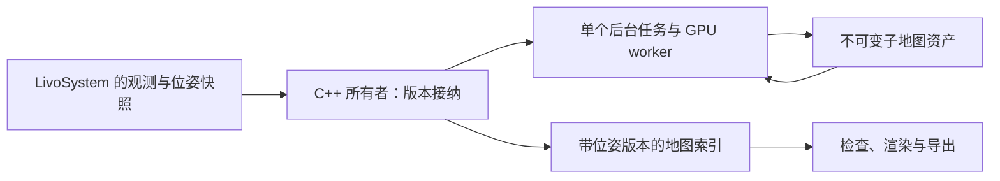

# P6-03c2：Gaussian 子地图保存、恢复与位姿一致性

2026-11-17，基于 `2708aef`。本文继续已完成的
[C1 在线试验](../../p6-03c1-validation.md)，是待实施设计，不是新功能验收记录。
本轮先交付 C2a 的可恢复模型资产，C2b 再接入在线多子地图和闭环修正。
技术选择由执行者根据用户授权提出；正式修改产品代码前通知用户切换模型。

进展：C2a 已完成保存/恢复与真实来源验收，见[记录](../../p6-03c2a-validation.md)。
C2b 的[详细设计](2026-11-17-p6-03c2b-online-gaussian-submaps-design.md)和
[实施计划](../plans/2026-11-17-p6-03c2b-online-gaussian-submaps.md)已写出并完成独立
可实施性检查；C2b 已实现并完成阶段验收，见[阶段记录](../../p6-03c2b-validation.md)。下文 C2a 的“本轮”保留原阶段语境。

## 目标与实施范围

用户需要同一套工程支持几何 SLAM 和在线 3DGS 研究。已有 PNG 预览只能观察训练结果，
不能恢复高斯、检查来源或在闭环后重新训练。下一步先使一个已接纳模型可独立保存、检查、
重载和继续训练，再把这种资产作为在线子地图的存储单元。

| 阶段 | 交付 | 验收重点 |
| --- | --- | --- |
| C2a，本次实施计划 | 与运行时分离的资产格式、CPU 读写、GPU 模型捕获/恢复、离线检查和往返工具 | 数组与来源无损；重载渲染一致；候选未接纳时禁止捕获；恢复后能继续训练 |
| C2b，后续另写执行计划 | 在线历史子地图索引、有限 GPU 驻留、切换保存/加载、版本修正与过期提交处理 | 整体修正复用局部内容，组内变化重建，异步目录不伪装成最新地图 |
| 后续研究 | 增量覆盖、跨块可见性、去重、densification、外观优化及可选估计反馈 | 更多真实数据上的质量、资源与定位收益 |

C2a 不改变 ROS 节点、C1 socket 协议或前端调度，不放宽 512 帧前沿限制，不增加默认依赖。
存档保留 C1 的最多 10 个视图和 10,000 个高斯；它是训练工作集的快照，不能称为完整覆盖
一个子地图的稠密重建。多子地图保存也不等于在线恢复整个前端或自动重连 worker。

只修改 `livo-atlas` 包。继续使用普通 C++ 核心与共用 `src/app/livo_main.cc`，ROS1 Noetic /
ROS2 Humble 外围接入保持现有边界。新增或实质修改的 C++ 遵循 Google C++17 风格，
函数实现间空一行，适当说明坐标与生命周期；不用 Pimpl、通用插件或新的后台服务。

## 当前实现对设计的约束

- `OnlineGaussianModel` 在原地训练候选；`decide(False)` 清空模型，`decide(True)` 才结束
  待确认状态。`parameters` 保存均值、固定四元数、对数尺度、颜色 logit 和透明度 logit；
  `origin_ids` 是来源关键帧 ID。仅保存点的位置或最后一张 RGB 无法恢复这些参数。
- 新视图到来时 `_append()` 重建 Adam；第 11 个视图淘汰最旧视图和其来源高斯。留下的
  高斯曾受更早视图优化影响，因此仅比较当前 `origin_ids` 不足以证明整块未发生组内变化。
- `MakeReconstructionView` 在固定 body 系投影图像和深度，位姿修正不改变其像素与深度。
  `CameraPose` 使用原始 body/camera 相对关系推导新相机位姿。单视图内参采用 OpenCV
  整数像素中心；gsplat 的 0.5 主点转换只发生在渲染入口。
- `KeyframeReadView` 尚不提供完整图像读取。C2a 资产保留已准备的训练观测，不为保存模型
  扩大核心读接口；这些观测是可再生成的派生缓存，原始关键帧仍是观测权威。
- 现有离线 bundle 只有相机位姿。需给准备工具的每个视图增加可选 `parent_from_body`，
  使新工具能按实际首个 body 锚点转入局部系；旧 bundle 和原离线训练仍可使用。

## 方案选择及参考

| 方案 | 好处 | 代价与选择 |
| --- | --- | --- |
| 直接保存 Python 对象和 Adam 的 PyTorch checkpoint | 接近当前内存结构 | 耦合框架、类和优化器状态，格式不能作为长期地图契约；本轮不采用 |
| JSON 清单 + 无压缩 NPZ 数值数组 | 不保存 Python 对象，CPU 可检查，显式记录 dtype、坐标和来源 | 需要维护自己的小型 schema 和上限；推荐方案 |
| 只保存 PLY 或图片 | 查看方便 | 无法恢复训练观测、参数化和来源；可作为以后导出，不能替代资产 |

NumPy 1.26 的 [`savez`](https://numpy.org/doc/1.26/reference/generated/numpy.savez.html)
将命名数组存成无压缩 ZIP/NPY；读取显式使用
[`allow_pickle=False`](https://numpy.org/doc/1.26/reference/generated/numpy.load.html)，
并在数组分配前核对 NPY 头、形状和字节数。这里使用本机已验证的 NumPy 1.26.4、
Python 3.10、PyTorch 2.3.0+cu121、gsplat 1.5.3，不因本次设计升级环境。

[LoopSplat](https://github.com/GradientSpaces/LoopSplat/blob/main/src/entities/gaussian_slam.py)
把子地图 checkpoint 与位姿修正分开组织；
[Splat-SLAM](https://github.com/google-research/Splat-SLAM/blob/main/src/mapper.py)
对位姿改变处理高斯与相机关联。这些提供设计参考，不代表本工程复现了其闭环或画质。
本工程先采用整块刚性修正复用、组内变化重建；来源标签不被当成精确形变的证明。

## C2a 资产格式：`livo_atlas.gaussian_state` schema 1

每个资产是独立目录，提交后按约定只读：

```text
state/
  manifest.json          # 身份、坐标、来源、参数化与文件摘要；最后提交
  gaussians.npz          # 固定名称的 6 个数值数组
  observations.npz       # 最多 10 个保留视图的 RGB、掩码、深度
```

清单包含：

- `schema: 1`、`kind: "livo_atlas.gaussian_state"`、
  `representation: "gsplat-sh0-window-v1"`、`optimizer: "reset_on_restore"`。
- `capture_kind` 为 `offline_probe` 或 `online_confirmed`。C2a 工具只产生前者；
  `decide(True)` 本身不证明运行中已得到 C++ 所有者接纳，在线类型留给 C2b 协调器。
- `origin_session_id` 为 32 个小写十六进制字符；`submap_id`、`anchor_keyframe_id`、
  `membership_revision`、`generation`、`pose_version`、`frame_count`、
  `optimized_frame_count` 均为规范 uint64 十进制字符串。
  `parent_frame` 在版本 0 时为 `odom`，正版本为 `map`；优化前沿不能超过帧前沿。
- 完整主成员 `primary`：按 ID 连续递增的 `{keyframe_id, submap_from_body}`，
  长度 1–512、首成员为锚点且其局部变换为单位阵；全部 ID 在保存前沿内。
  `submap_state` 为 `active` 或 `sealed`，成员修订分别为主成员数或主成员数加 1。
  支持帧不重复初始化。离线工具的分组明确是 probe 分组，不冒充数据集在线成员索引。
- `parent_from_submap` 为锚点 body 到父系的 SE(3)。保留视图 ID 是主成员的有序子集，
  不要求连续。每个视图记录内参、宽高、三个采样时间、逆曝光、标定 ID 0、
  `camera_from_body` 和 `camera_from_submap`，两者与所属主成员的局部 body 位姿一致。
- `gaussian_count`、数组规格、文件字节数与 SHA-256；离线来源另外记录实际核验的
  `source_manifest_sha256` 和 `bundle_manifest_sha256`。这两个摘要分别标识来源文件清单
  与 bundle 清单，不宣称检查过不在清单中的整个原始数据集。
- 软件版本只供追溯，不写绝对路径作为恢复依赖。未知 schema、参数化或 optimizer 策略
  明确拒绝；跨 GPU/软件版本的数值一致性以实际验证为准。

schema 1 的根字段和视图字段使用确切允许列表，未知字段拒绝；可选的来源摘要缺省时
不填占位哈希。`source_manifest_sha256` 由 bundle 传递，来源文件本身的实际核验由准备与
验收命令负责；新工具重算 `bundle_manifest_sha256`，不把前者说成自行核验过原始数据。

编码细节固定如下，避免读写端各自发明字段：

- 根字段恰为以上身份/格式字段、`submap_state`、`primary`、`parent_from_submap`、`views`、
  `gaussian_count`、`software`、`files`，以及两个可选的 `*_manifest_sha256`。
  `software` 恰含 `python/numpy/torch/gsplat/cuda` 五个非空字符串，每项最多 128 字符。
  格式、姿态、数组中不得出现 NaN/Infinity 或重复 JSON 键。
- `files` 恰含 `gaussians.npz` 和 `observations.npz`，各值恰为
  `{"bytes": 正整数, "sha256": "64 个小写十六进制字符"}`。
  `gaussian_count` 是 1–10,000 的 JSON 整数。数组 dtype/shape 由 schema 的固定表和
  此计数、视图宽高推导，不再接受另一份可自由修改的数组布局声明。
- `views` 按 ID 升序排列，每项恰含 `keyframe_id/calibration_id`（十进制字符串）、
  `width/height`（正整数）、`fx/fy/cx/cy`、三个时间、`inverse_exposure_time`、
  `camera_from_body/camera_from_submap`。第 j 项对应 NPZ 的
  `v{j}_rgb/v{j}_image_mask/v{j}_depth_mask/v{j}_depth_m`。
  焦距和逆曝光为正；K 固定为 `[[fx,0,cx],[0,fy,cy],[0,0,1]]`。
- 内存 `GaussianState.metadata` 不含 `files/views/gaussian_count`，其余根字段保留；
  views 的数组和元数据在内存视图列表中。writer 生成这三个字段，reader 拆回同一结构。
  捕获 context 是 metadata 去掉 `schema/kind/representation/optimizer/software` 后的字段，
  再加仅用于捕获校验的 `source_cameras`。这些格式常量及软件版本由捕获代码生成，调用方
  不得覆盖；`source_cameras` 不作为额外根字段写入清单。

### 捕获 context 与视图 header 的责任

context 来自掌握已提交成员和位姿的调用方；它保证 `primary` 包含本子地图的完整主成员。
捕获器检查连续性、修订、锚点、前沿、来源包含关系，无法从已淘汰的 tensor 反推历史完整性，
也不声称能鉴别调用方伪造但自洽的数据。C2a CLI 使用整个 bundle 所选成员作为显式 probe
分组，C2b 必须从正式成员索引生成 context，不能用当前窗口反向拼凑。

`source_cameras` 是保留视图的独立 `{keyframe_id, camera_from_body}` 列表，ID 必须与
模型保留视图恰好相同。离线工具在修改相机坐标前由原始 bundle 的
`T_C_parent * T_parent_B` 计算；C2b 则由原始 Keyframe 的
`camera_from_odom * odom_from_body` 提供。捕获器核对实际用于训练的 `T_C_S` 与该独立
关系及 context 的 `T_S_B`，不能先从待校验的两者推出 `T_C_B` 再作恒成立的检查。

| 视图/header 字段 | 与捕获 context 的关系 |
| --- | --- |
| `session_id`、`submap_id`、`generation`、`pose_version`、`parent_frame` | session_id 对应 origin_session_id，其余对应同名捕获身份；模型 generation 也必须相同 |
| `keyframe_id`、`calibration_id` | 属于 primary/独立 source_cameras，标定 ID 为 0 |
| `frame_count` | 允许早于捕获前沿，但覆盖该视图 ID 且不超过 context.frame_count |
| `optimized_frame_count` | 同一位姿版本保持优化前缀不变，须等于 context 值，且不超过该视图的 frame_count |
| `membership_revision` | 允许旧修订，但为正且不超过捕获修订；不能用它覆盖 context 的完整成员 |
| `parent_from_submap` | 与同版本捕获锚点变换相同，绝对差容限 `1e-8` |
| `camera_from_parent`（模型使用的局部值）及存在的 `camera_from_submap` | 二者一致，并通过独立 camera/body 等式；不能静默用 context 覆盖冲突 |

离线工具补齐上述 C1 风格 header：ID 和前沿按现有 decoder 的字段类型规范化，generation
和 submap 等使用十进制字符串，帧/标定 ID 在内存中为整数。格式中的视图只保存采样时间、
实际图像/相机关系和来源；不保存当时到达 header 的旧前沿。恢复时把 header 前沿和成员
修订规范化到捕获 context，这不改变训练数组，也不将其称为原始到达日志。

变换都是行优先 4×4 数组，`T_A_B` 把 B 系变到 A 系。清单检查有限值、SE(3)、ID 和
`T_C_S = T_C_B * inverse(T_S_B)`；刚体误差容限为旋转正交/行列式 `1e-6`、
末行 `1e-9`、变换重算逐元素绝对差 `1e-8`。只有标定 ID 0，不推断其他标定。

`gaussians.npz` 固定字段如下，均为 C 连续、小端，禁止 object/结构化 dtype：

| 数组 | dtype / shape | 含义与校验 |
| --- | --- | --- |
| `means` | `<f4 [N,3]` | S 系米制均值，有限 |
| `quats` | `<f4 [N,4]` | wxyz，单位范数误差 ≤`1e-5`，按当前模型保持不可训练 |
| `log_scales` | `<f4 [N,3]` | 沿用 log 参数，范围 `[log(.001), log(.2)]`，浮点容差 `1e-6` |
| `color_logits` | `<f4 [N,3]` | RGB 的 SH0 外观参数，有限 |
| `opacity_logits` | `<f4 [N]` | 透明度 logit，有限 |
| `origin_ids` | `<u8 [N]` | 主成员且属于保留视图，每个来源 1–1,000 个 |

`N` 为 1–10,000。恢复直接使用保存的 log/logit，不再次 log、logit、exp 或 sigmoid。
每个 `observations.npz` 视图用 `v0_` 至 `v9_` 前缀、固定后缀：
`rgb: <f4[H,W,3]`、`image_mask: |u1[H,W]`、`depth_mask: |u1[H,W]`、
`depth_m: <f4[H,W]`。RGB 保存 float32 原值，避免重新量化；掩码只允许 0/1，深度掩码
必须为图像掩码子集，有效深度有限且为正、其余为 0。每个来源应有有效初始化深度。
内存视图恢复为现有 `rgb`、bool 掩码、`depth_m`、`K` 和局部 `camera_from_parent` 结构；
最后一个名称是现有训练器字段，其实际父系为 S，不能当全局地图位姿再次变换。

## 资源、写入与读取

固定初始上限：单视图 1,000,000 像素，10 个视图合计 10,000,000 像素；
`gaussians.npz` ≤1 MiB、`observations.npz` ≤192 MiB、清单 ≤512 KiB，
单个 NPY 头 ≤4 KiB。观察数组未压缩 payload 至多 180,000,000 字节。
这些是资产/数组上限，不是 Python、ZIP 缓冲或驱动的整个进程 RSS 上限。

读取先检查普通文件、确切文件名、大小与摘要，再检查 ZIP 中的确切成员名/数量和 NPY
头。只接受 ZIP_STORED、非加密、C 顺序及 NPY 1.0/2.0；拒绝重名成员、路径成员、未知数组、
object dtype、压缩归档、巨大形状、实际长度不符和符号链接。先算受限 shape × itemsize，
再分配数组，之后检查有限值、掩码和 ID。读写均逐块计算摘要，不先把整个文件读入 bytes。
ZIP 中央目录须先检查条目数与预期一致、大小不超过 64 KiB、无注释，再交给 ZIP 解析器，
防止文件总大小合法但条目元数据分配失控。
`allow_pickle=False` 用于读取；NumPy 1.26 的 `savez` 没有这个命名参数，writer 必须先
验证所有数组为规定的数值类型，不能误将该参数写成一个额外数组。

writer 只向此前不存在的目录写入；有文件输入的 CLI 另外检查输入与输出互不包含。
先通过独占 `mkdir` 取得目标目录，
不覆盖既有目录或符号链接。写入顺序为两个数组文件、完成并关闭、文件同步、清单临时文件、
清单同步、同目录重命名为 `manifest.json`，最后同步资产目录及其父目录。
清单重命名是**可见性提交点**：此前任一失败返回普通错误且没有最终清单；失败目录保留
供诊断。重命名成功后若目录同步失败，抛 `CommitUncertainError(OSError)`，保留已经可见
且结构完整的资产，不回滚、不删除、不自动重试覆盖；CLI 非零退出并报告 `commit_uncertain`。
读者只根据清单/内容判断资产当前可读，不能从读成功反推写入时已确认断电持久性。
此原子可见性按当前 Linux 本机文件系统设计，不承诺所有远程文件系统或断电硬件的持久性。

CPU 检查与读写模块仅依赖 Python 标准库和 NumPy，导入时不加载 torch/CUDA/ROS。
GPU 捕获/恢复继续要求预编译 gsplat、至少 4 GiB 空闲显存、40% PyTorch 分配限制；
没有 GPU 时 CPU 检查可成功，GPU 恢复明确失败，不能回退成假 GPU 验证。

## C2a 模型语义与工具

`GaussianState` 是普通 Python dataclass，包含清单数据、参数数组、origin IDs 和视图列表。
读出的数组拥有数据，不引用文件或模型的借用缓冲。`capture_state` 也生成独立 CPU 数组，
后续训练、reset 或模型析构不能改变已捕获状态。

`OnlineGaussianModel.capture_state(context)` 只接受非空且 `candidate_pending == False`
的模型。context 提供上述身份、完整主成员 body 位姿、独立 source_cameras 与来源摘要；
视图和 origin 按上表交叉校验。空模型、未确认候选、可检测的覆盖冲突或不一致的
camera/body 变换都失败，不产生可提交资产。

`OnlineGaussianModel.from_state(state, device)` 先做完整 CPU 验证，再建立新 GPU 模型。
保持参数、来源顺序、视图顺序和 generation 的保存值；`candidate_pending` 为 false，
`optimizer` 初始为 None。下一帧 `_append()` 按现有规则建立新的 Adam，不恢复动量，
也不保证逐步训练轨迹完全相同。保存的 generation 是历史身份，不能直接授权新的在线会话。
原运行实例不被载入操作修改。

`state_tool.py inspect --state DIR` 只用 CPU，返回 schema、来源、覆盖与预算检查摘要。
`state_tool.py roundtrip --bundle DIR --output NEW_DIR --anchor-id ID --submap-id ID`
使用 2–10 个训练视图：先用除末帧外的训练帧训练并确认，捕获、写入、释放模型，再恢复和
渲染，最后用末帧验证继续训练。锚点为 bundle 所选连续主成员的首个 body；留出帧可以提供
主成员元数据及评估，但不参与初始化、优化或 Adam。工具产生 `capture_kind: offline_probe`。
往返 probe 另外限制为最多 2 个留出视图、共 12 个输入视图，先在小型清单中检查数量和
单视图像素预算，再调用现有 eager bundle reader。此限制不改变资产中完整主成员的上限。

新 bundle 必须包含所选每帧的 `parent_from_body`，旧 bundle 可继续供原离线训练器使用，
但新往返工具明确要求重新准备，不能猜测 body 锚点。转换为局部训练输入：

```text
T_parent_S = T_parent_B_anchor
T_S_B_i = inverse(T_parent_S) * T_parent_B_i
T_C_i_B_i = T_C_i_parent * T_parent_B_i
T_C_i_S = T_C_i_parent * T_parent_S
```

只改变相机位姿表达，不改 RGB、深度、内参或曝光；不重复应用 LiDAR 外参和主点偏移。
CLI 的报告和渲染放在输出根目录，三文件资产放在 `output/state/`，不得混入资产目录。

## C2b 在线设计方向

以下用于约束 C2a 的资产兼容性，不授权直接实现全部在线调度；编码前另写详细协议和计划。



- **权威与驻留。** 原始数据和 `PoseSnapshot` 仍由现有系统管理。GPU 同时只驻留一个训练
  工作集；CPU 只保留有界目录/修订，历史参数和训练视图冷存盘，避免把所有高斯搬上 GPU。
  初始总地图预算及磁盘回收由 C2b 实测后确定；C2a 不宣称已有无界长期地图能力。
- **版本比较。** 对资产保存的完整主成员局部 body 位姿，与最新绝对快照逐项比较；
  不能仅转发最近一次增量 `pose_changes`，也不能只检查当前来源高斯或锚点。
  若所有既有局部位姿不变，只更新 `T_parent_S` 和目录位姿版本，参数与观察数组不改。
  同一版本新增前沿不使旧块无效；新增观测另行初始化。
- **组内变化。** 立即令相关块在当前视图中不可用，从保留观察和新的 camera/body 相对
  关系重建；重新生成模型与 Adam，不叠加全局和局部修正。支持的只是保存工作集的重建，
  如需完整历史覆盖，需另外从原始观测选帧，不能假装窗口包含全部历史。
- **提交。** 待确认候选不落正式资产；接纳确认后才可准备资产。写盘时又有位姿更新，
  完成的旧版本最多保留为历史，不能发布为当前地图。内存接纳、不可变文件和异步索引
  三者有明确身份；新会话加载历史资产必须重新绑定目标版本，不能复用旧 session/job。
- **积压与切换。** 新观测仍单 pending、单 in-flight；修正状态合并为最新绝对目标。
  尚未训练的中间子地图显式记为无资产；已接纳的历史块必须先取得可恢复资产再释放。
  修正与前台训练需有明确公平策略，不能让历史修正无限饿死，也不能使前端等待 GPU。
- **恢复含义。** 明确区分重新渲染资产、恢复 Gaussian 优化、恢复整套 SLAM session。
  C2a 仅验证前两者；前端/后端继续建图、消息重放和自动重连不从模型文件隐式推导。

## C2a 验收与证据边界

1. CPU 格式往返、上限、未知字段、坏摘要、坏 NPY 头、压缩/重复 ZIP 成员、目录覆盖、
   symlink、部分文件和写入/关闭错误。长度/格式错误在对应大数组分配前拒绝，内容错误在
   受限 CPU 读取后、GPU 分配前拒绝；单独验证提交后目录同步失败的可见/不确定状态。
2. 实际 CUDA 验证捕获不借用、候选确认边界、保存/恢复后的参数与数组逐位一致、未重复
   参数化。保存前与恢复后浮点 RGB/alpha 逐元素绝对差 ≤`1e-6`，相机 z 深度
   `atol=1e-5 m, rtol=1e-6`；RGB8 最大差 1。若失败先排查，不放宽门限掩盖问题。
3. 恢复后新帧仍按 20 步训练、窗口淘汰和 origin 上限执行；观察有限非零梯度和参数更新。
   不把“能继续训练”说成 Adam 逐步无损恢复。
4. 复用官方 bag 已保存的原始关键帧，重新准备带 body 位姿的独立 bundle，选取已知
   ID 0–11、训练 `0,1,2,4,5,6,8,9,10,11`、留出 `3,7`，在包外新目录做实际 GPU 往返。
   前后核对来源文件清单 SHA-256；若所选帧不属于单个在线分组，报告明确为 probe 分组。
5. C2a 不修改运行节点，无需仅为这一步重复完整 ROS bag 回放；运行受影响的 C++ 准备工具
   测试、现有及新增 Python/GPU 回归与一次独立代码审阅。C2b 才重新验收在线双 ROS 和
   同平台成对 bag，并单独报告 Humble 的真实 GPU 覆盖。

本阶段新增设计与计划必须能随仓库迁移；资产、环境和验证输出仍在包外，需要另行复制或
生成。约 135 秒 Retail_Street 和人工修正均不足以证明长期地图、真实长距离回环或画质。

## 本轮作出的取舍

- 先把保存/恢复作为独立可检验交付，再接在线多块；代价是本阶段还没有多块在线调度。
- 保存浮点观测和完整主成员局部位姿，避免颜色量化和错误刚性判断；代价是磁盘资产大于
  只保存模型参数，C2b 必须另外限制总磁盘与驻留量。
- 重置 Adam、组内变化重建；代价是恢复后需要重新优化，并且不能承诺训练轨迹或画质不变。
- NPZ 与清单单独版本化，不复用 C1 内部传输格式；代价是维护格式检查和明确的读取上限。
- 使用现有官方数据资产验证恢复，不要求新的长 bag；代价是结论仍限于当前数据和硬件。

## 独立设计检查

一次只读 builder check 指出相机/body 校验可能恒成立、context 与旧视图前沿的责任不清、
提交后的目录同步失败与“失败无清单”矛盾。本文已分别采用独立 source_cameras、明确字段
匹配表与可信完整成员责任、可见性提交点及 CommitUncertainError；对应负例列入实施计划。
这些是实现契约裁决，没有改变用户的 SLAM/3DGS 目标；本轮尚未实施或运行新功能测试。
