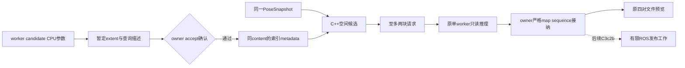

# P6-03c3c2：空间候选选块与 ROS 预览推进设计

2026-11-18，基于 `c4e28c6`（产品代码 `b6c3b4f`）。
状态：C3c1a/C3c2a已实施并完成审阅必要修复及实际验收；C3c2b双ROS显示待单独推进。

用户已确定先最终快照联合渲染、再接在线，要求核心独立于ROS、两端共用main、
Google C++17、无Pimpl、适当注释、函数之间空行，以及简洁的实现。
本稿沿C3c1已经记录的C3c2方向细化。阶段顺序、空间近似和默认值是执行者建议，
不记作用户已经逐项确认的新需求；可实施性检查已完成，现交付审阅。

## 1. 目标与推进顺序

当前C3c1已经证明同一worker可以只读联合最多两块，并严格拒绝过期结果。
但第二块固定为前一逻辑组，不能利用回环附近较早的空间邻块；当前也没有Gaussian ROS图像发布器。
本阶段把“选哪一块”和“如何显示一份有版本的结果”分别完成。

推荐顺序：

1. **C3c1a：可靠性收尾。** 关闭上轮5项Minor，建立后续发布所需的状态和来源核对基础。
2. **C3c2a：空间候选。** 缓存已确认Gaussian的轻量范围和查询相机，核心选择owner及最多一个空间候选。
3. **C3c2b：双ROS显示。** 复用已接纳的只读结果，增加图像与有版本的失效状态；另行细化消息和实施计划。

本稿完整定义前两步的行为与验收，第三步只固定架构边界，避免提前扩展ROS接口。
它们均不加入增密、跨块联合训练、新相机视点、第二个GPU模型或定位反馈。
图像质量改善需要后续训练研究，不将空间候选等同于高质量3DGS SLAM。

## 2. 当前代码和数据依据

- `GaussianMapIndex`持有来源身份、绑定、保留帧与资产引用，没有Gaussian空间范围或完整查询相机。
- `GaussianRenderRequest`由owner捕获，worker从确认状态取得相机；当前协议只允许owner及其前一组。
- `GaussianPreview`和`GaussianRender`已经是C++类型；后续ROS自定义消息必须避开同名，防止ROS1命名空间冲突。
- 轨迹和几何发布已有“普通C++快照、有限后台任务、薄ROS1/ROS2转换”的实现，可复用其组织方式。
- 保留的最终ON资产经过只读盘点：13块、116000个Gaussian、116个来源帧组，每块4到10组。
  最大scale约0.04517米。盘点只读小型参数NPZ和manifest，没有加载RGB/depth观测或使用GPU。

盘点证据：工作空间 `validation/P6-03c3c2-design-20261118/gaussian_extent_census.json`。
这仅证明元数据可提取，不是空间选块、性能或图像质量的验收。
旧C3c1证据与2695个保留文件保持原内容。

## 3. 路线比较

| 路线 | 得到什么 | 代价 |
| --- | --- | --- |
| 确认时提取轻量范围，C++核心选择（推荐） | 选块不读文件，不依赖ROS/GPU；与同一map/poses捕获 | 需扩展可选能力和确认元数据；范围只作候选近似 |
| worker每次扫描全部资产后选择 | 可直接检查每个Gaussian的投影 | 串行训练通道新增全图读取/投影，资源和延迟更难控制 |
| 仅按锚点距离选择 | 可直接复用现有位姿 | 相机轨迹不是内容范围，不能称作空间可见性 |

建议采用第一条。轻量范围按现有 `origin_ids` 分组，每块最多10个范围，不另建八叉树、
BVH或体素索引，也不把前端匹配地图当作Gaussian优化后内容的精确范围。
这里只构造视野候选；遮挡和实际像素贡献仍由联合光栅化及既有single/joint对照确定。

## 4. 先关闭现有5项Minor

| 项目 | 本次处理与边界 |
| --- | --- |
| 终端统计/持有对象 | 明确失败或join完成后清零render当前在途/待存储，释放待存储对象；保留峰值及累计计数。开始Finish时仍在运行的任务不提前记为结束 |
| 等待原因 | 暴露有界原因代码和对应map sequence；按状态变化去重，区分未确认、查询不可用、同步未完成和正常间隔等待，避免每次Poll刷日志 |
| DTO/指标/旋转校验 | 对render请求、wire与writer采用一致的语义检查；补齐单块原因、代数、perfect/empty/PSNR关系；render边界采用1e-6 SO3容差，不改变通用前端标定容差 |
| 文件独立来源核对 | owner日志额外保存有大小限制的完整请求header身份，使用安全单行编码；检查器与文件as_of逐字段比较，并验证原type和真实PNG格式。复用现有编码器，不引入通用序列化/加密框架 |
| 公共写者并发前提 | 采用最小方案：公开头和SDK文档明确每个输出目录由一个串行发布者管理。内置单I/O线程满足此约束；不新增跨进程锁或并发保留系统 |

增强来源核对只为新运行提供增强证据，不向旧归档补造接纳记录，也不改写旧阶段结论。
前四项代码行为用失败复现再修复；第五项是明确调用约束，不写验证注释字面的测试。
这一步不改变训练、查询相机和选块规则，单独提交、验证后再接空间策略。

## 5. 轻量空间元数据

拟增加普通C++值类型，保持成员可直接阅读，不使用Pimpl：

- `GaussianExtent`：`origin_keyframe_id`、三维means最小/最大值、`max_scale`。
- `GaussianCamera`：查询keyframe/calibration ID、width/height、原始K、`camera_from_body`和采集时间。
- `GaussianRenderMetadata`：精确`GaussianContentId`、最多10个extent、最新保留帧的相机描述。

extent来自真实优化参数：对每个origin分组计算means的AABB，scale来自`exp(log_scales)`。
不是对拍摄位姿、初始化点或原始匹配voxel map取范围。使用scale上界，可以避免只看Gaussian中心。
空组不生成extent；组ID严格对应确认的保留帧，每个Gaussian都有且只有一个来源组。

### 5.1 生命周期

1. worker已经持有candidate的CPU参数副本，在此提取metadata，不增加GPU模型或完整参数副本。
2. candidate只携带暂定metadata；owner决定accept前不得进入当前索引。
3. accept确认后，参数内容和metadata一起进入owner索引；拒绝、空激活和失败不能留下候选metadata。
4. rigid reuse保持同一content的局部范围；使用新的binding变换到当前parent。
5. 非刚性primary变化继续标记needs_rebuild，重建成功后随新content重新计算metadata。
6. checkpoint不改变metadata所属content；资产内存描述可带对应metadata，prune一起释放。
   最多32个已确认Gaussian内容组及现有受限的checkpoint过渡，不能形成无界旁路缓存。
   未训练分组的占位沿用现有512主帧/分组声明上限，不保存额外空间metadata。

查询仍取所有确认内容中的最新retained帧。查询owner或其metadata不可用时等待，不能退回旧相机。
根generation仍为会话fence，块绑定generation独立；保留C3c1丢弃激活后恢复旧绑定的合法场景。

### 5.2 格式和接口兼容

- 新能力暂名 `joint_render_spatial_v1`，只在显式选择空间策略时与`joint_render_v1`一起协商。
- 旧策略和关闭模式的hello、确认与render布局保持原样；旧worker不支持新能力时明确失败，不降回时间策略。
- metadata作为新能力下的确认扩展，严格检查身份、预算、有限值及query覆盖。
- 只扩展内存索引和可选协议；现有Gaussian asset schema、map schema保持原样，不批量重写旧资产。
  当前产品不支持完整会话恢复，不能据此声称重启后自动恢复这份内存metadata。
- 新公开结构成员追加到末尾，新增参数采用兼容的重载/默认值；继续编译旧聚合初始化消费者。

## 6. 核心空间候选规则

建议参数 `gaussian.joint_render_policy`：默认 `temporal`，显式 `spatial` 开启本策略。
两端使用同一ParameterReader；有效枚举提前校验，开启空间策略仍要求Gaussian、持久化及联合渲染。

### 6.1 同一坐标与相机

设`P_Bq`是捕获的查询body位姿，`C_B`来自该retained查询，`P_S`为候选当前绑定：

```text
C_S = C_B * inverse(P_Bq) * P_S
```

全程先用float64。原始K与渲染使用的K区分保存；仅在投影约定转换时给cx/cy加0.5一次。
不能使用节点当前视频帧、统一全局相机配置或旧训练capture的parent位姿替代查询描述。

### 6.2 带scale的投影外包络

直接把3-sigma三维盒与普通视锥相交，不能保证覆盖当前gsplat的屏幕空间足迹。
因此分别包围Gaussian中心投影和其二维半径，再取保守外包络。

对每个origin extent：

1. 将局部means AABB的8个角变换到查询相机，取得camera轴对齐包围盒。
2. 向外加入float32数值余量。初始约束为
   `64*epsilon_float32*(1 + means绝对值上界 + 查询/块parent平移绝对值上界 + C_B平移绝对值上界)`。
   scale上界再放宽相对1e-4。目的覆盖两侧实现/float32转换误差，不压缩原始范围。
3. 与当前renderer的中心深度区间 `[0.01, 1e10]` 求交；空交集可以排除。
   跨near plane时先裁剪中心盒的z区间，再投影新盒的8个角，不能直接丢掉负深度角。
4. 依据gsplat1.5.3的clamped projection Jacobian，为二维半径取上界。以横向为例：

```text
cx_eff = cx + 0.5
Lx = max(abs((width-cx_eff)/fx + 0.15*width/fx),
         abs(cx_eff/fx + 0.15*width/fx))
Ru = ceil(3.33 * sqrt(sigma_bound^2 * (fx/z_min)^2 * (1+Lx^2) + 0.3)) + 2
```

纵向替换fy、cy、height。sigma为该origin的最大轴scale上界；旋转后的最大协方差特征值
受此上界约束。3.33是当前kernel的最大延伸系数，0.3对应默认eps2d；opacity只会减小半径。
5. 投影中心盒扩张Ru/Rv，向外取整并裁到图像范围。最多10个整数矩形求并集，得到
   `candidate_pixels`，上限为图像像素数。使用最多20个x端点的简单扫描，不建通用空间索引。
6. 任何合法输入下的溢出/条件不稳均标记`projection_uncertain`，以整幅图的候选上界保留，
   不能把“算不出来”当作不可见。畸形metadata则按协议错误处理。

以上外包络的保守性需要CPU与真实GPU对照门槛，不能只凭公式宣布无漏选。
它不是可见像素数量、遮挡结论或图像质量评价。若换renderer模型/参数，必须重新验证该包络。

### 6.3 选择与返回

- owner永远包含，仍使用原single基准；其它来源须通过既有current/asset/完整canonical检查。
- 只从`candidate_pixels>0`的其它块取一个，排序：像素并集面积降序、相机到局部means盒的最短距离升序、submap ID升序。
- 面积为整数，不按浮点近似相等临时改变tie-break。
- 没有其它候选时明确单块，`neighbor_reason`在空间策略下使用`no_spatial_candidate`。
  该字段继续表示未选第二块的原因，不再增加重复的reason字段。
- 新策略允许非相邻历史块。主组primary严格分区且查询为全局最新retained，所以其它确认组ID应小于owner；
  选中块仍按ID排序，owner最后。此性质作为输入校验和测试，不隐式依赖未检查的下标。
- request追加默认temporal的policy及有界selection摘要；新policy字段仅在空间能力下上wire。
  完整primary body数组仍只传选中的1到2块，保持原body预算。
- 记下选中ID、candidate_pixels、候选数量及uncertain标识；文件/owner日志/回放摘要能区分两种策略。

## 7. 一致性、错误和预算



- 一条GPU通道、一个训练模型、总in-flight1、pending render1；不另开GPUworker或旁路模型。
- 原两次内容尝试/一次到期render机会及一次同步上限不变，前台/repair/持久链继续前进。
- 最多32个已确认Gaussian组、512个primary帧、每组10个extent、每块10000个Gaussian；实际联合仍最多20000个Gaussian、1M像素。
- 消息header64KiB、body16MiB上限及render request 131200bytes上限保持；新metadata也受实际编码预算检查。
- 元数据提取计入真实worker时间/RSS；选块不读文件、不持有图像/深度、参数或Adam。
- 入队前重建当前引用，返回后严格比对当前map/poses/metadata及重新选择结果；不把旧结果重新贴版本。
- OOM/写盘失败仍仅禁用预览；来源/协议/设备/超时仍使Gaussian会话失败，前端继续。
- 新SDK和ROS边界保持普通C++数据、共享校验、同一main；不引入Pimpl、通用任务框架或新训练依赖。

## 8. 验收与实施顺序

### 8.1 可靠性收尾

原5项分别闭环：timeout和中断Finish后的当前计数/持有对象；原因去重与变化；畸形DTO及指标/SO3；
完整来源身份被篡改、原type被替换、非PNG伪装；公共头明确串行调用约束。
保留原真实OOM继续训练、写盘失败继续训练、Finalize及C++17旧消费者回归。

### 8.2 元数据与CPU选择

- candidate未确认/被丢弃不能进入索引；metadata content/query/origin/count不符拒绝。
- rigid重绑定、非刚性重建、checkpoint替换、资产prune、第三块驻留均有状态转换测试。
- 前后向、图像边缘、near/far plane、相机位于盒内、各向异性旋转、半像素、大坐标与不稳数值覆盖。
- 构造owner3、前一组2不可见、历史0有候选的情况，必须选择0和3；不能仍暗用owner-1。
- 各组相同面积/距离、单组、无邻候选、最新查询不可用、超预算输入均确定处理。

### 8.3 真实GPU和来源

- CPU包络对照当前gsplat的真实投影/半径与实际输出，覆盖随机及边界fixtures；不得漏掉GPU有屏幕支持的测试Gaussian。
- 非相邻资产的真实双块渲染、第三块驻留、旧capture/当前投影、恢复旧绑定代数继续通过。
- 模型参数、Adam、梯度、确认与训练前沿不变；旧checkpoint冒充当前、坏能力/身份、OOM及超时仍正确分类。
- 新文件/日志身份一致，历史文件保持原as_of，EOF后文件不能充当在线证据。

### 8.4 矩阵和官方bag

- shared/static、Gaussian OFF/ON、安装消费者/公开头、Noetic/Humble同入口和参数检查。
- 固定源码及peer/node/lib/bag身份；配置前固定OMP环境，避免ProcessorCount改变编译宏。
- Noetic同条件做短/完整persist+Finalize对照，分别验证temporal和spatial模式，前端/原始观测/发布语义严格一致。
- spatial完整运行仍要求保守输入边界前至少6次双块实际RGB贡献、跨3个查询组，两个模式均current/durable并成功Finalize。
- 正式GPU合成用例必须证明非相邻选择。Retail额外统计非相邻选择数量；若数据未触发，仅记覆盖缺口，
  不能改选相机或临时扩大候选数制造结果。
- 训练异步计数允许不同；报告选择耗时、worker/RSS/显存、接纳/过期和Finalize；Humble不冒称CUDA实测。
- 新验证产物独立目录，保护旧C3c1完整数据及环境，哈希归档后清理自产重复产物，保留目标不超过1GiB。

建议编码任务依次为：可靠性收尾；确认metadata及能力；纯C++投影/策略；原worker协议/调度接线；
工具/兼容及来源检查；最终矩阵和真实bag。设计确认后再写逐任务RED/GREEN实施计划。

## 9. 后续C3c2b的固定边界

后续ROS显示不再重读PNG或map文件，直接消费owner已经接纳的拥有结果。
遵循现有轨迹/几何输出模式，有限的ROS发布工作与主前端、GPU通道分开，防止慢订阅者拖住它们。
不因为两种ROS而增加main或复制核心选择器；格式转换共享，两端只有薄发布实现。

图像Header保留查询采集时刻、光学相机坐标语义；版本和parent下的相机位姿单独携带。
不能用“当前发布时间”覆盖历史采集时间，也不改写原live camera TF冒充优化后的历史视图。
标准Image便于RViz Image查看，但必须另有有版本的ready/失效状态；不承诺RViz自动擦除缓存图。
若采用含image的组合消息，应避开已有C++ `GaussianRender`/`GaussianPreview`，可考虑`GaussianRenderFrame`。
该消息名、QoS、终端状态/接收端时序合同在C3c2b另文确认。

## 10. 依据与待确认项

工程依据：当前GaussianRender/MapIndex/worker/rasterizer、单main、TrajectoryOutput和两端发布器。

当前gsplat默认near/far/eps2d及模型参数见
[gsplat1.5.3 rendering](https://github.com/nerfstudio-project/gsplat/blob/v1.5.3/gsplat/rendering.py)。
3.33延伸和投影clamp由本机固定版本的
[ProjectionEWA3DGSPacked.cu](https://github.com/nerfstudio-project/gsplat/blob/v1.5.3/gsplat/cuda/csrc/ProjectionEWA3DGSPacked.cu)
及[Utils.cuh](https://github.com/nerfstudio-project/gsplat/blob/v1.5.3/gsplat/cuda/include/Utils.cuh)核对。
投影外包络及阶段顺序是本稿的工程推导/建议，不是对上游可见性或性能保证的转述。

ROS图像时刻和光学坐标约定依据
[Image.msg](https://github.com/ros/common_msgs/blob/noetic-devel/sensor_msgs/msg/Image.msg)
与[CameraInfo.msg](https://github.com/ros/common_msgs/blob/noetic-devel/sensor_msgs/msg/CameraInfo.msg)。

用户已在正式编码前的模型切换交接后回复“继续”；按本稿阶段顺序实施前两步。
实施计划见 `../plans/2026-11-18-p6-03c3c2a-spatial-rendering.md`。
2026-11-18，一次fresh、只读builder check返回“nothing important left”。
检查读取设计与必要源码，没有构建、GPU、bag或再次委派。原始回答SHA256：
`73acaa7fed393a4d119f0c47d9eed132f9341921e4d22140b3b1cf53f2eb181b`。
证据保存在工作空间 `validation/P6-03c3c2-design-20261118/`。
这只说明没有阻塞实施规划的未决问题，不替代实现审阅、数学证明或CPU/GPU/真实回放验收。
当前没有C3c2产品验收结论。
