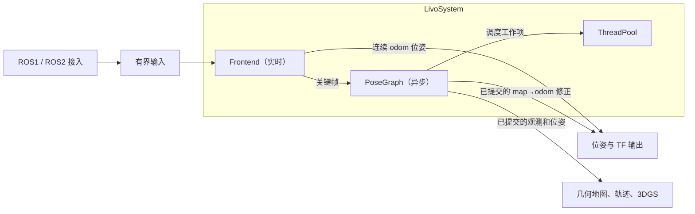

# LivoAtlas SLAM 工程优化设计

第一批改动解决 SDK 安装、无效传感器组合和运行期输入积压。随后测量处理链的各段耗时，再逐步收敛 ROS 调度、位姿历史和回环生命周期。每批都能单独构建、验证和回退。

## 目标架构

`LivoSystem` 是完整 SLAM 的入口，持有实时 `Frontend`、异步 `PoseGraph` 和后台 `ThreadPool`。参照 Cartographer 的 `MapBuilder` 装配方式，前端把关键帧交给位姿图，位姿图协调约束计算、优化和结果提交。Noetic 与 Humble 共用入口，各自处理原生 ROS 消息。 [Cartographer MapBuilder](https://github.com/cartographer-project/cartographer/blob/2.0.0/cartographer/mapping/map_builder.h#L77) · [关键帧交接](https://github.com/cartographer-project/cartographer/blob/2.0.0/cartographer/mapping/internal/global_trajectory_builder.cc#L54) · [共用入口](../../../src/app/livo_main.cc)



| 组件 | 职责 |
| --- | --- |
| `Frontend` | 处理同步后的观测，执行 IMU 传播、LIO 和 VIO，维护估计所需的局部地图 |
| `PoseGraph` | 接收关键帧和子地图，调度配准与优化，串行验收约束并提交全局位姿 |
| `LoopClosure` | 在固定的关键帧、子地图和位姿视图上寻找候选，通过几何验证后生成回环约束提案 |
| `Optimizer` | 用现有里程计约束、回环约束和 GTSAM 求解生成候选位姿 |
| `WorkQueue` / `ThreadPool` | 位姿图用前者按序推进图状态，用后者执行后台任务 |

`LoopClosure` 和 `Optimizer` 是拟整理出的 C++ 类。三个模块在 `src/` 下同级，现有 `src/backend/` 按职责迁移。

```text
src/
├── pose_graph/      # PoseGraph、WorkQueue、约束接纳与位姿提交
├── loop_closure/    # LoopClosure、候选搜索、几何配准与质量检查
└── optimization/   # Optimizer、GTSAM 构图与求解
```

`PoseGraph` 调度 `LoopClosure` 和 `Optimizer`。模块通过 `LoopConstraint`、`PoseSnapshot` 和 `PoseUpdate` 等数据类型交接。公开头文件按 `include/livo_atlas/` 下的同名模块组织，内部头文件跟随实现。

回环检测和位姿图优化组成同一个后端。完整 SLAM 的运行和验收配置启用关键帧、子地图、`loop_closure.enabled` 和 `pose_graph.enabled`。纯里程计与仅检测用于对照，由同一套配置控制。数据集验证工具复用约束构建和优化代码。3DGS 由独立 GPU 进程消费已提交结果。 [Cartographer PoseGraph3D](https://github.com/cartographer-project/cartographer/blob/2.0.0/cartographer/mapping/internal/3d/pose_graph_3d.cc#L474) · [现有回环配置](../../online-loop-backend.md#构建与开启)

## 方案选择

| 路径 | 能解决的问题 | 实施代价 |
| --- | --- | --- |
| 局部修复 | 补齐安装文件、启动校验和输入限额 | 上手快，串行处理路径与历史复制的成本仍随运行增长 |
| 分阶段改造（推荐） | 先约束输入和测量成本，再调整线程交接、位姿数据与回环所有权 | 每批有独立基线，可以把差异定位到具体改动 |
| 一次调整执行器和后端 | 同时改消息调度、快照协议和求解器 | 同一次回放的变化会涉及多条链路，需要一起验证输入顺序、地图版本和关闭语义 |

源码采用 C++17、Google C++ 风格和 glog，使用可以直接导航到定义的具体组件。CMake 选择 ROS 版本与平台能力，YAML 选择本次运行的回环、位姿图和高斯功能。已有数据集、公开话题和 SDK 的迁移按各阶段的约定验证。

## 1. 安装、运行模式和输入上限

### 1.1 安装

当前工作区缺少 `LICENSE.cartographer`，独立 SDK 的 `cmake --install` 已复现失败。建议将原始 Cartographer 许可放入已有的 `docs/LICENSE.cartographer`，然后更新安装规则和来源说明。已安装 SDK 中的许可继续放在 `share/livo_atlas/licenses/cartographer/LICENSE`。 [安装规则](../../../cmake/core.cmake#L126) · [线程池来源说明](../../cartographer-scheduler.md)

### 1.2 运行模式

`PrepareSystemOptions` 在创建输出文件前校验传感器组合。保留三项现有 YAML 键作为输入，由 `SystemOptions::frontend_mode()` 派生供同步器和关键帧选择使用的模式。导出器和着色器接收该模式用于自己的输出。

| 模式 | `common.lidar_en` | `imu.imu_en` | `common.img_en` |
| --- | ---: | --- | ---: |
| LO | 1 | false | 0 |
| LIO | 1 | true | 0 |
| LIVO | 1 | true | 1 |

表外组合在启动校验中报告哪项传感器条件不满足。直接构造 SDK 与从 ROS 参数启动都走同一校验路径。具体反例是相机和 LiDAR 启用、IMU 关闭时，目前配置会进入 LIVO 并等待 IMU。 [当前模式来源](../../../src/core/system_options.cc#L105) · [同步就绪条件](../../../src/sensor/synchronizer.cc#L132)

### 1.3 输入上限与故障处理

运行期限制同步器的 LiDAR、IMU 和图像队列，同时限制高频传播保留的 IMU 队列。上限由两端共用的 `config/backend.yaml` 加载。以下数值是待回放校准的首轮配置，按 Retail_Street 约 10 Hz 的 LiDAR 与图像、约 200 Hz 的 IMU 留出余量。

```yaml
sensor_buffer:
  max_lidar_scans: 64
  max_imu_samples: 4096
  max_images: 32
  max_span_s: 3.0
```

- 帧数和时间跨度分别检查。时间跨度使用同一队列内校正后的传感器时间。传播缓存先根据最新估计时刻移除已经被状态覆盖的 IMU，再检查 IMU 数量和时间跨度。
- 首帧前使用启动队列计数上限和运行期配置上限中的较小值。首个有效 LiDAR 到达时，以其时间为锚按现有规则修正启动样本，在临时缓冲中选出满足运行期上限的最新连续后缀，再提交首帧游标和队列。启动期间淘汰的样本计入启动统计。按现有上限，2000 个 IMU 样本可覆盖约 10 秒，这个交接策略允许传感器先后启动。
- 运行期超限在追加样本和改变时间游标前记录首个故障。日志包含队列名、占用和最老待处理样本。SDK 后续输入和推进都报告同一运行期错误，ROS 节点以失败状态停止。退出关闭线程和文件，保留已提交资产，按已有归档格式留下可检查的未完成状态。首版采用报告并停止的策略，重新启动以恢复估计。
- 时间跨度与帧数预算自然覆盖部分传感器失联时其他流继续入队的情况。仿真暂停且所有输入停止时，系统保持等待，后台结果仍可收取。图像故障恢复涉及 LIO/VIO 成对处理、IMU 积分区间和点云余量，在线降级与恢复作为单独能力设计。

合成测试中，只送入 LiDAR 和图像时，当前实现保留了 512 帧图像引用。增加上限后的测试应覆盖三种流分别缺失、首个 LiDAR 尚未到达、启动缓存交接、传播积压、容量边界和一组数值等价回放。 [入队路径](../../../src/core/livo_system.cc#L89) · [现有系统测试](../../../tests/core/livo_system_test.cc)

主要改动涉及 `cmake/core.cmake`、`system_options.{h,cc}`、`livo_config.cc`、`livo_system.{h,cc}`、`config/backend.yaml` 和双 ROS 参数测试。安装在临时前缀执行，并运行既有安装消费测试。 [独立 SDK 消费测试](../../../tests/installed_admission_consumer)

## 2. 计时、发布和串行处理

### 2.1 先建立同一输入的计时基线

独立记录传感器转换与入队等待、同步与预处理、前端计算、关键帧写入、位姿提交、ROS 序列化与发布。使用单调时钟衡量处理耗时，用传感器时间衡量观测覆盖和顺序。按流记录队列最高占用、最老样本年龄和超限原因。报告各段 P50/P95/P99，按任务类型记录回环时延。

把 `Current Total Time` 迁移为 `frontend_process_seconds`，基线工具继续识别历史日志。当前这个计时只包含 `Frontend::Process()`。 [计时范围](../../../src/core/livo_system.cc#L193) · [Noetic 回放解析器](../../../tools/run_baseline.py#L648)

### 2.2 先限制可视化路径

两端的 `/path` 都从持续累积的向量发布全量路径。新增 `publish.path.max_poses`，首轮取 2000，覆盖目前 Retail_Street 完整回放的 1352 条 LiDAR 轨迹记录。超过容量后滚动保留最新位姿。完整历史由轨迹文件和版本化关键帧轨迹提供，按各自的容量和输出配置运行。验证短路径的顺序、坐标系和消息语义，以及长路径的内存与消息大小。 [Noetic 路径发布](../../../src/ros1/livo_publisher.cc#L249) · [Humble 路径发布](../../../src/ros2/livo_publisher.cc#L251)

### 2.3 缩短 ROS 持锁路径

第一版先做 2.1 和 2.2。根据入队等待与发布段实测，再实施下面的线程交接。

- 两端订阅先按配置过滤禁用流，完成转换后把自有数据投到 `src/ros_common` 中的有界队列。按传感器限制入口容量并报告入口与算法队列的总驻留量。应用入口满时采用阶段 1 的终止策略，诊断单独记录传输层可观测的丢帧和应用层拒收。Noetic 以可配置的订阅深度替换当前硬编码的 200000，Humble 沿用已有 QoS 深度配置。
- Noetic 由主循环推进 `LivoSystem`，Humble 由现有互斥处理组推进。系统按入队顺序消费，保留各流的 FIFO 和跨流的入队次序。`driver_fix` 使用该顺序对应的 LiDAR 锚点。一个执行上下文负责同步、估计和传播。每轮都限制取入的消息数和同步步骤数，并处理到期的传播及结果通知。等待输入时也处理已提交的通知。
- 在结果回调内一并捕获最新已提交的 `MapCorrection` 和对应的自有结果消息，随后按序发送。待发消息采用捕获时的修正版本。跨周期编码时复制或明确移交所需图像和点云数据。现有 `FrontendResult` 中的借用视图只在下一次处理前有效。过渡期的关键帧和位姿写入先计时，阶段 3 按同一存档写入者迁移。
- 正常停止时关闭入口，等订阅回调退出，再由系统所有者消费能够同步的已接收输入并记录余量。封存后等待 `PoseGraph` 排空，再结束持久化输出。终止故障采用阶段 1 的失败收尾。ROS 上下文关闭时，发布报告不可用，系统仍完成对应的存档收尾。

主要改动涉及 `livo_main.cc`、两端 `livo_node.cc`、两端 `livo_publisher.cc` 和 `ros_common/input_diagnostics.h`。重点验证高负载下的输入顺序、传播调度、暂停时收取后台结果及关闭期间的资产状态。 [现有系统锁](../../../src/ros2/livo_node.cc#L170) · [前端输出生命周期](../../../include/livo_atlas/frontend/frontend_result.h#L25)

## 3. 异步位姿图

### 3.1 减少重复校验和历史复制

先把一次回环提交中的旧、新位姿快照校验提升到子地图循环外，每块只比较自己的成员和锚点。保留对外单块比较入口的输入校验。用带多块子地图的合成序列验证结果和无效输入处理，记录全量校验次数随子地图数量增长的变化。 [提交循环](../../../src/core/online_submap_manager.cc#L146) · [子地图位姿比较](../../../src/mapping/submap_pose_change.cc#L8)

下一批把系统内部通知拆成两种数据变化。

| 变化 | 传给内部消费者的数据 |
| --- | --- |
| 追加关键帧、封存子地图 | 新增观测或成员修订，当前 `pose_version` 与已提交帧数 |
| 接纳回环位姿 | 新位姿版本、受影响子地图及其成员相对位姿变化，附该版本的不可变位姿视图 |

常规追加只处理新增数据和被修改的成员。回环派发、全局轨迹发布和导出在需要时取得完整快照，保持派发前沿和位姿版本一致。对外 `GetPoseSnapshot()` 与现有完整快照回调按原合同供 SDK 使用。旧回调注册期间，每次通知仍提供完整历史。工程内消费者逐个迁移后，常规追加按增量处理。用 256、512、1024 和 4096 个合成关键帧记录扫描元素数与提交耗时，断言已迁移路径在活动子地图大小固定时，追加一次的扫描量与历史帧数无关。 [当前通知](../../../src/core/online_submap_manager.cc#L83) · [快照物化](../../../src/mapping/pose_snapshot.cc#L74)

### 3.2 工作队列与约束计算

`LivoSystem` 按现有规则选择关键帧，把自有观测交给 `PoseGraph::AddObservation()` 排队。位姿图使用已迁入项目的 Cartographer `WorkItem`、`WorkQueue`、`Task` 和 `ThreadPool`。`WorkQueue` 按 FIFO 处理关键帧与子地图登记和优化触发。同一时刻只有一个队列执行者修改图状态。每次只取有界数量的工作项，留出线程池处理已调度任务的机会。标准 C++ 短锁保护入队、出队和执行者标志，配准、求解、文件写入在这些锁之外执行。 [Cartographer 入队](https://github.com/cartographer-project/cartographer/blob/2.0.0/cartographer/mapping/internal/3d/pose_graph_3d.cc#L151) · [本工程队列定义](../../../src/pose_graph/work_queue.h)

`LoopClosure` 复用现有候选搜索和几何配准，只读取派发时捕获的观测与位姿。需要等约束结果时，队列执行者让出线程。任务执行边界把成功和异常都交回同一完成槽。完成通知调度同一条执行线，处理当前结果后恢复普通 FIFO，终止错误进入统一收尾路径。暂按现有的一个在途回环查询和一个最新待查查询执行，合并只作用于待查回环，已接收的关键帧保持顺序。`config/backend.yaml` 中的 `pose_graph.max_pending_keyframes` 限制待处理关键帧，满载采用阶段 1 的失败语义。完成结果和停止请求由固定大小的状态交接，单线程池在普通队列满载时仍可推进收尾。 [Cartographer 队列续跑](https://github.com/cartographer-project/cartographer/blob/2.0.0/cartographer/mapping/internal/3d/pose_graph_3d.cc#L474) · [现有待查合并](../../../src/pose_graph/pose_graph.cc)

当工作项触发优化，`PoseGraph` 将约束和基准位姿交给 `Optimizer`。该组件复用现有 GTSAM 批量求解。几何复核、残差判定和版本检查仍用于确认提案，试算成功后才变更已接纳的图状态。候选并行之前先验证 `Task` 依赖生命周期与单线程池的完成路径，完成结果按候选原有顺序归并。 [现有约束与求解](../../../src/loop_closure/loop_admission.cc) · [Cartographer 求解边界](https://github.com/cartographer-project/cartographer/blob/2.0.0/cartographer/mapping/internal/3d/pose_graph_3d.cc#L800)

### 3.3 提交、发布与迁移

最终由位姿图的串行执行线统一写入原始关键帧、子地图成员修订和正式位姿。启用关键帧存档的会话使用这条写入路径，回环关闭时仍可写入观测和成员修订。关键帧及其成员写入后，发布一份不可变的提交前沿，包含读取视图、成员、位姿版本和修正。优化结果先写 `prepared`，再原子发布正式位姿文件，随后更新图状态、接纳统计和提交前沿。SDK、轨迹、几何地图与 3DGS 使用已发布的前沿。

`ProcessNext()` 返回前端进度，关键帧是否可读以已提交前沿为准。SDK 显式调用 `SealInput()` 或经授权的 `ApplyPoseUpdate()` 时，由存档写入者执行并确认对应操作，系统调用方在线程池外等待。完整快照回调沿用逐次交付语义。注册这类回调时，提交前为该通知预留容量，满载时让出执行线程，调用方取出通知后再恢复。系统在等待输入、等待操作确认及 `Finish()` 等待排空时都取出通知，并在位姿图锁外调用消费者。

前端处理周期从发布过的快照读固定大小的 `MapCorrection` 并持续输出 odom 位姿。全局修正通过 `map_from_odom` 应用到输出，前端状态和局部地图使用原 odom 坐标。必须交付的 SDK 回调在提交后失败时，保留最后一个有效位姿版本并记录未完成，归档检查器返回 3。ROS 和 3DGS 的输出状态各自记录。正常停止由 `LivoSystem` 在线程池外等待位姿图封存、排空和完成交付。写入者确认最后一次必需通知完成后写完成摘要，检查器返回 0。线程池的生命周期覆盖位姿图的创建、排空和销毁。 [当前前端处理](../../../src/core/livo_system.cc#L187) · [位姿和归档约定](../../online-loop-backend.md#文件与只读检查)

1. 将候选搜索、配准与质量检查迁入 `src/loop_closure/`，由 `LoopClosure` 组织。把现有 GTSAM 求解提取到 `src/optimization/optimizer.cc`，由 `Optimizer` 提供。用现有测试核对提案与残差。
2. 将图状态、`WorkQueue` 与 `LoopBackend` 的协调职责归入 `src/pose_graph/` 中的 `PoseGraph` 模块。在迁移存档前，以现行提交路径验证后台调度与关闭。随后把关键帧、子地图成员和位姿的写入职责作为一批迁到位姿图，按同一已提交前沿发布结果。
3. SDK 的主要装配入口为 `LivoSystem(SystemOptions)`。`pose_graph.h` 的原有求解构造与方法兼容调用同一个 `Optimizer`，`livo_atlas::online_backend` 作为已安装工程的过渡链接名。旧 `LoopBackend` 入口在迁移期共用同一后端实现，独立使用时仍通过其显式 `Finish()` 收尾。独立实例持有提交权时，直接调用 `LivoSystem::Finish()` 报出结束入口的冲突。存档字段和检查工具按现有格式读取。 [现有求解接口](../../../include/livo_atlas/backend/pose_graph.h) · [现有系统停止](../../../src/core/livo_system.cc#L258)

同步迁移三组目录的源码、头文件路径和 CMake 源码清单。`loop_admission.cc` 中的筛选、求解与接纳按上述职责归位，`online_submap_manager.cc` 与相关存储和输出按提交前沿交接。用单线程池及故意放慢的后台任务验证前端仍能推进，测试队列上限、过期提案和提交失败。 [回环生命周期测试](../../../tests/core/loop_backend_test.cc)

## 4. 随职责迁移的命名

| 当前名称 | 建议名称 | 随哪一步迁移 |
| --- | --- | --- |
| 依赖 `ExportOptions::mode` 取得系统模式 | `SystemOptions::frontend_mode()` | 阶段 1 统一模式选择，导出器按自己的配置使用模式 |
| `Current Total Time` | `frontend_process_seconds` | 阶段 2 同步更新 GLOG 统计与回放解析 |
| `LoopBackend` 及位姿图协调 | `PoseGraph`，`src/pose_graph/` | 统一工作队列、约束验收和位姿发布 |
| 当前 `PoseGraph` 的求解部分 | `Optimizer`，`src/optimization/` | 复用 GTSAM 求解路径 |
| 候选搜索与几何配准 | `LoopClosure`，`src/loop_closure/` | 组织检测与几何验证，输出约束提案 |
| `KeyframePose::map_from_body` | `parent_from_body()` | 阶段 3 添加访问器并迁移内部读取，坐标由 `parent_frame` 指定，兼容原 SDK 字段和存档键 |
| `app::OnlineGaussian` | `app::GaussianMappingOutput` | 应用层持有 `OnlineGaussianMapper` 与预览发布器，类名指明其接入和输出职责 |
| `LIVO_ATLAS_ONLINE_GAUSSIAN` | `LIVO_ATLAS_HAS_LINUX_GAUSSIAN_BRIDGE` | 随应用层文件修改，宏表明平台构建能力，实际运行由 `gaussian.enabled` 配置 |

应用层重命名涉及 `src/app/online_gaussian.{h,cc}`、`livo_main.cc` 和 `cmake/node.cmake`。同时用当前入口核对工程路线图中的 Noetic 和 Humble 执行器说明。 [高斯接入定义](../../../src/app/online_gaussian.h#L42) · [位姿坐标定义](../../../include/livo_atlas/mapping/pose_snapshot.h#L16)

## 输出、故障与会话约定

- **输出时间。** 对外接口迁移时，同一条位姿及其 TF 采用同一估计时刻和捕获的 `MapCorrection`。图像和点云使用各自的观测时间。单调时钟用于调度与延迟测量。现有 ROS 话题按其时间戳合同做配对回归，测试覆盖播放变速、暂停和回环修正交接。 [当前 ROS 时间语义](../../global-pose-output.md#时间与停止语义) · [前端观测时间](../../../include/livo_atlas/frontend/frontend_result.h)
- **异步结果的版本。** `pose_version` 标识全局位姿修正，`frame_count` 标识该结果的覆盖前沿。同一个位姿版本可继续追加关键帧。轨迹、几何地图和高斯预览各自发布实际覆盖与状态，分别验收。联合渲染或导出选定同一会话的提交前沿，并逐块检查资产来源与版本。需要精确版本的消费者读取带版本的结果。 [几何地图消息](../../../msg/GeometryMap.msg) · [关键帧轨迹消息](../../../msg/KeyframeTrajectory.msg) · [高斯预览消息](../../../msg/GaussianRenderFrame.msg)
- **故障归属。** 回环候选被拒绝属于普通任务结果，系统继续推进下一批。运行中的 3DGS 通信或渲染故障属于输出状态，几何 SLAM 继续处理和提交。输入超限、必需存档写入失败和必须交付的通知失败按前述规则终止会话，归档检查器报告已提交前沿。分别验证回环候选拒绝、断开高斯 worker 和位姿存档失败时的处理、版本和归档状态。 [回环处置及检查](../../online-loop-backend.md#文件与只读检查) · [Gaussian 资源和状态](../../online-gaussian.md#资源和统计)
- **会话与地图复用。** 本轮以单会话的实时估计、闭环优化、正常封存及异常后的只读检查验收。重启时创建新会话，既有档案可用于检查、离线重建和导出。跨会话重定位与接续建图，以及掉电持久性，分别作为后续能力验收。当前归档的原子发布语义以存档文档为准。 [子地图存档与异常退出](../../online-submap-dataset.md#存储与异常退出)

## 验收顺序

| 批次 | 必过验证 |
| --- | --- |
| 安装与输入 | 独立 SDK 安装及消费，三种合法模式可推进，错误组合在 I/O 前报错。入口超限按策略拒收并保留存档前缀，仿真暂停期间可收取后台结果。Noetic、Humble 参数与回调测试通过 |
| 计时与 ROS 路径 | 正常回放的输入计数、LIO/VIO 次数、轨迹、原始关键帧校验值与现有消息语义按配对基线核验。长路径保持在配置容量内。先采集受控负载的入队等待、传播间隔和发布 P95，再用同一负载判断线程交接的收益 |
| 位姿与回环 | 放慢后台任务时前端继续推进，单线程池在队列满载及通知延迟时能续跑并关停。每次回环提交的全量快照校验次数独立于子地图数量。完整 SLAM 配置提交递增位姿版本，仅检测对照保留版本 0。正常归档检查返回 0。正式位姿写入前后的注入失败均返回 3，并分别保留旧版本或新版本 |
| 在线 3DGS 与命名 | GPU 上验证播放期间预览、纯刚性修正后复用、相对位姿变化后的重建，以及退出后的封存状态。构建文档、命名和参数样例与实际入口对应 |

在同一机器上固定输入、提交前版本、编译类型、CPU 亲和性、OpenMP 环境与配置，先跑 10 秒，再对照完整 `Retail_Street.bag`。保存输入计数、LIO/VIO 次数、轨迹和原始关键帧校验值，以及队列、内存与阶段耗时。如果异步调度改变回环选择，报告被合并和实际派发的查询，结合确定性的提案验收测试检查差异。跨机器时按各自环境建立配对基线，保留最小结果和失败日志。 [构建与平台设置](../../ros-builds.md) · [SDK 构建](../../core-build.md) · [已有完整回放](../../p6-03c4c-validation.md)

此前 Retail_Street 一次查询的五个候选验证合计约 809 ms，GTSAM 求解约 6.8 ms。先用分段计时确认候选、提交和求解各自的占比，再决定候选并行、几何缓存或增量求解的优先级。135 秒的回放用于数值回归，合成序列用于检查增长趋势，长距离实机性能由长序列补验。 [既有回环计时](../../engineering-roadmap.md#ros-执行器与后端线程)
